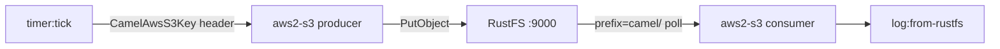

Ce guide connecte [Apache Camel](https://github.com/apache/camel) — le cadre d'intégration polyvalent — à **RustFS** via son composant S3. Vous allez écrire une intégration à deux routes en YAML : une route productrice qui écrit un message dans le bucket à intervalle régulier, et une route consommatrice qui relit ces objets et les journalise. Le workflow a été vérifié avec Camel JBang sur `eclipse-temurin:21-jdk`, en utilisant le composant `aws2-s3` avec un endpoint redéfini et l'adressage path-style.

Vous avez besoin de Docker. Ce déploiement est destiné aux tests d'intégration locaux, pas à la production.

## Architecture



Camel JBang exécute directement le fichier de routes et résout automatiquement les dépendances du composant S3 — aucun échafaudage de projet, aucune étape de build ou de déploiement.

## 1. Écrire la route d'intégration

Créez le fichier de routes. Les identifiants proviennent de la chaîne d'identifiants AWS par défaut (variables d'environnement), donc les URI ne portent que l'adressage :

```yaml title="route.yaml"
- from:
    uri: "timer:tick"
    parameters:
      period: "5000"
    steps:
      - setBody:
          simple: "Hello from Camel at ${date:now:yyyy-MM-dd HH:mm:ss}"
      - setHeader:
          name: "CamelAwsS3Key"
          simple: "camel/hello-${date:now:HHmmss}.txt"
      - to:
          uri: "aws2-s3://my-bucket?overrideEndpoint=true&uriEndpointOverride=http://<your-rustfs-endpoint>:9000&forcePathStyle=true&useDefaultCredentialsProvider=true"
- from:
    uri: "aws2-s3://my-bucket?prefix=camel/&deleteAfterRead=false&maxMessagesPerPoll=5&overrideEndpoint=true&uriEndpointOverride=http://<your-rustfs-endpoint>:9000&forcePathStyle=true&useDefaultCredentialsProvider=true"
    steps:
      - to:
          uri: "log:from-rustfs"
```

Le producteur fixe la clé d'objet via l'en-tête `CamelAwsS3Key` — ici un horodatage par message, de sorte que chaque battement écrit un nouvel objet. Le consommateur interroge le préfixe `camel/` avec `deleteAfterRead=false` : les objets restent dans le bucket après consommation.

:::note[Nom du composant et options d'endpoint]

Le composant résolu par Camel JBang dans ce workflow est `aws2-s3`. `overrideEndpoint=true` active l'endpoint personnalisé, `uriEndpointOverride` porte son URL, `forcePathStyle=true` sélectionne l'adressage path-style attendu par RustFS, et `useDefaultCredentialsProvider=true` fait lire les identifiants depuis les variables d'environnement standard.

:::

## 2. Exécuter la route avec Camel JBang

Exécutez l'intégration dans un conteneur avec les identifiants exportés. JBang demande de faire confiance aux sources au premier usage — ajoutez donc les règles de confiance avant de démarrer :

```bash
docker run --rm --network bridge \
  -e AWS_ACCESS_KEY_ID=<your-access-key> \
  -e AWS_SECRET_ACCESS_KEY=<your-secret-key> \
  -e AWS_REGION=us-east-1 \
  -v "$PWD:/routes" \
  --entrypoint bash eclipse-temurin:21-jdk -c '
    export JBANG_DIR=/root/.jbang PATH=/root/.jbang/bin:$PATH
    curl -Ls https://sh.jbang.dev | bash >/dev/null 2>&1
    jbang trust add https://github.com/apache/ 2>/dev/null || true
    jbang trust add /routes 2>/dev/null || true
    cd /routes && jbang camel@apache/camel run route.yaml
  '
```

La première exécution télécharge le runtime Camel et ses dépendances, puis démarre les routes. Le consommateur journalise chaque objet lu :

```text
2026-10-25 02:02:41.069  INFO 120 --- [-s3://my-bucket] from-rustfs : Exchange[ExchangePattern: InOnly, BodyType: byte[], Body: Hello from Camel at 2026-10-25 02:02:38]
```

## 3. Vérifier les objets

Confirmez que les objets du producteur sont bien dans RustFS, en remplaçant tous les paramètres fictifs de connexion :

```bash
aws s3 ls s3://my-bucket/camel/ \
  --endpoint-url http://<your-rustfs-endpoint>:9000
```

```text
2026-10-25 02:02:13         39 hello-020213.txt
2026-10-25 02:02:18         39 hello-020218.txt
2026-10-25 02:02:23         39 hello-020223.txt
```


## 4. Arrêter ou réinitialiser

Arrêtez le conteneur pour terminer les routes. Supprimer les objets de démonstration :

```bash
aws s3 rm s3://my-bucket/camel --recursive \
  --endpoint-url http://<your-rustfs-endpoint>:9000
```

## Dépannage

### `Cannot find component with name: aws-s3`

Votre version de Camel résout le composant sous un autre nom — ce workflow utilise `aws2-s3`. Utilisez le nom que votre runtime propose dans la liste de suggestions (`Did you mean: ... aws2-s3 ...`).

### `is not from a trusted source`

JBang refuse d'exécuter du code non fiable. Exécutez `jbang trust add https://github.com/apache/` et `jbang trust add /routes` avant `jbang camel@apache/camel run`, comme à l'étape 2.

### `useDefaultCredentialsProvider is set to false`

Le composant n'a trouvé aucune configuration d'identifiants dans l'URI. Ajoutez `useDefaultCredentialsProvider=true` et exportez `AWS_ACCESS_KEY_ID` et `AWS_SECRET_ACCESS_KEY`, ou configurez directement les options d'endpoint `accessKey` et `secretKey`.

### Le consommateur ne lit rien

Le consommateur n'interroge que le préfixe donné par `prefix=camel/`. Confirmez que le producteur a tourné (lignes de journal `timer` visibles) et que son en-tête `CamelAwsS3Key` commence par `camel/`.

## Prochaines étapes

- Consultez les [notes de compatibilité S3](/administration/protocols/s3) avant d'adopter des opérations multiparties ou en flux sur ce composant.
- Créez des identifiants de production dédiés avec la [gestion des clés d'accès](/security-compliance/iam/access-token).
- Suivez la [documentation du composant S3 de Camel](https://camel.apache.org/components/latest/aws2-s3-component.html) pour les plages de téléchargement, les opérations de bucket et le réglage du consommateur sur les mêmes routes.
