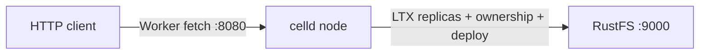
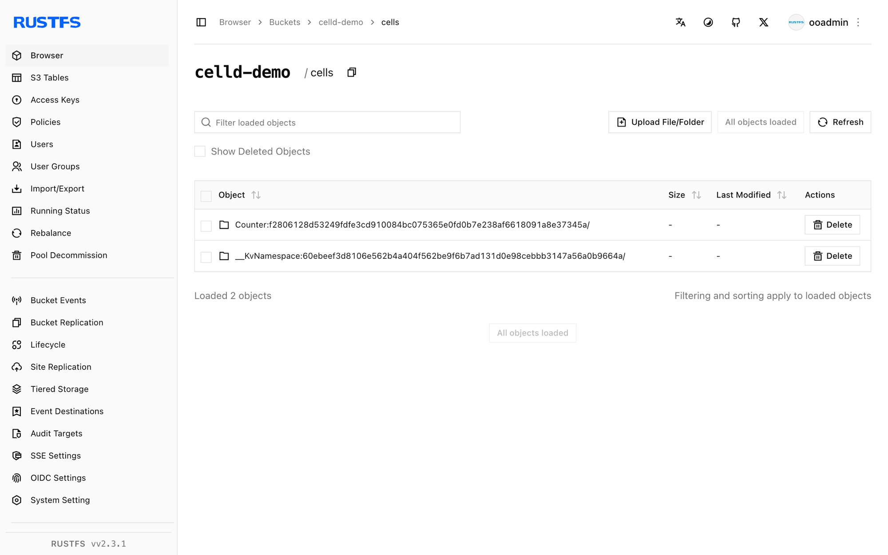

Ce guide connecte [celld](https://github.com/denoland/celld) — l’environnement d’exécution distribué et auto-hébergé de Durable Objects, proposé par Denoland — à **RustFS** comme compartiment (bucket) de flotte. Vous allez exécuter `celld diagnose` sur un compartiment RustFS (y compris la sonde d’écriture conditionnelle), déployer un worker Counter, modifier l’état d’un Durable Object via HTTP, redémarrer celld et confirmer que l’état survit. Le flux a été validé avec celld v0.6.2 face à `rustfs/rustfs-x86-musl:v2.3.1`.

Vous avez besoin du binaire `celld`, de l’outil `esbuild` (pour l’empaquetage) et de Node.js pour piloter le worker déployé.

## Schéma d’architecture



celld ne conserve qu’un WAL local. Chaque écriture SQLite validée est capturée au format LTX et chargée dans le compartiment de flotte ; une écriture conditionnelle sur le compartiment (put-if-not-exists) attribue la propriété du nœud. Le compartiment est la source de vérité — les nœuds peuvent tomber en panne ou redémarrer sans perdre l’état des Durable Objects.

## 1. Installer celld

```bash
curl -sLo /tmp/celld.gz \
  https://github.com/denoland/celld/releases/download/v0.6.2/celld-x86_64-unknown-linux-gnu.gz
gunzip /tmp/celld.gz && chmod +x /tmp/celld
mv /tmp/celld /usr/local/bin/celld
celld --version
```

```text
celld 0.6.2
```

Installez aussi esbuild — `celld deploy` empaquete les workers avec cet outil :

```bash
npm install -g esbuild
```

## 2. Diagnostiquer le compartiment

`celld diagnose` sonde le compartiment, y compris l’écriture conditionnelle dont celld a besoin pour réserver la propriété d’un nœud :

```bash
export S3_ENDPOINT=http://<your-rustfs-endpoint>:9000
export AWS_REGION=us-east-1
export AWS_ACCESS_KEY_ID=<your-access-key>
export AWS_SECRET_ACCESS_KEY=<your-secret-key>

rc mb rustfs/celld-demo
celld diagnose --bucket s3://celld-demo
```

```text
ok listen 127.0.0.1:18080: bind check; diagnose does not serve
ok bucket s3://celld-demo
ok bucket conditional write: create, reject-create, update, reject-stale
ok fleet: 0 node lease(s) enumerated
```

`ok bucket conditional write` est la ligne importante — RustFS prend en charge put-if-not-exists nativement, donc aucun stockage de repli n’est nécessaire.

## 3. Démarrer un nœud

Un `--listen` qui n’est pas en loopback exige un `--internal-listen` explicite :

```bash
nohup celld --bucket s3://celld-demo \
  --listen 0.0.0.0:18080 \
  --internal-listen 0.0.0.0:9099 \
  --advertise 127.0.0.1:9099 > /opt/celld/celld.out 2>&1 &
```

```text
INFO celld: host runtime initialized event="host_runtime" worker_count=4
INFO celld::fleet: no deployment yet; run `celld deploy` ...
```

## 4. Déployer le worker Counter

Utilisez l’exemple counter du dépôt celld — un Durable Object qui incrémente `n` dans le stockage SQLite à chaque requête :

```bash
curl -sLo /tmp/celld.zip https://codeload.github.com/denoland/celld/zip/refs/tags/v0.6.2
unzip /tmp/celld.zip -d /opt/celld
cd /opt/celld/celld-0.6.2/examples/counter
celld deploy . --bucket s3://celld-demo
```

```text
Uploaded counter (0.02 sec)
  s3://celld-demo/deploy/counter/bf5806589892a6cc
Current Version ID: bf5806589892a6cc
```

## 5. Modifier l’état du Durable Object

Chaque requête est routée vers le Durable Object `Counter`, qui lit `n` dans le stockage, l’incrémente et le réécrit :

```bash
curl -s "http://127.0.0.1:18080/?name=rustfs"
curl -s "http://127.0.0.1:18080/?name=rustfs"
curl -s "http://127.0.0.1:18080/?name=rustfs"
```

```json
{"n":1,"url":"http://127.0.0.1:18080/?name=rustfs"}
{"n":2,"url":"http://127.0.0.1:18080/?name=rustfs"}
{"n":3,"url":"http://127.0.0.1:18080/?name=rustfs"}
```

## 6. Redémarrer celld et vérifier la persistance

Arrêtez le nœud, redémarrez-le et interrogez la même URL — le compteur reprend là où il s’était arrêté, car l’état se trouvait dans RustFS depuis le début :

```bash
pkill -f "celld --bucket"
nohup celld --bucket s3://celld-demo \
  --listen 0.0.0.0:18080 --internal-listen 0.0.0.0:9099 \
  --advertise 127.0.0.1:9099 > /opt/celld/celld2.out 2>&1 &
sleep 8
curl -s "http://127.0.0.1:18080/?name=rustfs"
```

```json
{"n":4,"url":"http://127.0.0.1:18080/?name=rustfs"}
```

Listez le compartiment — l’état de la flotte s’y trouve entièrement :

```bash
rc ls rustfs/celld-demo/ -r | head -5
```

```text
cells/Counter:f2806128.../ltx/e1/0000/0000000000000001-0000000000000001.ltx
cells/Counter:f2806128.../own.json
deploy/counter/bf5806589892a6cc/index.js
deploy/counter/current.json
```



## 7. Arrêter ou réinitialiser

```bash
pkill -f "celld --bucket"
rc rm rustfs/celld-demo/ --recursive --force
```

## Dépannage

### `bind --listen 127.0.0.0.1:8080 ... Address already in use`

Le port 8080 est souvent déjà pris (un registre GitLab local ou un serveur de développement). Déplacez l’écouteur du Worker : `--listen 0.0.0.0:18080`.

### `a non-loopback --listen requires an explicit --internal-listen`

Lier une interface publique exige un écouteur pair distinct : ajoutez `--internal-listen 0.0.0.0:9099 --advertise 127.0.0.1:9099`.

### `esbuild not found`

`celld deploy` empaquete le worker avec esbuild. Installez-le globalement (`npm install -g esbuild`) ou faites pointer `CELLD_ESBUILD` vers le binaire.

### `celld deploy` sur l’exemple affiche `unknown command init for argo` à l’exécution

Cela signifie que le conteneur ou le pod d’exécuteur exécute un binaire CLI `argo` à la place d’argoexec — signe qu’une mauvaise image a été étiquetée comme exécuteur dans la configuration de votre cluster, sans rapport avec celld lui-même. Sur un hôte simple (sans cluster), cela ne se produit pas.

## Étapes suivantes

- Comparez avec la [documentation Cloudflare Durable Objects](https://developers.cloudflare.com/durable-objects/) — celld exécute le même modèle de programmation sur votre propre compartiment.
- Créez des identifiants de production dédiés avec la [gestion des clés d’accès](/fr/security-compliance/iam/access-token).
- Suivez le [README de celld](https://github.com/denoland/celld) pour les flottes multi-nœuds : pointez un second nœud vers le même compartiment et laissez les écritures conditionnelles élire le propriétaire.
