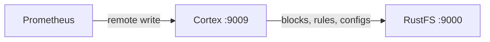
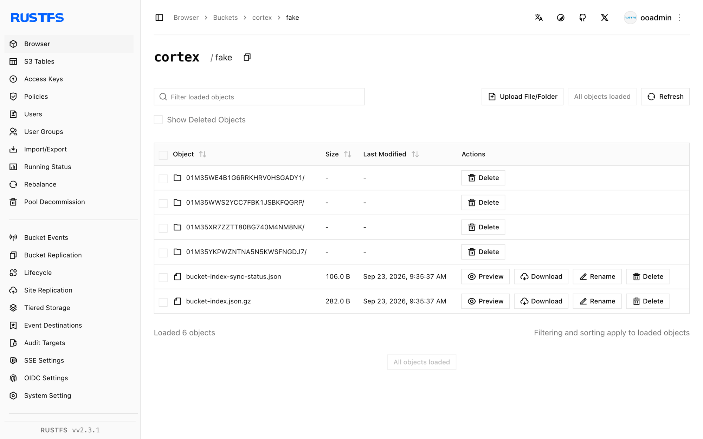

Ce guide connecte [Cortex](https://github.com/cortexproject/cortex) — le backend de métriques compatible avec Prometheus et extensible horizontalement — à **RustFS** via le stockage S3 natif de Cortex. Vous allez exécuter Cortex en mode binaire unique (single-binary), diriger le stockage des blocs, du ruler et de l’alertmanager vers un compartiment (bucket) RustFS, envoyer des métriques par remote write, enregistrer un groupe de règles et vérifier les objets. Le flux a été validé avec `cortexproject/cortex:v1.21.1` et `rustfs/rustfs-x86-musl:v2.3.1`.

Vous avez besoin de Docker. Ce déploiement est destiné aux tests d’intégration locaux, pas à la production.

## Schéma d’architecture



Cortex stocke chaque bloc TSDB, chaque groupe de règles du ruler et chaque configuration d’alertmanager dans le stockage objet. Diriger le backend `s3` vers RustFS fait du compartiment la source de vérité unique pour toutes les données de tenant.

## 1. Créer la configuration Cortex

Créez le fichier de configuration en remplaçant toutes les valeurs de connexion indicatives :

```yaml title="cortex.yaml"
target: all
auth_enabled: false

server:
  http_listen_port: 9009

distributor:
  shard_by_all_labels: true
  pool:
    health_check_ingesters: true

ingester:
  lifecycler:
    min_ready_duration: 0s
    final_sleep: 0s
    num_tokens: 512
    ring:
      kvstore:
        store: inmemory
      replication_factor: 1

blocks_storage:
  backend: s3
  s3: &s3
    endpoint: <your-rustfs-endpoint>:9000
    region: us-east-1
    bucket_name: cortex
    access_key_id: <your-access-key>
    secret_access_key: <your-secret-key>
    insecure: true
    bucket_lookup_type: path
  tsdb:
    dir: /data/tsdb
    block_ranges_period: [15m]
    ship_interval: 30s
  bucket_store:
    sync_dir: /data/tsdb-sync
    bucket_index:
      enabled: true

compactor:
  data_dir: /data/compactor
  sharding_ring:
    kvstore:
      store: inmemory

ruler:
  enable_api: true
  rule_path: /data/ruler

ruler_storage:
  backend: s3
  s3:
    <<: *s3

alertmanager:
  external_url: /alertmanager
  enable_api: true
  data_dir: /data/alertmanager

alertmanager_storage:
  backend: s3
  s3:
    <<: *s3
```

Cortex nomme le champ du compartiment `bucket_name` et contrôle l’adressage avec `bucket_lookup_type: path`. `insecure: true` autorise le point de terminaison en HTTP non chiffré. Les valeurs `block_ranges_period` et `ship_interval` raccourcissent le cycle des blocs afin que le test produise des objets rapidement ; conservez les valeurs par défaut en production.

## 2. Exécuter Cortex

Créez le compartiment et démarrez Cortex sur le même réseau Docker que RustFS :

```bash
rc mb rustfs/cortex

docker run -d --name cortex --network oo-rustfs_default -p 9009:9009 \
  -v "$PWD/cortex.yaml":/etc/cortex/cortex.yaml:ro \
  -v /opt/cortex/data:/data \
  cortexproject/cortex:v1.21.1 -config.file=/etc/cortex/cortex.yaml
```

```text
ts=... caller=cortex.go:469 level=info msg="Cortex started"
```

## 3. Envoyer des métriques et des règles

Démarrez un Prometheus qui se collecte lui-même et envoie les métriques en remote write vers Cortex :

```yaml title="prometheus.yml"
global:
  scrape_interval: 5s
scrape_configs:
  - job_name: self
    static_configs:
      - targets: ["localhost:9090"]
remote_write:
  - url: http://cortex:9009/api/v1/push
```

```bash
docker run -d --name prom-writer --network oo-rustfs_default \
  -v "$PWD/prometheus.yml":/etc/prometheus/prometheus.yml:ro \
  prom/prometheus:latest --config.file=/etc/prometheus/prometheus.yml
```

Enregistrez un groupe de règles via l’API du ruler :

```bash
cat > rules.yaml << "EOF"
name: rustfs-demo
rules:
  - alert: RustFSAlwaysFiring
    expr: vector(1)
    labels:
      severity: demo
    annotations:
      summary: "demo alert stored in RustFS"
EOF

curl -s -o /dev/null -w "%{http_code}\n" \
  -X POST http://localhost:9009/api/v1/rules/rustfs-demo \
  --data-binary @rules.yaml -H "Content-Type: application/yaml"
```

```text
202
```

Réinterrogez les séries ingérées :

```bash
curl -s "http://localhost:9009/prometheus/api/v1/query?query=up"
```

```text
{"status":"success","data":{"resultType":"vector","result":[{"metric":{"__name__":"up",...},"value":[...,"1"]}]}}
```

## 4. Vérifier les objets dans RustFS

Listez les préfixes du compartiment :

```bash
rc ls rustfs/cortex/ -r
```

La configuration du ruler est arrivée immédiatement, et l’ingester a expédié deux blocs TSDB (chacun avec `chunks`, `index` et `meta.json`) :

```text
fake/01M35WE4B1G6RRKHRV0HSGADY1/chunks/000001
fake/01M35WE4B1G6RRKHRV0HSGADY1/index
fake/01M35WE4B1G6RRKHRV0HSGADY1/meta.json
fake/01M35WWS2YCC7FBK1JSBKFQGRP/chunks/000001
fake/01M35WWS2YCC7FBK1JSBKFQGRP/index
fake/01M35WWS2YCC7FBK1JSBKFQGRP/meta.json
rules/fake/cnVzdGZzLWRlbW8=/cnVzdGZzLWRlbW8=
```



## 5. Arrêter ou réinitialiser

Pour arrêter la démonstration tout en conservant les objets du compartiment :

```bash
docker rm -f cortex prom-writer
```

Pour supprimer les données stockées :

```bash
rc rm rustfs/cortex/ --recursive --force
```

## Dépannage

### `field bucket not found in type s3.Config`

Cortex utilise `bucket_name`, et non `bucket`. L’adressage de type chemin (path-style) se définit avec `bucket_lookup_type: path` — la clé `force_path_style` utilisée par Thanos n’existe pas dans Cortex.

### Les blocs n’apparaissent jamais dans le compartiment

L’ingester n’expédie un bloc qu’après compactage du head à une frontière de `block_ranges_period` (2 h par défaut). Pour les tests, définissez une petite plage telle que `[15m]` avec `ship_interval: 30s` et attendez une période.

### `Unauthorized` ou listes de compartiment vides

Vérifiez que `access_key_id` et `secret_access_key` sont présents dans chaque bloc `s3` qui utilise le compartiment, et que `insecure: true` correspond au point de terminaison en HTTP non chiffré.

## Étapes suivantes

- Consultez les [notes de compatibilité S3](/fr/administration/protocols/s3) avant d’adopter d’autres options de stockage Cortex.
- Créez des identifiants de production dédiés avec la [gestion des clés d’accès](/fr/security-compliance/iam/access-token).
- Combinez Cortex avec [Thanos](/fr/developer/integration/observability/thanos) lorsque vous avez aussi besoin d’un stockage de blocs pour les données Prometheus à long terme.
