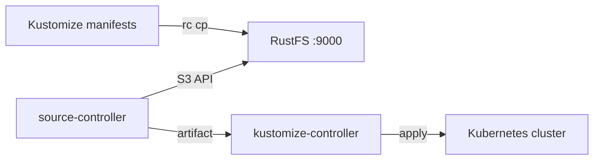

Ce guide connecte [Flux CD](https://github.com/fluxcd/flux2) — le kit d’outils GitOps pour Kubernetes — à **RustFS** via l’API Bucket du source-controller. Vous allez amorcer un compartiment (bucket) RustFS avec des manifestes Kubernetes, enregistrer ce compartiment comme source Flux `Bucket` avec le fournisseur `generic`, et laisser une Kustomization appliquer tout ce qu’il contient. Le flux a été validé avec `flux v2.9.5` (source-controller) sur `k3s v1.36.4+k3s1` face à `rustfs/rustfs-x86-musl:v2.3.1`.

Vous avez besoin d’un cluster Kubernetes avec Flux installé (`flux install`) et du client `rc`. Ce déploiement est destiné aux tests d’intégration locaux, pas à la production.

## Schéma d’architecture



Le source-controller répertorie et télécharge les objets du compartiment via l’API S3, les emballe dans un artefact, et le kustomize-controller applique les manifestes de cet artefact. RustFS sert de source de vérité du cluster, consommée par tirage (pull).

## 1. Amorcer le compartiment

Déposez un overlay Kustomize dans le compartiment, en remplaçant toutes les valeurs de connexion indicatives :

```yaml title="clusters/staging/kustomization.yaml"
apiVersion: kustomize.config.k8s.io/v1beta1
kind: Kustomization
resources:
  - rustfs-demo-configmap.yaml
```

```yaml title="clusters/staging/rustfs-demo-configmap.yaml"
apiVersion: v1
kind: ConfigMap
metadata:
  name: rustfs-flux-demo
  namespace: default
data:
  storage: rustfs
  source: s3-bucket
```

Chargez (upload) les fichiers :

```bash
rc mb rustfs/flux-src
rc cp --recursive ./clusters rustfs/flux-src/
rc ls rustfs/flux-src/ -r
```

```text
staging/kustomization.yaml
staging/rustfs-demo-configmap.yaml
```

## 2. Créer le secret d’identifiants

Flux lit les identifiants dans un secret du même espace de noms que la source, avec des clés en minuscules :

```bash
kubectl -n flux-system create secret generic rustfs-creds \
  --from-literal=accesskey=<your-access-key> \
  --from-literal=secretkey=<your-secret-key>
```

Les noms de champs doivent être `accesskey` et `secretkey` — une capitalisation telle que `accessKey` échoue avec un statut `AuthenticationFailed`.

## 3. Enregistrer la source Bucket

Créez la source Bucket avec le fournisseur `generic` :

```bash
flux create source bucket rustfs-demo \
  --bucket-name=flux-src \
  --endpoint=<your-rustfs-endpoint>:9000 \
  --insecure \
  --secret-ref=rustfs-creds \
  --provider=generic \
  --interval=30s \
  --namespace=flux-system
```

```text
✔ Bucket source reconciliation completed
```

Si la réconciliation est encore en cours, vérifiez l’état avec `flux get sources bucket` :

```text
NAME        REVISION       SUSPENDED READY MESSAGE
rustfs-demo sha256:481816d1 False     True  stored artifact: revision 'sha256:481816d1'
```

Le fournisseur `generic` utilise des requêtes en adressage de type chemin (path-style) et le HTTP non chiffré avec `--insecure`, si bien que le point de terminaison se limite à `host:port`.

## 4. Appliquer les manifestes

Créez une Kustomization qui consomme l’artefact :

```bash
flux create kustomization rustfs-demo \
  --source=Bucket/rustfs-demo \
  --path="./staging" \
  --prune=true \
  --interval=30s \
  --namespace=flux-system
```

```text
✔ applied revision sha256:481816d1
```

Confirmez que le manifeste est arrivé sur le cluster :

```bash
kubectl -n default get configmap rustfs-flux-demo -o jsonpath="{.data}"
```

```text
{"source":"s3-bucket","storage":"rustfs"}
```

## 5. Arrêter ou réinitialiser

Suspendez ou supprimez les ressources Flux sans toucher au compartiment :

```bash
flux suspend source bucket rustfs-demo --namespace=flux-system
flux delete kustomization rustfs-demo --namespace=flux-system
```

Pour supprimer le contenu du compartiment :

```bash
rc rm rustfs/flux-src/ --recursive --force
```

## Dépannage

### `invalid 'rustfs-creds' secret data: required fields 'accesskey' and 'secretkey'`

Les clés du secret sont en minuscules. Recréez le secret avec `accesskey` et `secretkey` comme noms de clés littéraux.

### La réconciliation ne passe jamais à l’état prêt

Vérifiez que le point de terminaison est joignable depuis l’intérieur du cluster — les pods ne peuvent pas utiliser `localhost`, donc pointez la source vers l’adresse IP de l’hôte ou la passerelle du pont Docker (souvent `172.17.0.1`) qui publie le port RustFS. `--insecure` est requis pour le HTTP non chiffré.

### `AuthenticationFailed` malgré des identifiants valides

Vérifiez que le secret se trouve dans le même espace de noms que la source Bucket et que les clés ne comportent ni espace final ni guillemets.

## Étapes suivantes

- Consultez les [notes de compatibilité S3](/fr/administration/protocols/s3) avant d’adopter d’autres types de sources.
- Créez des identifiants de production dédiés avec la [gestion des clés d’accès](/fr/security-compliance/iam/access-token).
- Suivez la [documentation des sources Bucket de Flux](https://fluxcd.io/flux/components/source/buckets/) pour combiner les sources Bucket avec les releases Helm et l’automatisation d’images.
