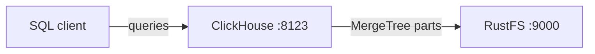

Ce guide connecte [ClickHouse](https://github.com/ClickHouse/ClickHouse) — la base de données OLAP temps réel — à **RustFS** via la politique de stockage sur disque S3 de ClickHouse. Vous allez démarrer un serveur ClickHouse avec Docker, créer une table MergeTree qui stocke ses parties sur RustFS, insérer des lignes et vérifier que les données de la table se trouvent dans le compartiment (bucket). Le flux a été validé avec `clickhouse/clickhouse-server:25.8` et `rustfs/rustfs-x86-musl:v2.3.1`.

Vous avez besoin de Docker. Ce déploiement est destiné aux tests d’intégration locaux, pas à la production.

## Schéma d’architecture



Le disque `rustfs` est un disque S3 ClickHouse dirigé vers le compartiment `clickhouse-data`. Les tables créées avec la politique de stockage correspondante écrivent leurs parties — données, index et fichiers de sommes de contrôle — dans le compartiment plutôt que sur le système de fichiers local.

## 1. Créer les fichiers du projet

Créez d’abord le compartiment — ClickHouse ne crée pas les compartiments :

```bash
rc alias set rustfs http://<your-rustfs-endpoint>:9000 <your-access-key> <your-secret-key>
rc mb rustfs/clickhouse-data
```

Créez la configuration de stockage en remplaçant les deux valeurs d’identifiants indicatives :

```xml title="storage.xml"
<clickhouse>
  <storage_configuration>
    <disks>
      <rustfs>
        <type>s3</type>
        <endpoint>http://rustfs:9000/clickhouse-data/</endpoint>
        <access_key_id><your-access-key></access_key_id>
        <secret_access_key><your-secret-key></secret_access_key>
      </rustfs>
    </disks>
    <policies>
      <rustfs_policy>
        <volumes>
          <main>
            <disk>rustfs</disk>
          </main>
        </volumes>
      </rustfs_policy>
    </policies>
  </storage_configuration>
</clickhouse>
```

Le point de terminaison doit se terminer par `/` et inclut le nom du compartiment comme premier segment de chemin. À l’intérieur du réseau Compose, le nom d’hôte est `rustfs` ; depuis l’hôte, utilisez `http://localhost:9000/clickhouse-data/`.

Démarrez ClickHouse avec la configuration montée :

```bash
docker run -d --name clickhouse --network oo-rustfs_default \
  -p 8123:8123 \
  -e CLICKHOUSE_PASSWORD=<your-clickhouse-password> \
  -v "$PWD/storage.xml":/etc/clickhouse-server/config.d/storage.xml:ro \
  clickhouse/clickhouse-server:25.8
```

## 2. Créer une table sur le disque S3

Attendez l’interface HTTP, puis créez une base de données et une table MergeTree avec la politique de stockage :

```bash
curl "http://localhost:8123/?password=<your-clickhouse-password>" \
  --data-binary "CREATE DATABASE rustfs_demo"

curl "http://localhost:8123/?password=<your-clickhouse-password>" \
  --data-binary "CREATE TABLE rustfs_demo.events
    (id UInt32, name String)
    ENGINE = MergeTree ORDER BY id
    SETTINGS storage_policy = 'rustfs_policy'"

curl "http://localhost:8123/?password=<your-clickhouse-password>" \
  --data-binary "INSERT INTO rustfs_demo.events
    VALUES (1, 'clickhouse-on-rustfs'), (2, 'second')"
```

Relisez les lignes et confirmez que ClickHouse signale la partie sur le disque `rustfs` :

```bash
curl "http://localhost:8123/?password=<your-clickhouse-password>" \
  --data-binary "SELECT count(), any(name) FROM rustfs_demo.events"

curl "http://localhost:8123/?password=<your-clickhouse-password>" \
  --data-binary "SELECT name, disk_name FROM system.parts
    WHERE database = 'rustfs_demo' AND active"
```

```text
2  clickhouse-on-rustfs
all_1_1_0  rustfs
```

## 3. Vérifier les objets dans RustFS

Listez le compartiment :

```bash
rc ls rustfs/clickhouse-data/ -r
```

ClickHouse écrit chaque partie sous forme de blobs adressés par leur contenu. La sortie contient plusieurs petits objets, et leur nombre augmente à mesure que d’autres parties sont écrites :

```text
dtg/hpsyncexixvdnsgorvseobogcgowg
dzp/zfblobhsatzdveqdrsfqcupkdehja
izg/gvhchqobrizpkdftuvlmakkoutwps
```


Les données survivent à un redémarrage du conteneur, car les parties résident dans RustFS :

```bash
docker restart clickhouse
curl "http://localhost:8123/?password=<your-clickhouse-password>" \
  --data-binary "SELECT count() FROM rustfs_demo.events"
```

## 4. Arrêter ou réinitialiser le déploiement

Arrêtez le serveur tout en conservant les données :

```bash
docker rm -f clickhouse
```

Les parties restent dans le compartiment `clickhouse-data` et la table peut à nouveau être interrogée après le prochain démarrage. Pour supprimer les données, supprimez le compartiment :

```bash
rc rb rustfs/clickhouse-data --force
```

## Dépannage

### `REQUIRED_PASSWORD` à chaque requête

Les images ClickHouse 25.8 exigent un mot de passe pour l’utilisateur `default`. Définissez `CLICKHOUSE_PASSWORD` sur le conteneur et transmettez la même valeur comme paramètre de requête `password`, comme indiqué ci-dessus.

### La création de la table échoue avec une erreur de disque ou de point de terminaison

Vérifiez que le compartiment existe avant la création de la table, que le point de terminaison se termine par `/` et que les identifiants correspondent au déploiement RustFS. Consultez le journal du serveur pour l’erreur S3 sous-jacente :

```bash
docker logs clickhouse | grep -i s3 | tail
```

## Étapes suivantes

- Consultez les [notes de compatibilité S3](/fr/administration/protocols/s3) avant d’adopter d’autres opérations ClickHouse.
- Créez des identifiants de production dédiés avec la [gestion des clés d’accès](/fr/security-compliance/iam/access-token).
- Suivez la [documentation du disque S3 de ClickHouse](https://clickhouse.com/docs/engines/table-engines/mergetree-family/mergetree#table_engine-mergetree-s3) pour ajouter un disque de cache ou une politique à étages chaud/froid.
