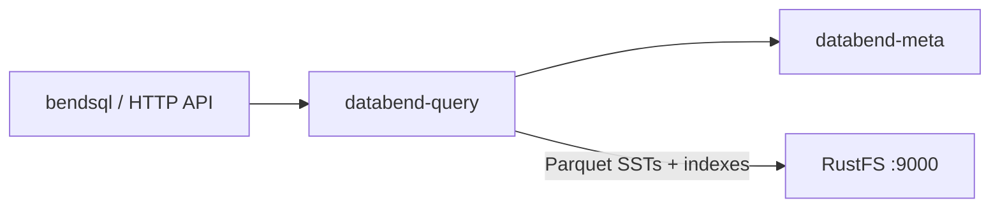

Ce guide connecte [Databend](https://github.com/datafuselabs/databend) — l’entrepôt de données cloud open source — à **RustFS** comme backend de stockage objet. Vous allez démarrer le service meta et le nœud de requête, diriger le backend de stockage vers un compartiment (bucket) RustFS, créer une base de données et une table, puis vérifier les fichiers Parquet dans le compartiment. Le flux a été validé avec Databend v1.2.925-patch-13 face à `rustfs/rustfs-x86-musl:v2.3.1`.

Vous avez besoin de l’archive de version Databend sur un hôte Linux (ou de Docker). Ce déploiement est destiné aux tests d’intégration locaux, pas à la production.

## Schéma d’architecture



Databend stocke les données des tables en fichiers Parquet, avec des index de filtre de Bloom, dans le stockage objet, de sorte que le compartiment contient l’intégralité du jeu de données de la table et que le nœud de requête reste sans état.

## 1. Télécharger et installer

Récupérez une archive de version et décompressez les binaires :

```bash
curl -Lo /tmp/databend.tgz \
  "https://github.com/datafuselabs/databend/releases/download/v1.2.925-patch-13/databend-v1.2.925-patch-13-x86_64-unknown-linux-gnu.tar.gz"
tar -xzf /tmp/databend.tgz -C /opt
```

Créez les répertoires de données :

```bash
mkdir -p /opt/databend/data /opt/databend/logs /opt/databend/meta-logs
```

## 2. Configurer le service meta

Créez `databend-meta.toml` — notez les adresses de premier niveau et la section `[raft_config]` avec `single = true` :

```toml title="databend-meta.toml"
admin_api_address = "0.0.0.0:28002"
grpc_api_address = "0.0.0.0:9191"
grpc_api_advertise_host = "127.0.0.1"

[log]
[log.file]
level = "INFO"
dir = "/opt/databend/meta-logs"

[raft_config]
id = 0
raft_dir = "/opt/databend/data/raft"
raft_api_port = 28004
raft_listen_host = "127.0.0.1"
raft_advertise_host = "127.0.0.1"
single = true
```

## 3. Configurer le nœud de requête

Créez `databend-query.toml`. Les clés `tenant_id` et `cluster_id` doivent se trouver dans la section `[query]`, et `[storage.s3]` pointe vers RustFS :

```toml title="databend-query.toml"
[query]
username = "databend"
tenant_id = "default"
cluster_id = "rustfs-demo"
flight_api_address = "127.0.0.1:9091"
metric_api_address = "127.0.0.1:7071"
admin_api_address = "127.0.0.1:8081"

[[query.users]]
name = "databend"
auth_type = "no_password"

[log]
[log.file]
dir = "/opt/databend/logs"

[meta]
endpoints = ["127.0.0.1:9191"]
username = "root"
password = "root"
client_timeout_in_second = 20
auto_sync_interval = 60

[storage]
type = "s3"

[storage.s3]
bucket = "databend-demo"
endpoint_url = "http://<your-rustfs-endpoint>:9000"
access_key_id = "<your-access-key>"
secret_access_key = "<your-secret-key>"
enable_virtual_host_style = false
```

Placez toutes les clés avant l’entrée de tableau `[[query.users]]` — TOML traite tout ce qui suit comme faisant partie de cet élément de tableau, et des clés mal placées échouent à la validation avec des erreurs peu claires.

## 4. Démarrer les services

```bash
nohup /opt/databend/bin/databend-meta -c /opt/databend/databend-meta.toml > /opt/databend/meta.out 2>&1 &
sleep 10
nohup /opt/databend/bin/databend-query -c /opt/databend/databend-query.toml > /opt/databend/query.out 2>&1 &
sleep 20
```

## 5. Créer une table et l’interroger

Databend expose une API HTTP sur le port 8000. Créez une base de données et une table, insérez des lignes et relisez-les — les guillemets à l’intérieur du SQL doivent être des guillemets simples (les guillemets doubles désignent des identifiants) :

```bash
curl -s -m 90 -u databend: http://127.0.0.1:8000/v1/query \
  -H "Content-Type: application/json" \
  -d '{"sql": "CREATE DATABASE rustfs_demo; CREATE TABLE rustfs_demo.events (id INT, label STRING);"}' | head -c 120

curl -s -m 120 -u databend: http://127.0.0.1:8000/v1/query \
  -H "Content-Type: application/json" \
  -d "{\"sql\": \"INSERT INTO rustfs_demo.events VALUES (1,'alpha'),(2,'beta'),(3,'gamma')\"}" | head -c 120

curl -s -m 120 -u databend: http://127.0.0.1:8000/v1/query \
  -H "Content-Type: application/json" \
  -d "{\"sql\": \"SELECT * FROM rustfs_demo.events ORDER BY id\"}" | head -c 300
```

```text
{"id":"...","state":"Succeeded",...,"data":[["1","alpha"],["2","beta"],["3","gamma"]],...}
```

## 6. Vérifier les objets dans RustFS

Listez le compartiment — la table y réside sous forme de blocs Parquet accompagnés de fichiers d’index, sous des préfixes numériques :

```bash
rc ls rustfs/databend-demo/ -r | head -4
```

```text
73/116/_b/h01a1192b11b07c38b9ae1178abc78882_v2.parquet
73/116/_i_b_v2/01a1192b11b07c38b9ae1178abc78882_v4.parquet
```


## 7. Arrêter ou réinitialiser

```bash
pkill -f databend-query; pkill -f databend-meta
rc rm rustfs/databend-demo/ --recursive --force
```

## Dépannage

### `cluster_id is empty without resources management`

`tenant_id` et `cluster_id` ont été placés en dehors de la section `[query]`. En TOML, chaque clé appartient à l’en-tête de section le plus récent — remettez-les sous `[query]`.

### `CannotListenerPort ... 127.0.0.1:9090`

L’API Flight utilise le port 9090 par défaut, que d’autres services locaux occupent souvent. Définissez `flight_api_address`, `metric_api_address` et `admin_api_address` sur des ports libres, à l’intérieur de `[query]`.

### La requête renvoie `Authentication error: no authorization header provided`

L’API HTTP exige une authentification Basic correspondant à l’entrée `[[query.users]]`, par exemple `-u databend:` avec `auth_type = "no_password"`.

### `Unknown table` juste après la réussite de CREATE

Les chaînes entre guillemets doubles en SQL sont des identifiants, pas des littéraux. Utilisez des guillemets simples pour VALUES et pour les options CONNECTION/LOCATION.

## Étapes suivantes

- Consultez les [notes de compatibilité S3](/fr/administration/protocols/s3) avant d’adopter d’autres options de stockage Databend.
- Créez des identifiants de production dédiés avec la [gestion des clés d’accès](/fr/security-compliance/iam/access-token).
- Suivez la [documentation Databend](https://docs.databend.com/) pour les clusters multi-nœuds et les tables partagées au-dessus du même compartiment.
