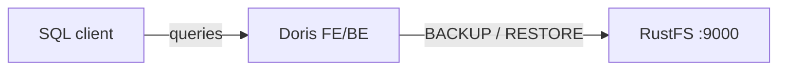
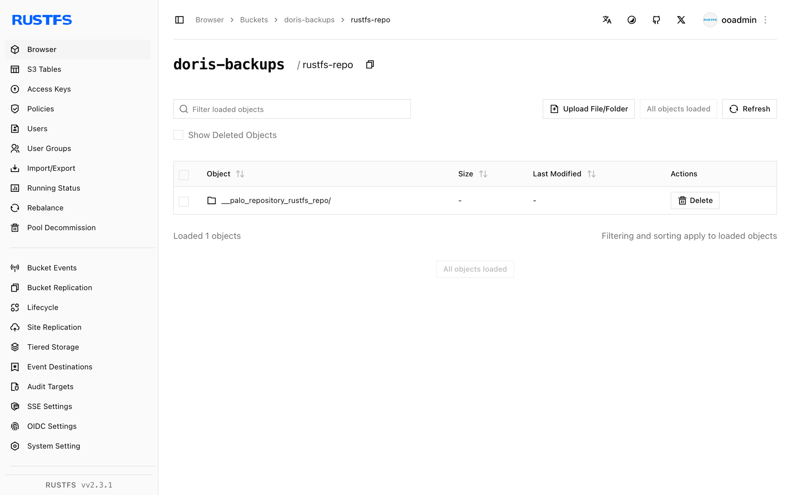

Ce guide connecte [Apache Doris](https://github.com/apache/doris) — l’entrepôt de données analytique temps réel — à **RustFS** via un dépôt de sauvegarde S3. Vous allez démarrer un conteneur Doris all-in-one, créer un dépôt S3 qui pointe vers un compartiment (bucket) RustFS, sauvegarder une table, la supprimer, puis la restaurer depuis RustFS. Le flux a été validé avec `apache/doris:all-in-one-4.1.3` et `rustfs/rustfs-x86-musl:v2.3.1`.

Vous avez besoin de Docker. Ce déploiement est destiné aux tests d’intégration locaux, pas à la production.

## Schéma d’architecture



Le dépôt est un emplacement S3 nommé sous le compartiment `doris-backups`. `BACKUP SNAPSHOT` charge les métadonnées de la table et les fichiers de données des tablets ; `RESTORE SNAPSHOT` les télécharge dans une nouvelle table.

## 1. Démarrer Doris et créer le dépôt

Créez d’abord le compartiment — Doris ne crée pas les compartiments :

```bash
rc alias set rustfs http://<your-rustfs-endpoint>:9000 <your-access-key> <your-secret-key>
rc mb rustfs/doris-backups
```

Démarrez le conteneur all-in-one sur le même réseau Docker que RustFS :

```bash
docker run -d --name doris --network oo-rustfs_default \
  -p 8030:8030 -p 9030:9030 apache/doris:all-in-one-4.1.3
```

Attendez que le frontend soit prêt, puis connectez-vous avec le protocole MySQL (port 9030, utilisateur `root`, sans mot de passe dans l’image all-in-one).

Créez une table de test avec des lignes :

```sql
CREATE DATABASE rustfs_demo;
CREATE TABLE rustfs_demo.events
  (id INT, name VARCHAR(50))
  DISTRIBUTED BY HASH(id) BUCKETS 1
  PROPERTIES ("replication_num" = "1");
INSERT INTO rustfs_demo.events VALUES (1, 'doris-on-rustfs'), (2, 'backup-test');
```

Créez le dépôt S3, en remplaçant le point de terminaison par l’adresse IP du conteneur RustFS et les deux valeurs d’identifiants indicatives :

```sql
CREATE REPOSITORY `rustfs_repo`
  WITH S3
  ON LOCATION "s3://doris-backups/rustfs-repo"
  PROPERTIES (
    "AWS_ENDPOINT" = "http://<rustfs-container-ip>:9000",
    "AWS_ACCESS_KEY" = "<your-access-key>",
    "AWS_SECRET_KEY" = "<your-secret-key>",
    "AWS_REGION" = "us-east-1",
    "AWS_PATH_STYLE_ACCESS" = "true"
  );
```

Doris 4.1 place le nom du compartiment dans le nom d’hôte du point de terminaison même lorsque `AWS_PATH_STYLE_ACCESS` est activé, si bien qu’un point de terminaison par nom d’hôte échoue avec `UnknownHostException: doris-backups.rustfs`. L’adresse IP du conteneur force les requêtes en adressage de type chemin (path-style) et fonctionne ; `SHOW REPOSITORIES` confirme que le dépôt est enregistré avec un `ErrMsg` vide.

## 2. Sauvegarder une table vers RustFS

Prenez un snapshot de la table :

```sql
BACKUP SNAPSHOT rustfs_demo.demo_snapshot
  TO rustfs_repo
  ON (events);
```

L’instruction revient immédiatement ; la tâche de sauvegarde s’exécute en arrière-plan. Surveillez son état :

```sql
SHOW BACKUP;
```

Attendez que `State` atteigne `FINISHED` — les métadonnées du snapshot et les fichiers de données des tablets sont alors des objets dans le compartiment.

## 3. Vérifier la sauvegarde dans RustFS

Listez le compartiment :

```bash
rc ls rustfs/doris-backups/ -r
```

Le dépôt conserve un descripteur de dépôt, les métadonnées du snapshot et les fichiers de tablets :

```text
rustfs-repo/__palo_repository_rustfs_repo/__repo_info
rustfs-repo/__palo_repository_rustfs_repo/__ss_demo_snapshot/__meta.d50ecf9b...
rustfs-repo/__palo_repository_rustfs_repo/__ss_demo_snapshot/__ss_content/.../...dat...
```



## 4. Restaurer la table depuis RustFS

Supprimez la table et restaurez-la depuis le snapshot. L’horodatage provient du nom de snapshot affiché par `SHOW SNAPSHOT ON REPOSITORY rustfs_repo;` :

```sql
DROP TABLE rustfs_demo.events;

RESTORE SNAPSHOT rustfs_demo.demo_snapshot
  FROM rustfs_repo
  ON (events)
  PROPERTIES (
    "backup_timestamp" = "2026-09-21-16-35-12",
    "replication_num" = "1"
  );
```

Attendez la fin de la tâche de restauration et confirmez les données :

```sql
SHOW RESTORE;
SELECT count(*) FROM rustfs_demo.events;
```

```text
2
```

## 5. Arrêter ou réinitialiser le déploiement

Arrêtez Doris tout en conservant les données :

```bash
docker rm -f doris
```

La sauvegarde reste dans le compartiment `doris-backups` et peut être restaurée dans tout cluster Doris qui enregistre le même dépôt. Pour la supprimer, supprimez le compartiment :

```bash
rc rb rustfs/doris-backups --force
```

## Dépannage

### `UnknownHostException: doris-backups.rustfs` lors de la création du dépôt

Doris construit un nom d’hôte en adressage de type hôte virtuel à partir du compartiment et du point de terminaison. Utilisez l’adresse IP du conteneur RustFS dans `AWS_ENDPOINT` avec `AWS_PATH_STYLE_ACCESS = "true"`, comme indiqué ci-dessus.

### La sauvegarde reste longtemps dans `SNAPSHOTING`

Le backend charge les fichiers de tablets. Vérifiez que le backend est sain (`SHOW BACKENDS;`) et qu’il peut atteindre le point de terminaison ; l’image all-in-one a besoin d’une ou deux minutes après le démarrage avant que les deux processus ne se déclarent prêts.

### `Failed to create repository: ... file status`

Le compartiment n’existe pas ou les identifiants sont incorrects. Créez `doris-backups` avec `rc mb` et vérifiez à nouveau les clés d’accès.

## Étapes suivantes

- Consultez les [notes de compatibilité S3](/fr/administration/protocols/s3) avant d’adopter d’autres opérations Doris.
- Créez des identifiants de production dédiés avec la [gestion des clés d’accès](/fr/security-compliance/iam/access-token).
- Suivez la [documentation de sauvegarde et de restauration Doris](https://doris.apache.org/docs/data-operate/backup-restore/) pour planifier des snapshots périodiques.
