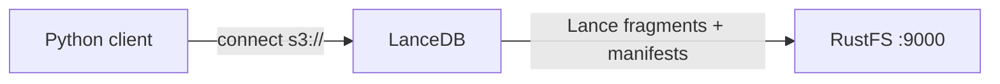

Ce guide connecte [LanceDB](https://github.com/lancedb/lancedb) — la base de données vectorielle open source fondée sur le format en colonnes Lance — à **RustFS** comme backend de stockage. Vous allez créer une table vectorielle directement à un emplacement `s3://`, ajouter des lignes, exécuter une recherche vectorielle et confirmer les fichiers de table Lance dans le compartiment (bucket). Le flux a été validé avec le paquet Python `lancedb` face à `rustfs/rustfs-x86-musl:v2.3.1`.

Vous avez besoin de Python 3.9 ou d’une version plus récente. Ce déploiement est destiné aux tests d’intégration locaux, pas à la production.

## Schéma d’architecture



LanceDB est embarqué : il n’y a pas de serveur à exécuter. Le client Python (ou Rust, ou JavaScript) parle directement au compartiment et stocke chaque table dans un répertoire `*.lance` avec des fragments de données, des manifestes de version et des journaux de transactions.

## 1. Installer le client

```bash
pip install lancedb
```

## 2. Créer une table sur RustFS

Connectez-vous directement au compartiment et créez une table, en remplaçant toutes les valeurs de connexion indicatives. Les clés `storage_options` suivent les conventions object-store de Lance ; les points de terminaison personnalisés utilisent l’adressage de type chemin (path-style) :

```python title="lance_s3.py"
import lancedb

storage_options = {
    "endpoint": "http://<your-rustfs-endpoint>:9000",
    "access_key_id": "<your-access-key>",
    "secret_access_key": "<your-secret-key>",
    "region": "us-east-1",
    "allow_http": "true",
}

db = lancedb.connect("s3://<your-bucket>/tables", storage_options=storage_options)

rows = [{"id": i, "label": f"row-{i}", "vector": [float(i) / 10, 0.5, 0.25, 0.1] * 2}
        for i in range(5)]
table = db.create_table("events", data=rows)
print("created:", table.count_rows(), "rows")

table.add([{"id": 99, "label": "query-target", "vector": [0.9, 0.5, 0.25, 0.1] * 2}])
print("after add:", table.count_rows(), "rows")
```

```text
created: 5 rows
after add: 6 rows
```

L’URI de la table utilise la forme `s3://bucket/prefix` ; chaque écriture et chaque lecture passe par l’API S3 de RustFS.

## 3. Exécuter une recherche vectorielle

```python title="lance_search.py"
import lancedb

db = lancedb.connect("s3://<your-bucket>/tables", storage_options=storage_options)
table = db.open_table("events")

res = table.search([0.9, 0.5, 0.25, 0.1] * 2).limit(3).to_list()
print("top3:", [(r["id"], r["label"]) for r in res])
print("version:", table.version)
```

```text
top3: [(99, 'query-target'), (4, 'row-4'), (3, 'row-3')]
version: 2
```

Le plus proche voisin est la ligne ajoutée à l’étape précédente, et le compteur de version reflète les deux commits (création et ajout).

## 4. Vérifier les objets dans RustFS

Listez le préfixe de la table :

```bash
rc ls rustfs/<your-bucket>/ -r
```

Chaque table est un répertoire `.lance` qui contient des fragments de données, des manifestes de version et des enregistrements de transaction :

```text
tables/events.lance/_transactions/0-b93cf795-fc3d-4bc9-88c8-e37baeefdd46.txn
tables/events.lance/_versions/18446744073709551613.manifest
tables/events.lance/data/101101011110110010000100e7a149411b847dbad6ebc7d47e.lance
```

Plusieurs tables partagent le compartiment sous le préfixe `tables/`, si bien qu’un seul compartiment peut porter tout un espace de travail LanceDB.


## 5. Arrêter ou réinitialiser

LanceDB ne conserve aucun état serveur. Pour supprimer la table :

```bash
rc rm rustfs/<your-bucket>/tables/ --recursive --force
```

## Dépannage

### Erreurs de connexion ou de signature à la première utilisation

Vérifiez que `endpoint` inclut le schéma, que `allow_http` vaut `"true"` pour les points de terminaison en HTTP non chiffré, et que le compartiment existe. La valeur `region` est exigée par le signataire S3, même si RustFS l’ignore.

### `Table not found` après la création

LanceDB répertorie le préfixe du compartiment pour découvrir les tables. Un cache client périmé ou un mauvais préfixe `tables/` dans l’URI rend les nouvelles tables invisibles ; reconnectez-vous avec la même URI que lors de la création.

### Chargements volumineux lents sur le réseau

Lance écrit un fragment par commit. Pour les imports volumineux, regroupez les lignes dans moins d’appels `table.add` — chaque appel produit un nouveau fichier de données dans le compartiment.

## Étapes suivantes

- Consultez les [notes de compatibilité S3](/fr/administration/protocols/s3) avant d’adopter d’autres options de stockage LanceDB.
- Créez des identifiants de production dédiés avec la [gestion des clés d’accès](/fr/security-compliance/iam/access-token).
- Suivez la [documentation LanceDB](https://lancedb.github.io/lancedb/) pour les index ANN, la recherche hybride et les dispositions de compartiments multi-locataires au-dessus du même backend.
