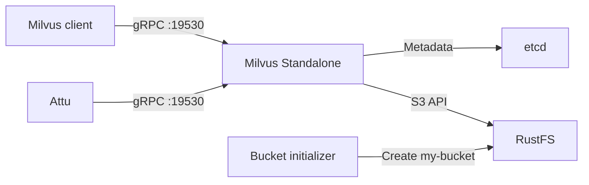

Ce guide exécute **Milvus Standalone** avec **RustFS** comme backend de stockage objet compatible avec S3. Vous allez démarrer Milvus, etcd, RustFS et Attu, insérer des vecteurs d’exemple et vérifier que Milvus persiste des objets dans RustFS.

Vous avez besoin de Docker avec le plugin Compose et de Python 3.9 ou d’une version plus récente. Ce déploiement est destiné aux tests d’intégration locaux, pas à la production.

:::note[Noms de configuration Milvus]

Milvus regroupe les paramètres de stockage compatible avec S3 sous la clé de configuration `minio`. Ce nom n’exige pas un serveur MinIO. Dans ce guide, `minio.address` pointe vers le service RustFS, et Milvus utilise l’API S3 exposée par RustFS.

:::

## Schéma d’architecture



Milvus stocke les métadonnées de service dans etcd et persiste les données vectorielles, les index et les objets associés sous `s3://my-bucket/milvus` dans RustFS. Le volume local de Milvus reste nécessaire pour les données d’exécution et les caches.

## 1. Créer les fichiers du projet

Créez un répertoire de travail :

```bash
mkdir rustfs-milvus
cd rustfs-milvus
```

Créez un fichier d’environnement et remplacez les deux valeurs d’identifiants indicatives :

```ini title=".env"
RUSTFS_ACCESS_KEY=<your-access-key>
RUSTFS_SECRET_KEY=<your-secret-key>
```

Utilisez des identifiants dédiés pour le compartiment (bucket) Milvus. N’ajoutez pas le fichier `.env` au dépôt.

Créez le fichier de surcharge du stockage Milvus :

```yaml title="user.yaml"
common:
  storageType: remote

minio:
  address: rustfs:9000
  port: 9000
  bucketName: my-bucket
  rootPath: milvus
  useSSL: false
  useIAM: false
  cloudProvider: aws
  region: us-east-1
  useVirtualHost: false
```

`useVirtualHost: false` sélectionne les requêtes S3 en adressage de type chemin (path-style). Le nom d’hôte `rustfs` se résout à l’intérieur du réseau Compose ; les clients sur l’hôte utilisent `http://localhost:9000`.

Créez le fichier Compose :

```yaml title="compose.yaml"
services:
  etcd:
    image: quay.io/coreos/etcd:v3.5.18
    environment:
      ETCD_AUTO_COMPACTION_MODE: revision
      ETCD_AUTO_COMPACTION_RETENTION: "1000"
      ETCD_QUOTA_BACKEND_BYTES: "4294967296"
      ETCD_SNAPSHOT_COUNT: "50000"
    command:
      - etcd
      - --advertise-client-urls=http://etcd:2379
      - --listen-client-urls=http://0.0.0.0:2379
      - --data-dir=/etcd
    volumes:
      - etcd-data:/etcd
    healthcheck:
      test: ["CMD", "etcdctl", "endpoint", "health"]
      interval: 30s
      timeout: 20s
      retries: 3
    networks:
      - milvus

  rustfs:
    image: rustfs/rustfs:1.0.0-alpha.83
    environment:
      RUSTFS_ACCESS_KEY: ${RUSTFS_ACCESS_KEY}
      RUSTFS_SECRET_KEY: ${RUSTFS_SECRET_KEY}
      RUSTFS_VOLUMES: /data
      RUSTFS_ADDRESS: ":9000"
      RUSTFS_CONSOLE_ADDRESS: ":9001"
      RUSTFS_CONSOLE_ENABLE: "true"
      RUSTFS_OBS_LOGGER_LEVEL: error
      RUSTFS_OBS_LOG_DIRECTORY: /var/log/rustfs/
    volumes:
      - rustfs-data:/data
    ports:
      - "9000:9000"
      - "9001:9001"
    healthcheck:
      test: ["CMD-SHELL", "curl -fsS http://localhost:9000/health/ready"]
      interval: 10s
      timeout: 5s
      retries: 12
      start_period: 20s
    networks:
      - milvus

  create-bucket:
    image: rustfs/rc:latest
    depends_on:
      rustfs:
        condition: service_healthy
    environment:
      RUSTFS_ACCESS_KEY: ${RUSTFS_ACCESS_KEY}
      RUSTFS_SECRET_KEY: ${RUSTFS_SECRET_KEY}
    entrypoint:
      - /bin/sh
      - -c
      - |
        /usr/bin/rc alias set rustfs http://rustfs:9000 "$${RUSTFS_ACCESS_KEY}" "$${RUSTFS_SECRET_KEY}" \
          --region us-east-1 --bucket-lookup path
        /usr/bin/rc bucket create rustfs/my-bucket --ignore-existing
    networks:
      - milvus

  standalone:
    image: milvusdb/milvus:v2.6.0
    command: ["milvus", "run", "standalone"]
    security_opt:
      - seccomp:unconfined
    depends_on:
      etcd:
        condition: service_healthy
      create-bucket:
        condition: service_completed_successfully
    environment:
      ETCD_ENDPOINTS: etcd:2379
      MINIO_ADDRESS: rustfs:9000
      MINIO_ACCESS_KEY_ID: ${RUSTFS_ACCESS_KEY}
      MINIO_SECRET_ACCESS_KEY: ${RUSTFS_SECRET_KEY}
      MINIO_REGION: us-east-1
      MQ_TYPE: woodpecker
    volumes:
      - milvus-data:/var/lib/milvus
      - ./user.yaml:/milvus/configs/user.yaml:ro
    ports:
      - "19530:19530"
      - "9091:9091"
    healthcheck:
      test: ["CMD", "curl", "-f", "http://localhost:9091/healthz"]
      interval: 30s
      timeout: 20s
      retries: 3
      start_period: 90s
    networks:
      - milvus

  attu:
    image: zilliz/attu:v2.6.5
    depends_on:
      standalone:
        condition: service_healthy
    environment:
      MILVUS_URL: standalone:19530
    ports:
      - "8000:3000"
    networks:
      - milvus

networks:
  milvus:

volumes:
  etcd-data:
  rustfs-data:
  milvus-data:
```

Le service `create-bucket` utilise l’image officielle [`rc`](https://github.com/rustfs/cli) et se termine après avoir vérifié que `my-bucket` existe. Les volumes nommés conservent les métadonnées etcd, les objets RustFS et les données locales de Milvus lorsque les conteneurs sont recréés.

:::warning[Protégez les ports des services locaux]

Le fichier Compose publie l’API et la Console RustFS, les ports gRPC et de contrôle d’intégrité de Milvus, ainsi qu’Attu, sur l’hôte pour les tests locaux. N’exposez pas ces ports à un réseau non fiable. Les déploiements de production exigent des identifiants limités, TLS, une authentification, une planification des ressources, des sauvegardes et des dépendances exploitées séparément.

:::

## 2. Valider et démarrer le déploiement

Résolvez le fichier Compose avant de démarrer les conteneurs :

```bash
docker compose config
```

Démarrez les services :

```bash
docker compose up -d
docker compose ps -a
```

Le service `create-bucket` devrait se terminer avec le code `0`, et `etcd`, `rustfs` ainsi que `standalone` devraient passer à l’état sain (healthy). Consultez les journaux si un service n’atteint pas l’état attendu :

```bash
docker compose logs create-bucket rustfs standalone
```

Ouvrez ces interfaces locales :

- Console RustFS : `http://localhost:9001`
- Attu : `http://localhost:8000`
- Point de terminaison de contrôle d’intégrité Milvus : `http://localhost:9091/healthz`

Attu se connecte à `standalone:19530` via le réseau Compose. Si Attu demande une adresse de connexion, utilisez ce nom de service à la place de `localhost:19530`.

## 3. Insérer et interroger des vecteurs d’exemple

Créez un environnement virtuel Python et installez la version du client Milvus qui correspond à la version du serveur :

```bash
python3 -m venv .venv
source .venv/bin/activate
python -m pip install "pymilvus==2.6.0"
```

Créez un script de test :

```python title="verify_milvus.py"
from pymilvus import MilvusClient

client = MilvusClient(uri="http://localhost:19530")
collection_name = "rustfs_demo"

if client.has_collection(collection_name=collection_name):
    client.drop_collection(collection_name=collection_name)

client.create_collection(
    collection_name=collection_name,
    dimension=4,
)

client.insert(
    collection_name=collection_name,
    data=[
        {"id": 1, "vector": [0.1, 0.2, 0.3, 0.4]},
        {"id": 2, "vector": [0.2, 0.3, 0.4, 0.5]},
        {"id": 3, "vector": [0.9, 0.8, 0.7, 0.6]},
    ],
)

client.flush(collection_name=collection_name)
results = client.search(
    collection_name=collection_name,
    data=[[0.1, 0.2, 0.3, 0.4]],
    limit=2,
    output_fields=["id"],
)

print(results)
client.close()
```

Exécutez le script :

```bash
python verify_milvus.py
```

Le résultat devrait classer en premier la ligne d’ID `1`. Ouvrez Attu et confirmez que la collection `rustfs_demo` contient trois entités.

## 4. Vérifier les objets Milvus dans RustFS

Utilisez l’image d’initialisation du compartiment pour lister les objets sous le chemin racine `milvus` configuré :

```bash
docker compose run --rm --entrypoint /bin/sh create-bucket -c \
  '/usr/bin/rc alias set rustfs http://rustfs:9000 "$RUSTFS_ACCESS_KEY" "$RUSTFS_SECRET_KEY" --region us-east-1 --bucket-lookup path >/dev/null && /usr/bin/rc find rustfs/my-bucket/milvus'
```

La sortie devrait contenir des objets créés par Milvus sous le préfixe `milvus/`. Vous pouvez aussi ouvrir `my-bucket` dans la Console RustFS.

Milvus peut mettre les données en tampon ou les compacter avant que chaque objet attendu n’apparaisse. L’insertion, le flush, la requête et le listage d’objets RustFS, lorsqu’ils réussissent ensemble, valident le chemin d’intégration.

## 5. Arrêter ou réinitialiser la pile

Arrêtez les conteneurs tout en conservant tous les volumes nommés :

```bash
docker compose down
```

Pour supprimer les données de test locales, y compris le contenu du compartiment Milvus et les métadonnées etcd, supprimez explicitement les volumes :

```bash
docker compose down --volumes
```

:::warning[La réinitialisation supprime les données de test]

L’option `--volumes` supprime définitivement les volumes nommés utilisés par ce projet Compose. Ne l’exécutez pas sur des données que vous devez conserver.

:::

## Dépannage

### Milvus n’atteint pas RustFS

Utilisez `rustfs:9000` comme point de terminaison S3 à l’intérieur de Compose. `localhost:9000` à l’intérieur du conteneur Milvus désigne ce conteneur, et non RustFS.

Vérifiez que `useVirtualHost` reste à `false` et que les identifiants transmis à Milvus correspondent aux identifiants RustFS :

```bash
docker compose logs standalone rustfs
```

### L’initialiseur de compartiment échoue

Vérifiez l’état de préparation de RustFS et les journaux de l’initialiseur :

```bash
curl -fsS http://localhost:9000/health/ready
docker compose logs create-bucket
```

Vérifiez que `.env` contient des identifiants non vides et que `docker compose config` résout les deux variables.

### Milvus démarre sans les données existantes

Ne modifiez pas `minio.bucketName`, `minio.rootPath` ni la racine etcd d’un déploiement existant. Vérifiez que les volumes `rustfs-data`, `etcd-data` et `milvus-data` existent encore et que le même nom de projet Compose est utilisé.

### Attu ne peut pas se connecter

Le conteneur Attu doit utiliser `standalone:19530`. Un navigateur ou un client côté hôte utilise `localhost:19530`. Vérifiez le contrôle d’intégrité de Milvus et les journaux d’Attu :

```bash
curl -fsS http://localhost:9091/healthz
docker compose logs attu standalone
```

## Étapes suivantes

- Consultez les [notes de compatibilité S3](/fr/administration/protocols/s3) avant d’activer d’autres fonctionnalités de stockage Milvus.
- Créez des identifiants de production dédiés avec la [gestion des clés d’accès](/fr/security-compliance/iam/access-token).
- Suivez la [documentation Milvus](https://milvus.io/docs) pour adapter ce schéma local à un déploiement géré ou distribué.