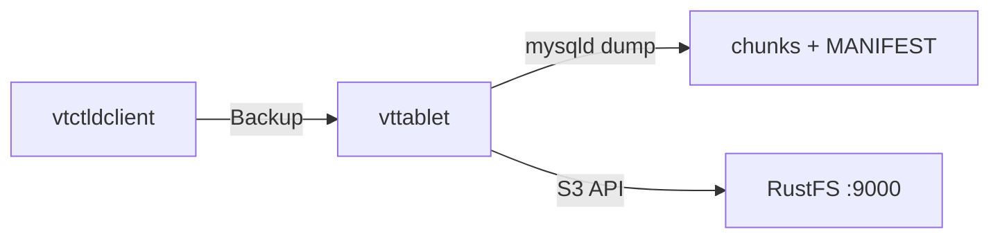
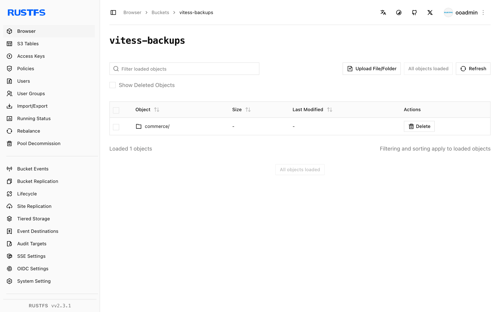

Ce guide connecte [Vitess](https://github.com/vitessio/vitess) — le système de clustering de bases de données pour la mise à l’échelle horizontale de MySQL — à **RustFS** via l’implémentation de stockage de sauvegarde S3 de Vitess. Vous allez mettre en place une topologie Vitess minimale sur un seul hôte, exécuter `Backup` sur un tablet, confirmer les fragments de sauvegarde et le `MANIFEST` dans le compartiment (bucket), puis relire la liste des sauvegardes depuis RustFS. Le flux a été validé avec `vitess/lite` (Vitess v25.0.0-SNAPSHOT, construit le 2026-09-22), MySQL 8.4 et `rustfs/rustfs-x86-musl:v2.3.1` ; les versions stables de Vitess 20 et suivantes utilisent les mêmes options.

Vous avez besoin de Docker. Ce déploiement est destiné aux tests d’intégration locaux, pas à la production.

## Schéma d’architecture



`vtctld` déclenche la sauvegarde, mais le `vttablet` qui possède le tablet l’exécute : il prend un instantané de MySQL, compresse les données en fragments numérotés et les charge avec un `MANIFEST` via le point de terminaison compatible avec S3.

## 1. Exécuter etcd et l’image Vitess

Vitess stocke sa topologie dans etcd, et l’image `vitess/lite` fournit tous les binaires Vitess ainsi que MySQL :

```bash
docker run -d --name etcd --hostname etcd --network oo-rustfs_default \
  quay.io/coreos/etcd:v3.5.17 etcd \
  --advertise-client-urls http://etcd:2379 \
  --listen-client-urls http://0.0.0.0:2379

docker run -d --name vtess --hostname vtess --network oo-rustfs_default \
  -e AWS_ACCESS_KEY_ID=<your-access-key> \
  -e AWS_SECRET_ACCESS_KEY=<your-secret-key> \
  vitess/lite:latest sleep infinity
```

Les variables d’environnement AWS fournissent les identifiants du stockage de sauvegarde S3, à la fois pour `vtctld` et pour `vttablet`.

## 2. Initialiser MySQL

Initialisez une instance MySQL dans le répertoire de tablet Vitess standard, afin que `vttablet` puisse charger son `my.cnf` ensuite :

```bash
docker exec vtess sh -c \
  "/vt/bin/mysqlctl --log_dir /tmp/vtlogs init --tablet-dir vt_0000000100"
```

L’instance est prête lorsque le fichier de socket existe :

```text
/vt/vtdataroot/vt_0000000100/mysql.sock
```

## 3. Démarrer vtctld et vttablet

Démarrez `vtctld` avec les options de sauvegarde S3, enregistrez la cell et démarrez le tablet. Remplacez toutes les valeurs de connexion indicatives :

```bash
docker exec vtess sh -c "nohup /vt/bin/vtctld \
  --topo-implementation etcd2 \
  --topo-global-server-address etcd:2379 \
  --topo-global-root /vitess/global \
  --service-map grpc-vtctl,grpc-vtctld \
  --backup-storage-implementation s3 \
  --s3-backup-aws-endpoint http://<your-rustfs-endpoint>:9000 \
  --s3-backup-aws-region us-east-1 \
  --s3-backup-force-path-style \
  --s3-backup-storage-bucket vitess-backups \
  --s3-backup-storage-root commerce \
  --port 15999 --grpc-port 15998 \
  --log_dir /tmp/vtlogs > /tmp/vtlogs/vtctld.out 2>&1 &"

docker exec vtess sh -c \
  "/vt/bin/vtctldclient --server localhost:15998 \
  AddCellInfo --root /vitess/zone1 --server-address etcd:2379 zone1"

docker exec vtess sh -c "nohup /vt/bin/vttablet \
  --topo-implementation etcd2 \
  --topo-global-server-address etcd:2379 \
  --topo-global-root /vitess/global \
  --tablet-path zone1-0000000100 \
  --init-keyspace commerce --init-shard 0 --init-tablet-type replica \
  --port 15100 --grpc-port 15101 \
  --service-map grpc-queryservice,grpc-tabletmanager,grpc-throttler \
  --mycnf-file /vt/vtdataroot/vt_0000000100/my.cnf \
  --db-dba-user root --db-allprivs-user root --db-app-user root --db-repl-user root \
  --db-dba-use-ssl=false --db-allprivs-use-ssl=false \
  --db-app-use-ssl=false --db-repl-use-ssl=false \
  --backup-storage-implementation s3 \
  --s3-backup-aws-endpoint http://<your-rustfs-endpoint>:9000 \
  --s3-backup-aws-region us-east-1 \
  --s3-backup-force-path-style \
  --s3-backup-storage-bucket vitess-backups \
  --s3-backup-storage-root commerce \
  --log_dir /tmp/vtlogs > /tmp/vtlogs/vttablet.out 2>&1 &"
```

Les deux processus incluent les options S3, car `vttablet` exécute la sauvegarde tandis que `vtctld` répertorie et supprime les sauvegardes. `--s3-backup-force-path-style`, qui impose l’adressage de type chemin (path-style), est obligatoire pour les points de terminaison autres qu’AWS. Vérifiez que le tablet est enregistré :

```bash
docker exec vtess /vt/bin/vtctldclient --server localhost:15998 GetTablets
```

```text
zone1-0000000100 commerce 0 replica vtess:15100 vtess:3306 [] <null>
```

## 4. Exécuter la sauvegarde

Créez le compartiment et déclenchez la sauvegarde :

```bash
rc mb rustfs/vitess-backups

docker exec vtess /vt/bin/vtctldclient --server localhost:15998 \
  Backup zone1-0000000100
```

Le flux se termine lorsque le moteur écrit le manifeste :

```text
commerce/0 (zone1-0000000100): ... value:"Completed backing up MANIFEST (attempt 1/2)"
```

## 5. Vérifier les objets dans RustFS

Listez le préfixe de sauvegarde :

```bash
rc ls rustfs/vitess-backups/ -r | head -4
```

Le tablet a chargé des fragments de données compressés ainsi que les fichiers de métadonnées :

```text
commerce/commerce/0/2026-09-23.011225.zone1-0000000100/0
commerce/commerce/0/2026-09-23.011225.zone1-0000000100/1
commerce/commerce/0/2026-09-23.011225.zone1-0000000100/MANIFEST
```



Relisez la liste des sauvegardes depuis RustFS via `vtctld` :

```bash
docker exec vtess /vt/bin/vtctldclient --server localhost:15998 GetBackups commerce/0
```

```text
2026-09-23.011225.zone1-0000000100
```

## 6. Arrêter ou réinitialiser

Pour arrêter la démonstration tout en conservant les objets du compartiment :

```bash
docker rm -f vtess etcd
```

Pour supprimer les sauvegardes stockées :

```bash
rc rm rustfs/vitess-backups/ --recursive --force
```

## Dépannage

### `cannot perform backup without my.cnf`

Si vous transmettez des paramètres de connexion tels que `--db-socket` ou `--db-host`, `vttablet` n’charge pas `my.cnf` et les sauvegardes refusent de s’exécuter. Démarrez `vttablet` avec `--mycnf-file` pointant vers la configuration de l’instance et laissez-le découvrir le socket à partir de là — c’est pourquoi l’instance MySQL se trouve dans le répertoire `vt_0000000100` depuis l’étape 2.

### `unknown service vtctlservice.Vtctld`

`vtctld` n’expose l’API utilisée par `vtctldclient` que lorsque la carte des services l’inclut : `--service-map grpc-vtctl,grpc-vtctld`. Assurez-vous aussi que `vtctldclient --server` pointe vers le port gRPC (`15998` ici), et non vers le port de l’interface web.

### `node doesn't exist: /vitess/global/cells/zone1/CellInfo`

La cell doit exister avant l’enregistrement des tablets. Exécutez `vtctldclient AddCellInfo` comme indiqué à l’étape 3 avant de démarrer `vttablet`.

### Erreurs d’analyse d’options telles que `unknown shorthand flag`

Vitess 20 et les versions suivantes normalisent les tirets bas en tirets, donc écrivez les options avec des tirets (`--tablet-path`). Une option longue à un seul tiret, comme `-tablet_dir`, est analysée comme des options abrégées et échoue.

## Étapes suivantes

- Consultez les [notes de compatibilité S3](/fr/administration/protocols/s3) avant d’adopter d’autres options de stockage Vitess.
- Créez des identifiants de production dédiés avec la [gestion des clés d’accès](/fr/security-compliance/iam/access-token).
- Suivez la [documentation de sauvegarde et de restauration Vitess](https://vitess.io/docs/user-guides/configuration-basic/#backups) pour planifier les sauvegardes et restaurer des tablets depuis le compartiment.
