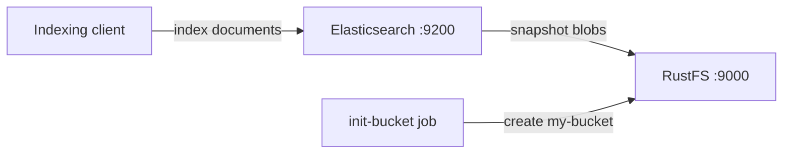
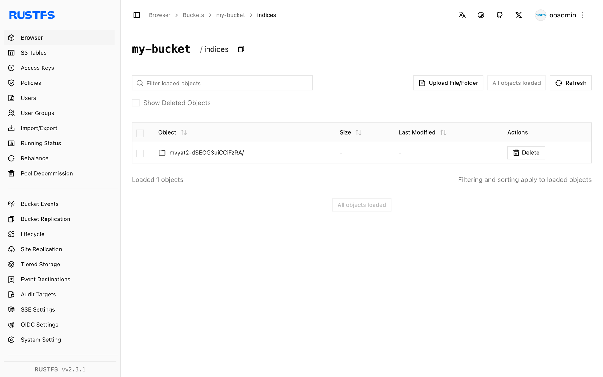

Ce guide connecte [Elasticsearch](https://github.com/elastic/elasticsearch) — le moteur distribué de recherche et d’analyse — à **RustFS** comme dépôt d’instantanés S3 pour ses index. Vous allez démarrer Elasticsearch avec le plugin `repository-s3`, enregistrer un dépôt d’instantanés adossé à RustFS, indexer des documents, prendre un instantané, puis démontrer le cycle complet en supprimant l’index et en le restaurant depuis RustFS. Le flux a été validé avec `docker.elastic.co/elasticsearch/elasticsearch:8.18.0` et `rustfs/rustfs-x86-musl:v2.3.1`.

Vous avez besoin de Docker avec le plugin Compose. Ce déploiement est destiné aux tests d’intégration locaux, pas à la production.

## Schéma d’architecture



Elasticsearch conserve ses données primaires sur des disques locaux et externalise les sauvegardes d’index vers un dépôt d’instantanés. Le plugin `repository-s3` écrit les métadonnées d’instantané et les blobs de données des shards vers RustFS via l’API S3, avec un adressage de type chemin (path-style) en HTTP non chiffré.

## 1. Créer les fichiers du projet

Créez un répertoire de travail :

```bash
mkdir rustfs-elasticsearch
cd rustfs-elasticsearch
```

Créez un fichier d’environnement et remplacez les deux valeurs d’identifiants indicatives :

```ini title=".env"
RUSTFS_ACCESS_KEY=<your-access-key>
RUSTFS_SECRET_KEY=<your-secret-key>
```

Utilisez des identifiants dédiés pour le compartiment (bucket). N’ajoutez pas le fichier `.env` au dépôt (ne le versionnez pas).

Elasticsearch répartit ses réglages S3 entre `elasticsearch.yml` (valeurs non secrètes) et le keystore (identifiants). Créez le fichier de configuration :

```yaml title="elasticsearch.yml"
discovery.type: single-node
xpack.security.enabled: false
s3.client.default.endpoint: "rustfs:9000"
s3.client.default.protocol: "http"
s3.client.default.path_style_access: "true"
s3.client.default.region: "us-east-1"
```

Créez le fichier Compose :

```yaml title="compose.yaml"
services:
  rustfs:
    image: rustfs/rustfs-x86-musl:v2.3.1
    environment:
      RUSTFS_ACCESS_KEY: ${RUSTFS_ACCESS_KEY}
      RUSTFS_SECRET_KEY: ${RUSTFS_SECRET_KEY}
      RUSTFS_VOLUMES: /data
      RUSTFS_ADDRESS: ":9000"
      RUSTFS_CONSOLE_ADDRESS: ":9001"
      RUSTFS_CONSOLE_ENABLE: "true"
    volumes:
      - rustfs-data:/data
    ports:
      - "9000:9000"
      - "9001:9001"
    healthcheck:
      test: ["CMD", "curl", "-sf", "http://127.0.0.1:9000/health"]
      interval: 10s
      timeout: 5s
      retries: 6
      start_period: 10s
    networks:
      - es

  create-bucket:
    image: rustfs/rc:latest
    depends_on:
      rustfs:
        condition: service_healthy
    environment:
      RUSTFS_ACCESS_KEY: ${RUSTFS_ACCESS_KEY}
      RUSTFS_SECRET_KEY: ${RUSTFS_SECRET_KEY}
    entrypoint:
      - /bin/sh
      - -c
      - |
        until /usr/bin/rc alias set rustfs http://rustfs:9000 "$${RUSTFS_ACCESS_KEY}" "$${RUSTFS_SECRET_KEY}"; do
          echo "Waiting for RustFS..."
          sleep 2
        done
        /usr/bin/rc ls rustfs/my-bucket >/dev/null 2>&1 || /usr/bin/rc mb rustfs/my-bucket
    networks:
      - es

  elasticsearch:
    image: docker.elastic.co/elasticsearch/elasticsearch:8.18.0
    environment:
      ES_JAVA_OPTS: "-Xms512m -Xmx512m"
    volumes:
      - ./elasticsearch.yml:/usr/share/elasticsearch/config/elasticsearch.yml:ro
    entrypoint: >
      bash -c '
        bin/elasticsearch-plugin install --batch repository-s3 &&
        echo "$${RUSTFS_ACCESS_KEY}" | bin/elasticsearch-keystore add -f -x s3.client.default.access_key &&
        echo "$${RUSTFS_SECRET_KEY}" | bin/elasticsearch-keystore add -f -x s3.client.default.secret_key &&
        exec bin/elasticsearch'
    ports:
      - "9200:9200"
    depends_on:
      create-bucket:
        condition: service_completed_successfully
    networks:
      - es

networks:
  es:

volumes:
  rustfs-data:
```

`repository-s3` est un plugin fourni avec la distribution et s’installe sans accès réseau. Seules la clé d’accès et la clé secrète appartiennent au keystore — les réglages non sécurisés, comme le point de terminaison, doivent figurer dans `elasticsearch.yml`, sinon le nœud refuse de démarrer.

## 2. Démarrer le déploiement

Vérifiez le fichier Compose avant de démarrer les conteneurs :

```bash
docker compose config
```

Démarrez les services et attendez la fin du démarrage d’Elasticsearch (le premier démarrage installe le plugin et crée les entrées du keystore, ce qui prend une à deux minutes) :

```bash
docker compose up -d
curl -s http://localhost:9200
```

## 3. Enregistrer le dépôt d’instantanés et indexer des documents

Enregistrez RustFS comme dépôt d’instantanés, créez un index et indexez cinq documents :

```bash
curl -s -X PUT "http://localhost:9200/_snapshot/rustfs_repo" \
  -H "Content-Type: application/json" \
  -d '{"type":"s3","settings":{"bucket":"my-bucket"}}'

curl -s -X PUT "http://localhost:9200/rustfs_index" \
  -H "Content-Type: application/json" \
  -d '{"mappings":{"properties":{"label":{"type":"keyword"}}}}'

for v in 1 2 3 4 5; do
  curl -s -X POST "http://localhost:9200/rustfs_index/_doc" \
    -H "Content-Type: application/json" \
    -d "{\"label\":\"rustfs-es-doc-$v\",\"value\":$v}" > /dev/null
done
curl -s -X POST "http://localhost:9200/rustfs_index/_refresh" > /dev/null
curl -s "http://localhost:9200/rustfs_index/_count"
```

```text
{"count":5,...}
```

## 4. Prendre un instantané

Créez un instantané avec `wait_for_completion` afin que le résultat soit connu immédiatement :

```bash
curl -s -X PUT "http://localhost:9200/_snapshot/rustfs_repo/snap1?wait_for_completion=true"
```

```text
{"snapshot":{"snapshot":"snap1",...,"indices":["rustfs_index"],"shards":{"total":1,"failed":0,"successful":1}}}
```

## 5. Vérifier les objets dans RustFS

Listez les objets d’instantané via l’image d’initialisation du compartiment :

```bash
docker compose run --rm --entrypoint /bin/sh create-bucket -c \
  '/usr/bin/rc alias set rustfs http://rustfs:9000 "$RUSTFS_ACCESS_KEY" "$RUSTFS_SECRET_KEY" >/dev/null && /usr/bin/rc ls rustfs/my-bucket/indices --recursive'
```

Les métadonnées d’instantané et les blobs de données des shards se trouvent sous `indices/` dans le compartiment :

```text
[2026-09-21 02:58:01]   3.56 KiB indices/mvyat2-dSEOG3uiCCiFzRA/0/__LbLsSgUUTpqji_EXvqHYCg
[2026-09-21 02:58:01]   3.21 KiB indices/mvyat2-dSEOG3uiCCiFzRA/0/__VIuGNJn3RB-RBWvr4tMn7Q
[2026-09-21 02:58:01]   1.00 KiB indices/mvyat2-dSEOG3uiCCiFzRA/0/index-e9P8q6E9QhitpkiOdgjVDQ
```

Vous pouvez également parcourir le préfixe dans la Console RustFS :



## 6. Restaurer l’index depuis RustFS

Supprimez l’index, puis restaurez-le depuis l’instantané :

```bash
curl -s -X DELETE "http://localhost:9200/rustfs_index" > /dev/null
curl -s -X POST "http://localhost:9200/_snapshot/rustfs_repo/snap1/_restore?wait_for_completion=true" > /dev/null
curl -s "http://localhost:9200/rustfs_index/_count"
```

```text
{"count":5,...}
```

Les documents réapparaissent, car les blobs d’instantané ont été lus depuis RustFS.

## 7. Arrêter ou réinitialiser la pile

Arrêtez les conteneurs en conservant le volume de données RustFS :

```bash
docker compose down
```

Pour supprimer les instantanés et repartir d’un volume RustFS vide, ajoutez explicitement `--volumes` :

```bash
docker compose down --volumes
```

## Dépannage

### Le nœud refuse de démarrer avec « non-secure setting ... must be stored inside elasticsearch.yml »

Seuls `s3.client.default.access_key` et `s3.client.default.secret_key` appartiennent au keystore. Le point de terminaison, le protocole, l’accès en adressage de type chemin et la région sont des réglages non sécurisés et doivent être définis dans `elasticsearch.yml`.

### Les shards restaurés ou nouveaux restent non assignés

Elasticsearch cesse d’allouer des shards lorsque l’utilisation du disque dépasse le seuil bas (low watermark, 85 pour cent par défaut). Libérez de l’espace disque, ou désactivez le contrôle pour un test local :

```bash
curl -s -X PUT "http://localhost:9200/_cluster/settings" \
  -H "Content-Type: application/json" \
  -d '{"transient":{"cluster.routing.allocation.disk.threshold_enabled":false}}'
```

### La restauration échoue parce que l’index existe déjà

Une restauration précédente en échec laisse l’index en place. Supprimez-le avec `DELETE /rustfs_index` et relancez la restauration.

### Réponses AccessDenied ou 403

Vérifiez que les identifiants du keystore correspondent aux identifiants RustFS et que le service `create-bucket` s’est terminé avec succès :

```bash
docker compose logs create-bucket
```

## Étapes suivantes

- Consultez les [notes de compatibilité S3](/fr/administration/protocols/s3) avant d’adopter d’autres opérations S3.
- Créez des identifiants de production dédiés avec la [gestion des clés d’accès](/fr/security-compliance/iam/access-token).
- Suivez la [documentation des instantanés Elasticsearch](https://www.elastic.co/guide/en/elasticsearch/reference/current/snapshot-restore.html) pour la gestion du cycle de vie des instantanés (SLM).
