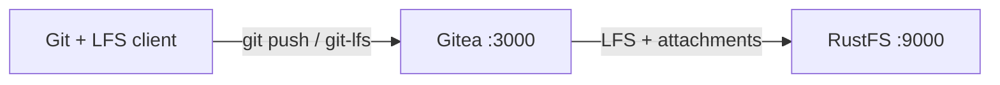

Ce guide connecte [Gitea](https://github.com/go-gitea/gitea) — le service Git auto-hébergé — à **RustFS** via le type de stockage `minio` de Gitea. Vous allez démarrer Gitea avec Docker Compose, créer un dépôt, pousser un objet Git LFS, joindre un fichier à un ticket (issue), puis vérifier que l’objet LFS et la pièce jointe sont tous deux stockés dans RustFS. Le flux a été validé avec `gitea/gitea:1.24.4` et `rustfs/rustfs-x86-musl:v2.3.1`.

Vous avez besoin de Docker avec le plugin Compose, ainsi que des clients `git` et `git-lfs` sur votre poste de travail. Ce déploiement est destiné aux tests d’intégration locaux, pas à la production.

## Schéma d’architecture



Gitea conserve le dépôt Git lui-même sur son disque local, tandis que le type de stockage `minio` achemine les fichiers volumineux — objets LFS, pièces jointes de tickets, avatars, archives de dépôt, paquets et artefacts Actions — vers le compartiment (bucket) `gitea-data` dans RustFS. Gitea crée le compartiment au démarrage s’il n’existe pas.

## 1. Créer les fichiers du projet

Créez un répertoire de travail :

```bash
mkdir rustfs-gitea
cd rustfs-gitea
```

Créez un fichier d’environnement et remplacez les deux valeurs d’identifiants indicatives :

```ini title=".env"
RUSTFS_ACCESS_KEY=<your-access-key>
RUSTFS_SECRET_KEY=<your-secret-key>
```

Utilisez des identifiants dédiés pour le compartiment `gitea-data`. N’ajoutez pas le fichier `.env` au dépôt (ne le versionnez pas).

Créez la configuration Gitea et remplacez les deux valeurs d’identifiants indicatives par les mêmes valeurs que dans `.env` — le type de stockage global `minio` s’applique au LFS, aux pièces jointes, aux avatars, aux archives de dépôt, aux paquets et aux artefacts Actions :

```ini title="app.ini"
APP_NAME = RustFS Gitea
RUN_MODE = prod
WORK_PATH = /data/gitea

[server]
DOMAIN = localhost
ROOT_URL = http://localhost:3000/
HTTP_PORT = 3000
LFS_START_SERVER = true

[database]
DB_TYPE = sqlite3
PATH = /data/gitea/gitea.db

[storage]
STORAGE_TYPE = minio
MINIO_ENDPOINT = rustfs:9000
MINIO_ACCESS_KEY_ID = <your-access-key>
MINIO_SECRET_ACCESS_KEY = <your-secret-key>
MINIO_BUCKET = gitea-data
MINIO_LOCATION = us-east-1
MINIO_USE_SSL = false

[log]
MODE = console
LEVEL = info

[security]
INSTALL_LOCK = true
SECRET_KEY = change-me-to-a-random-string
```

`LFS_START_SERVER` active l’API HTTP Git LFS. `MINIO_ENDPOINT` utilise le nom d’hôte interne à Compose `rustfs` ; le point de terminaison est joint par défaut avec des requêtes en adressage de type chemin (path-style).

Créez le fichier Compose :

```yaml title="compose.yaml"
services:
  rustfs:
    image: rustfs/rustfs-x86-musl:v2.3.1
    environment:
      RUSTFS_ACCESS_KEY: ${RUSTFS_ACCESS_KEY}
      RUSTFS_SECRET_KEY: ${RUSTFS_SECRET_KEY}
      RUSTFS_VOLUMES: /data
      RUSTFS_ADDRESS: ":9000"
      RUSTFS_CONSOLE_ADDRESS: ":9001"
      RUSTFS_CONSOLE_ENABLE: "true"
    volumes:
      - rustfs-data:/data
    ports:
      - "9000:9000"
      - "9001:9001"
    healthcheck:
      test: ["CMD", "curl", "-sf", "http://127.0.0.1:9000/health"]
      interval: 10s
      timeout: 5s
      retries: 6
      start_period: 10s
    networks:
      - gitea

  gitea:
    image: gitea/gitea:1.24.4
    depends_on:
      rustfs:
        condition: service_healthy
    environment:
      USER_UID: "1000"
      USER_GID: "1000"
    volumes:
      - gitea-data:/data
      - ./app.ini:/data/gitea/conf/app.ini:ro
    ports:
      - "3000:3000"
    networks:
      - gitea

networks:
  gitea:

volumes:
  rustfs-data:
  gitea-data:
```

Le répertoire `/data`, adossé à un volume, conserve la base SQLite et les dépôts Git entre les redémarrages du conteneur, tandis que les objets LFS et les pièces jointes résident dans RustFS.

## 2. Valider et démarrer le déploiement

Vérifiez le fichier Compose avant de démarrer les conteneurs :

```bash
docker compose config
```

Démarrez les services :

```bash
docker compose up -d
docker compose ps
```

Surveillez le journal de Gitea jusqu’à ce que chaque backend de stockage signale le type Minio :

```bash
docker compose logs gitea | grep "Initialising"
```

La sortie devrait lister `Attachment`, `Avatar`, `LFS` et les autres sections de stockage, chacune suivie d’une ligne `Creating Minio storage at rustfs:9000:gitea-data`.

Ouvrez `http://localhost:3000` et créez le compte administrateur, puis ouvrez la Console RustFS à l’adresse `http://localhost:9001` — le compartiment `gitea-data` apparaît après la première opération de stockage.

## 3. Pousser un objet Git LFS

Créez un dépôt nommé `rustfs-demo` dans l’interface web de Gitea, puis poussez un fichier suivi par LFS depuis votre poste de travail :

```bash
mkdir lfs-demo && cd lfs-demo
git init
git config user.email you@example.com
git config user.name you
git lfs install
git lfs track "*.bin"
git add .gitattributes
dd if=/dev/urandom of=dataset.bin bs=1M count=8
git add dataset.bin
git commit -m "add LFS dataset"
git remote add origin http://localhost:3000/<your-username>/rustfs-demo.git
git push origin main
```

`git push` charge (upload) l’objet LFS via l’API LFS de Gitea, qui l’écrit dans RustFS. Clonez le dépôt dans un second répertoire et exécutez `git lfs pull` — le fichier `dataset.bin` téléchargé doit être identique octet pour octet à l’original :

```bash
sha256sum dataset.bin
cd ../lfs-demo-clone && git lfs pull && sha256sum dataset.bin
```

Les deux sommes de contrôle correspondent, car les deux clients lisent l’objet depuis RustFS.

## 4. Joindre un fichier à un ticket

Ouvrez le dépôt `rustfs-demo`, créez un ticket et joignez un petit fichier texte via le formulaire du ticket. Gitea stocke le chargement sous `attachments/<prefix>/<uuid>` dans le compartiment `gitea-data` et sert les téléchargements via `/attachments/<uuid>`.

## 5. Vérifier les objets dans RustFS

Listez le compartiment avec le [client `rc`](https://github.com/rustfs/cli) :

```bash
docker compose exec rustfs /usr/bin/rc ls local/gitea-data/ -r
```

La sortie devrait inclure l’objet LFS sous `lfs/` et la pièce jointe sous `attachments/` :

```text
attachments/9/2/92fdd48d-531c-4cba-8b3f-4e2004a10fc7
lfs/37/76/6ddfc07e803de58a69328db9a58a07cf7080ddde55c155a7531bc650a000
```

La clé d’objet LFS est le hachage de contenu SHA-256 utilisé par le protocole Git LFS.


## 6. Arrêter ou réinitialiser le déploiement

Arrêtez les conteneurs en conservant toutes les données :

```bash
docker compose down
```

Le volume RustFS conserve le compartiment `gitea-data`, de sorte que les objets LFS et les pièces jointes survivent à un redémarrage. Pour tout supprimer, y compris les objets dans RustFS, ajoutez `--volumes`.

## Dépannage

### La page d’installation de Gitea s’affiche à la place de la page de connexion

Le fichier de configuration doit se trouver à l’emplacement `/data/gitea/conf/app.ini` dans le conteneur. Si le chemin de montage est incorrect, Gitea démarre avec les valeurs par défaut et affiche l’assistant d’installation. Montez le fichier comme dans l’exemple Compose, puis redémarrez.

### Le push échoue avec une erreur LFS ou 403

Vérifiez que les identifiants de `app.ini` correspondent aux identifiants RustFS et que le nom d’hôte `rustfs` se résout dans le réseau Compose :

```bash
docker compose logs gitea | grep -i minio
```

### Les objets arrivent dans le stockage local au lieu de RustFS

La variable d’environnement `GITEA__storage__STORAGE_TYPE: minio` et la section `[storage]` de `app.ini` doivent concorder. Après avoir modifié l’une ou l’autre, redémarrez Gitea et vérifiez de nouveau les lignes de journal `Initialising`.

## Étapes suivantes

- Consultez les [notes de compatibilité S3](/fr/administration/protocols/s3) avant d’adopter d’autres cibles de stockage Gitea.
- Créez des identifiants de production dédiés avec la [gestion des clés d’accès](/fr/security-compliance/iam/access-token).
- Suivez la [documentation de stockage Gitea](https://docs.gitea.com/administration/storage-configurations) pour déplacer les paquets, les artefacts Actions ou des sections de stockage individuelles vers des compartiments distincts.
