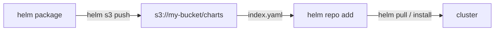

Ce guide connecte [Helm](https://github.com/helm/helm) — le gestionnaire de paquets CNCF pour Kubernetes — à **RustFS** via le plugin [helm-s3](https://github.com/hypnoglow/helm-s3), pour qu'un bucket RustFS devienne un dépôt privé de charts. Vous allez initialiser le dépôt dans le bucket, pousser un chart empaqueté, puis ajouter le dépôt à Helm et rapatrier le chart. Le workflow a été vérifié avec `alpine/helm:3.16.4` et helm-s3 `v0.17.2` sur un bucket RustFS.

Vous avez besoin de Docker. Ce déploiement est destiné aux tests d'intégration locaux, pas à la production.

## Architecture



Le préfixe du bucket contient `index.yaml` et un fichier `.tgz` par version de chart. Helm le lit et l'écrit via le plugin, donc le dépôt est accessible partout où RustFS l'est.

## 1. Installer le plugin et initialiser le dépôt

L'image `alpine/helm` n'embarque pas `git` — installez donc le plugin depuis son archive de version plutôt que depuis l'URL du dépôt :

```bash
cd /tmp
wget -q https://github.com/hypnoglow/helm-s3/releases/download/v0.17.2/helm-s3_0.17.2_linux_amd64.tar.gz
mkdir -p helm-s3 && tar -xzf helm-s3_0.17.2_linux_amd64.tar.gz -C helm-s3
helm plugin install helm-s3
```

Pointez le plugin vers RustFS via ses propres variables d'environnement et initialisez le préfixe du dépôt :

```bash
export AWS_ENDPOINT=<your-rustfs-endpoint>:9000
export AWS_DISABLE_SSL=true
export AWS_ACCESS_KEY_ID=<your-access-key>
export AWS_SECRET_ACCESS_KEY=<your-secret-key>
export AWS_DEFAULT_REGION=us-east-1

helm s3 init s3://my-bucket/charts
```

```text
Initialized empty repository at s3://my-bucket/charts
```

:::note[helm-s3 utilise AWS_ENDPOINT, pas AWS_ENDPOINT_URL]

Le plugin construit ses URL de requête à partir de `AWS_ENDPOINT` (hôte et port, sans schéma) et de `AWS_DISABLE_SSL=true` pour le HTTP en clair. La variable standard `AWS_ENDPOINT_URL` n'est pas prise en compte, et l'adressage virtual-hosted par défaut du SDK échoue contre RustFS avec `403 Forbidden`.

:::

## 2. Pousser un chart

Enregistrez le dépôt avant la première poussée — le plugin lit le fichier de dépôts de Helm et échoue s'il est absent :

```bash
helm repo add rustfs-charts s3://my-bucket/charts
```

Créez et empaquetez un chart de démonstration, puis poussez-le. `helm s3 push` accepte le **nom du dépôt**, pas l'URI `s3://` :

```bash
helm create demo
helm package demo
helm s3 push ./demo-0.1.0.tgz rustfs-charts
```

```text
Successfully uploaded the chart to the repository.
```

## 3. Installer ou rapatrier depuis le bucket

Rafraîchissez l'index du dépôt et confirmez que le chart est découvrable :

```bash
helm repo update
helm search repo rustfs-charts/demo
```

```text
NAME              	CHART VERSION	APP VERSION	DESCRIPTION
rustfs-charts/demo	0.1.0        	1.16.0     	A Helm chart for Kubernetes
```

Rapatriez le chart depuis RustFS :

```bash
helm pull rustfs-charts/demo --destination ./pullback
tar -tzf ./pullback/demo-0.1.0.tgz | head -2
```

```text
demo/Chart.yaml
demo/values.yaml
```


## 4. Arrêter ou réinitialiser

Les charts sont de simples objets de bucket, donc le nettoyage consiste à supprimer le préfixe :

```bash
aws s3 rm s3://my-bucket/charts --recursive \
  --endpoint-url http://<your-rustfs-endpoint>:9000
```

## Dépannage

### `head s3 object: Forbidden` sur `helm s3 init`

Le plugin utilise l'adressage virtual-hosted — `AWS_ENDPOINT` et `AWS_DISABLE_SSL` ne sont pas définis. Exportez-les exactement comme à l'étape 1.

### `check if index exists in the storage` échoue avec une erreur git

L'image n'a pas de `git`, donc `helm plugin install <git-url>` ne peut pas cloner. Installez depuis l'archive de version comme à l'étape 1.

### `The index file already exists under the provided URI`

Le préfixe du dépôt a déjà été initialisé. Relancez avec `helm s3 init --ignore-if-exists s3://my-bucket/charts`, ou passez `--force` pour remplacer l'index.

### `repo with name s3://... not found` à la poussée

`helm s3 push` attend le nom de dépôt enregistré via `helm repo add` — utilisez `helm s3 push ./demo-0.1.0.tgz rustfs-charts`.

### `couldn't load repositories file` pendant la poussée

Le `repositories.yaml` de Helm n'existe pas encore dans cet environnement. Exécutez `helm repo add rustfs-charts s3://my-bucket/charts` avant de pousser.

## Prochaines étapes

- Consultez les [notes de compatibilité S3](/administration/protocols/s3) avant d'héberger des dépôts plus volumineux avec de nombreuses versions de charts.
- Créez des identifiants de production dédiés avec la [gestion des clés d'accès](/security-compliance/iam/access-token).
- Suivez la [documentation helm-s3](https://github.com/hypnoglow/helm-s3) pour la réindexation, la suppression de charts et l'usage CI sur le même bucket.
