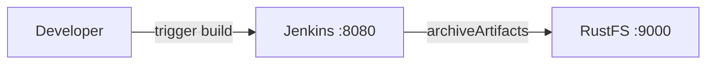

Ce guide connecte [Jenkins](https://github.com/jenkinsci/jenkins) — le serveur d’automatisation — à **RustFS** via le plugin Artifact Manager on S3. Vous allez démarrer Jenkins avec le plugin, pointer son gestionnaire d’artefacts vers un compartiment (bucket) RustFS, exécuter un job qui archive un artefact, puis vérifier que l’artefact est stocké dans RustFS. Le flux a été validé avec `jenkins/jenkins:lts-jdk17` (Jenkins 2.5xx LTS) et `rustfs/rustfs-x86-musl:v2.3.1`.

Vous avez besoin de Docker. Ce déploiement est destiné aux tests d’intégration locaux, pas à la production.

## Schéma d’architecture



Lorsque le plugin est actif, chaque job qui publie des artefacts via l’étape standard `archiveArtifacts` (ou `stash`/`unstash`) les charge (upload) dans le compartiment `jenkins-artifacts`, sous le préfixe configuré, au lieu de les stocker sur le disque du contrôleur.

## 1. Créer les fichiers du projet

Créez d’abord le compartiment — le plugin le valide, mais ne le crée pas :

```bash
rc alias set rustfs http://<your-rustfs-endpoint>:9000 <your-access-key> <your-secret-key>
rc mb rustfs/jenkins-artifacts
```

Créez un Dockerfile qui installe le plugin dans l’image Jenkins LTS :

```dockerfile title="Dockerfile"
FROM jenkins/jenkins:lts-jdk17
USER root
RUN jenkins-plugin-cli --plugins artifact-manager-s3 aws-credentials
USER jenkins
```

Le plugin `artifact-manager-s3` apporte la prise en charge des identifiants AWS dont il a besoin ; indiquer `aws-credentials` explicitement conserve le type d’identifiant disponible.

Construisez l’image et démarrez Jenkins sur le même réseau Docker que RustFS :

```bash
docker build -t jenkins-rustfs .
docker run -d --name jenkins --network oo-rustfs_default \
  -p 8080:8080 -v jenkins-home:/var/jenkins_home jenkins-rustfs
```

Terminez l’assistant de configuration, puis créez un identifiant AWS : **Manage Jenkins → Credentials → global → Add Credentials** (Gérer Jenkins, Identifiants, global, Ajouter des identifiants), de type **AWS Credential** (identifiant AWS), avec l’ID `rustfs-creds`, ainsi que votre clé d’accès et votre clé secrète RustFS.

## 2. Configurer le gestionnaire d’artefacts

Ouvrez **Manage Jenkins → AWS Configuration** (Configuration AWS, fournie par le plugin `aws-global-configuration`) et définissez :

- **Region name** (nom de la région) : `us-east-1`
- **Credentials** (identifiants) : `rustfs-creds`

Ouvrez **Manage Jenkins → System** (Système) et repérez la section **Artifact Management for Builds** (gestion des artefacts des builds). Sélectionnez **Cloud Provider Amazon S3** (fournisseur cloud Amazon S3), puis renseignez la configuration S3 :

- **S3 Bucket Name** (nom du compartiment S3) : `jenkins-artifacts`
- **S3 Bucket Region** (région du compartiment S3) : `us-east-1`
- **Base Prefix** (préfixe de base) : `artifacts/`
- **Custom Endpoint** (point de terminaison personnalisé) : `<your-rustfs-endpoint>:9000` (par exemple `rustfs:9000` à l’intérieur du réseau Compose)
- **Custom Signing Region** (région de signature personnalisée) : `us-east-1`
- **Use Path Style URL** (utiliser une URL en adressage de type chemin (path-style)) : activé
- **Use Insecure HTTP** (utiliser HTTP non chiffré) : activé
- **Disable Session Token** (désactiver le jeton de session) : activé

L’adressage de type chemin et HTTP non chiffré sont requis pour un point de terminaison non AWS sans TLS. Désactiver le jeton de session empêche le plugin d’appeler AWS STS : une simple paire de clés d’accès ne peut pas répondre à cet appel. Cliquez sur **Validate S3 Bucket configuration** (valider la configuration du compartiment S3) pour confirmer les réglages, puis enregistrez.

## 3. Exécuter un job qui archive un artefact

Créez un job freestyle (ou un pipeline) qui produit un fichier et l’archive :

```groovy
pipeline {
    agent any
    stages {
        stage('Build') {
            steps {
                sh 'echo "jenkins artifact stored on rustfs" > report.txt'
            }
        }
    }
    post {
        always {
            archiveArtifacts 'report.txt'
        }
    }
}
```

Exécutez le build et attendez qu’il se termine. Le chargement de l’artefact part vers RustFS de façon transparente — la configuration du job ne mentionne pas S3 du tout.

## 4. Vérifier les objets dans RustFS

Listez le compartiment :

```bash
rc ls rustfs/jenkins-artifacts/ -r
```

L’artefact est stocké sous le préfixe, organisé par job et par numéro de build :

```text
artifacts/s3-artifacts-demo/3/artifacts/report.txt
```


Le téléchargement de l’artefact depuis la page du build le relit depuis RustFS.

## 5. Arrêter ou réinitialiser le déploiement

Arrêtez Jenkins en conservant les données :

```bash
docker rm -f jenkins
```

Les artefacts restent dans le compartiment `jenkins-artifacts`. Pour les supprimer, supprimez le compartiment :

```bash
rc rb rustfs/jenkins-artifacts --force
```

## Dépannage

### `StsException: The security token included in the request is invalid`

Le plugin appelle AWS STS pour obtenir des identifiants de session. Activez **Disable Session Token** dans la configuration S3 — une paire de clés d’accès statique ne peut pas répondre à un appel STS.

### `UnknownHostException: jenkins-artifacts.rustfs`

Le plugin utilise l’adressage de type hôte virtuel. Activez **Use Path Style URL** — RustFS résout les compartiments à partir du chemin de l’URL, et non du nom d’hôte.

### `No valid session credentials` ou erreurs d’identifiant vide

Vérifiez que la page AWS Configuration a l’identifiant sélectionné et enregistré **avant** que les réglages du compartiment S3 ne soient utilisés, et que l’ID d’identifiant correspond à celui que vous avez créé.

## Étapes suivantes

- Consultez les [notes de compatibilité S3](/fr/administration/protocols/s3) avant d’adopter d’autres intégrations Jenkins.
- Créez des identifiants de production dédiés avec la [gestion des clés d’accès](/fr/security-compliance/iam/access-token).
- Suivez la [documentation du plugin Artifact Manager on S3](https://plugins.jenkins.io/artifact-manager-s3/) pour la prise en charge de stash et les options de nettoyage.
