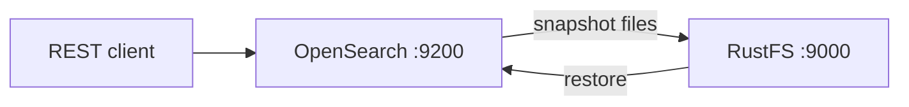

Ce guide connecte [OpenSearch](https://github.com/opensearch-project/OpenSearch) — la suite open source de recherche et d’analyse dérivée d’Elasticsearch — à **RustFS** via le plugin `repository-s3`. Vous allez enregistrer un dépôt d’instantanés S3 adossé à un compartiment (bucket) RustFS, prendre un instantané d’un index, puis le restaurer. Le flux a été validé avec `opensearchproject/opensearch:3.8.0` et le plugin `repository-s3` livré avec l’image, face à `rustfs/rustfs-x86-musl:v2.3.1`.

Vous avez besoin de Docker, ou d’un nœud OpenSearch sur lequel vous pouvez installer des plugins et modifier la configuration. Ce déploiement est destiné aux tests d’intégration locaux, pas à la production.

## Schéma d’architecture



Le plugin `repository-s3` écrit les instantanés sous forme d’archives de shard et de blobs de métadonnées dans le compartiment. L’enregistrement porte sur l’ensemble du cluster, si bien que chaque nœud a besoin du plugin et de la même configuration client.

## 1. Exécuter OpenSearch

Démarrez un nœud unique avec la sécurité désactivée et un petit tas mémoire (heap) :

```bash
docker run -d --name opensearch --network oo-rustfs_default -p 9200:9200 \
  -e discovery.type=single-node \
  -e OPENSEARCH_JAVA_OPTS="-Xms512m -Xmx512m" \
  -e DISABLE_SECURITY_PLUGIN=true \
  opensearchproject/opensearch:3.8.0
```

Le nœud est prêt lorsque `curl http://localhost:9200` renvoie l’en-tête du cluster (prévoyez une à deux minutes).

## 2. Installer le plugin repository-s3

Le plugin de dépôt S3 n’est pas préchargé. Installez-le et redémarrez le nœud :

```bash
docker exec opensearch bin/opensearch-plugin install --batch repository-s3
docker restart opensearch
```

## 3. Configurer le client S3

Les identifiants sont des réglages sécurisés : ils appartiennent au keystore OpenSearch, et non à la requête de dépôt ni à `opensearch.yml`. Créez les entrées du keystore, en remplaçant toutes les valeurs de connexion indicatives :

```bash
docker exec opensearch sh -c \
  "printf '<your-access-key>' | bin/opensearch-keystore create 2>/dev/null; \
   printf '<your-access-key>' | bin/opensearch-keystore add -f -x s3.client.default.access_key; \
   printf '<your-secret-key>' | bin/opensearch-keystore add -f -x s3.client.default.secret_key"
```

Ajoutez les réglages client non sécurisés à `config/opensearch.yml` :

```yaml title="opensearch.yml"
network.host: 0.0.0.0
plugins.security.disabled: true
s3.client.default.endpoint: http://<your-rustfs-endpoint>:9000
s3.client.default.protocol: http
s3.client.default.path_style_access: "true"
```

Redémarrez le nœud une fois de plus afin qu’il lise à la fois le keystore et les nouveaux réglages :

```bash
docker restart opensearch
```

Créez le compartiment pendant le démarrage du nœud :

```bash
rc mb rustfs/opensearch-snapshots
```

## 4. Enregistrer le dépôt et l’instantané

Créez un index de test avec un document, puis enregistrez le dépôt :

```bash
curl -sX PUT http://localhost:9200/rustfs-demo -H "Content-Type: application/json" \
  -d '{"settings":{"number_of_shards":1}}'

curl -sX PUT http://localhost:9200/rustfs-demo/_doc/1 -H "Content-Type: application/json" \
  -d '{"product":"rustfs","via":"opensearch-snapshot"}'

curl -sX PUT "http://localhost:9200/_snapshot/rustfs-repo" -H "Content-Type: application/json" \
  -d '{"type":"s3","settings":{"bucket":"opensearch-snapshots","region":"us-east-1","server_side_encryption_type":"bucket_default"}}'
```

Le réglage `server_side_encryption_type: bucket_default` est important : sans lui, le plugin demande SSE-S3, qu’un RustFS auto-hébergé dépourvu de clé maître de chiffrement côté serveur refuse.

Prenez un instantané et attendez la fin :

```bash
curl -sX PUT "http://localhost:9200/_snapshot/rustfs-repo/snapshot-1?wait_for_completion=true" \
  -H "Content-Type: application/json" -d '{"indices":"rustfs-demo"}'
```

```text
{"snapshot":{"snapshot":"snapshot-1","state":"SUCCESS","indices":["rustfs-demo"],...}}
```

## 5. Vérifier les objets et restaurer

Listez le compartiment :

```bash
rc ls rustfs/opensearch-snapshots/ -r
```

```text
index-0
index.latest
indices/5x1bwsWaSv2XINIbeoe-RQ/0/__GgxvoCw-TKuMMAYBq5Khag
indices/5x1bwsWaSv2XINIbeoe-RQ/0/snap-kRgFBiuyQIyPo3_-CMp7Hw.dat
meta-kRgFBiuyQIyPo3_-CMp7Hw.dat
snap-kRgFBiuyQIyPo3_-CMp7Hw.dat
```

Supprimez l’index et restaurez-le depuis l’instantané :

```bash
curl -sX DELETE http://localhost:9200/rustfs-demo
curl -sX POST "http://localhost:9200/_snapshot/rustfs-repo/snapshot-1/_restore?wait_for_completion=true"
curl -s http://localhost:9200/rustfs-demo/_doc/1
```

```text
{"_index":"rustfs-demo","_id":"1","found":true,"_source":{"product":"rustfs","via":"opensearch-snapshot"}}
```


## 6. Arrêter ou réinitialiser

Pour arrêter la démonstration tout en conservant les objets du compartiment :

```bash
docker rm -f opensearch
```

Pour supprimer les instantanés stockés :

```bash
rc rm rustfs/opensearch-snapshots/ --recursive --force
```

## Dépannage

### `Setting [access_key] is insecure, but property [allow_insecure_settings] is not set`

Les identifiants placés dans la requête de dépôt sont refusés. Stockez-les dans le keystore comme à l’étape 3 — `access_key` et `secret_key` sont des réglages sécurisés dans OpenSearch.

### `SSE-S3 requires RUSTFS_SSE_S3_MASTER_KEY ... (Status Code: 400)`

Le plugin chiffre les chargements (upload) avec SSE-S3 par défaut. Enregistrez le dépôt avec `"server_side_encryption_type": "bucket_default"` afin qu’aucun en-tête de chiffrement ne soit envoyé, comme à l’étape 4.

### `unknown setting [s3.client.default.access_key]` au démarrage

Les réglages font référence au plugin repository-s3. Si le nœud ne démarre pas alors qu’ils sont présents, le plugin n’est pas installé dans ce conteneur — recommencez l’étape 2 (un conteneur neuf perd les plugins installés avec `docker exec`).

### La vérification du dépôt échoue avec `path is not accessible`

Le nœud ne peut pas atteindre le compartiment : vérifiez que `s3.client.default.endpoint` est joignable depuis le conteneur, que `path_style_access` vaut `"true"`, et que les identifiants du keystore ont été chargés (ils sont lus au démarrage — redémarrez après les avoir ajoutés).

## Étapes suivantes

- Consultez les [notes de compatibilité S3](/fr/administration/protocols/s3) avant d’adopter d’autres dépôts OpenSearch.
- Créez des identifiants de production dédiés avec la [gestion des clés d’accès](/fr/security-compliance/iam/access-token).
- Suivez la [documentation des instantanés OpenSearch](https://docs.opensearch.org/docs/latest/tuning-your-cluster/availability-and-recovery/snapshots/index/) pour automatiser les instantanés avec les politiques Snapshot Management (SM).
