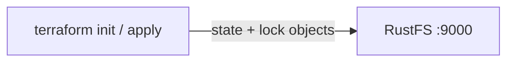

Ce guide connecte [Terraform](https://github.com/hashicorp/terraform) — l’outil d’infrastructure en tant que code de HashiCorp — à **RustFS** via le backend S3 : le fichier d’état, et le fichier de verrou qui empêche les exécutions concurrentes, sont stockés comme objets dans RustFS. Vous allez initialiser le backend, appliquer une petite configuration, puis vérifier l’objet d’état dans RustFS. Le flux a été validé avec `terraform 1.12.2` et `rustfs/rustfs-x86-musl:v2.3.1`.

Vous avez besoin d’un déploiement RustFS joignable depuis votre poste de travail (voir les guides sous [Installation](/fr/installation)) et de Terraform 1.10 ou ultérieur, qui prend en charge le verrouillage natif S3 via `use_lockfile`.

## Schéma d’architecture



Le backend S3 stocke le fichier d’état sous le préfixe `key` dans le compartiment (bucket). Avec `use_lockfile = true`, Terraform écrit un objet `<key>.tflock` tant qu’une exécution détient le verrou, ce qui remplace, pour cette configuration, l’ancien verrouillage fondé sur DynamoDB.

## 1. Créer les fichiers du projet

Créez un répertoire de travail :

```bash
mkdir rustfs-terraform
cd rustfs-terraform
```

Créez la configuration. Remplacez les valeurs d’identifiants indicatives et faites pointer le point de terminaison vers votre serveur RustFS — `localhost:9000` lorsque Terraform s’exécute sur le même hôte :

```hcl title="main.tf"
terraform {
  backend "s3" {
    bucket                      = "my-bucket"
    key                         = "rustfs-demo/terraform.tfstate"
    region                      = "us-east-1"
    endpoint                    = "http://localhost:9000"
    access_key                  = "<your-access-key>"
    secret_key                  = "<your-secret-key>"
    skip_credentials_validation = true
    skip_region_validation      = true
    skip_metadata_api_check     = true
    skip_requesting_account_id  = true
    force_path_style            = true
    insecure                    = true
    use_lockfile                = true
  }
}

provider "local" {}

resource "local_file" "demo" {
  content  = "provisioned with terraform, state stored in RustFS"
  filename = "${path.module}/demo.txt"
}
```

`force_path_style` et `insecure` sélectionnent l’adressage de type chemin (path-style) en HTTP non chiffré, ce qu’attend RustFS pour le point de terminaison local. `use_lockfile` active le verrouillage d’état natif S3, afin que des exécutions concurrentes ne puissent pas corrompre l’état.

## 2. Initialiser le backend

Téléchargez le fournisseur et configurez le backend S3 :

```bash
terraform init -input=false
```

```text
Successfully configured the backend "s3"! Terraform will automatically
use this backend unless the backend configuration changes.
```

## 3. Appliquer la configuration

Créez la ressource et écrivez l’état dans RustFS :

```bash
terraform apply -auto-approve -input=false
```

```text
Apply complete! Resources: 1 added, 0 changed, 0 destroyed.
```

## 4. Vérifier l’état dans RustFS

Listez les objets d’état via la CLI `rc` :

```bash
docker run --rm --network <rustfs-network> -v "$PWD:/m" \
  --entrypoint /bin/sh rustfs/rc:latest \
  -c 'rc alias set rustfs http://rustfs:9000 <your-access-key> <your-secret-key> >/dev/null && rc ls rustfs/my-bucket/rustfs-demo --recursive'
```

```text
[2026-09-21 03:05:03]   1.62 KiB rustfs-demo/terraform.tfstate
```

Vous pouvez également parcourir le préfixe dans la Console RustFS :


## 5. Confirmer que l’état est rechargé depuis RustFS

Exécutez un plan — Terraform lit l’état depuis RustFS et le compare à la configuration :

```bash
terraform plan -input=false
```

```text
No changes. Your infrastructure matches the configuration.
```

Le plan ne contient aucune modification, car l’état a été relu depuis RustFS, et non depuis un fichier local.

## 6. Détruire et réinitialiser

Détruisez la ressource ; la mise à jour de l’état est écrite dans RustFS de la même manière :

```bash
terraform destroy -auto-approve -input=false
```

Supprimez les objets d’état dans la Console RustFS (ou avec `rc rm`) pour repartir de zéro.

## Dépannage

### « dial tcp: lookup rustfs ... server misbehaving » ou échecs de connexion

`endpoint` doit être joignable depuis la machine où s’exécute Terraform. À l’intérieur d’un réseau Compose, utilisez `http://rustfs:9000` ; depuis l’hôte, `http://localhost:9000`.

### « Bucket cannot have ACLs set » ou erreurs de signature

`skip_credentials_validation`, `skip_region_validation`, `skip_metadata_api_check`, `skip_requesting_account_id`, `force_path_style` et `insecure` sont tous requis pour un point de terminaison non AWS ; s’il en manque un, le backend s’adresse aux valeurs par défaut d’AWS au lieu de RustFS.

### L’état n’apparaît pas dans le compartiment

Vérifiez que le compartiment existe et que les identifiants correspondent aux identifiants RustFS. L’objet d’état apparaît sous le chemin `key` (`rustfs-demo/terraform.tfstate` dans ce guide) après le premier `init` ou `apply`.

## Étapes suivantes

- Consultez les [notes de compatibilité S3](/fr/administration/protocols/s3) avant d’adopter d’autres opérations S3.
- Créez des identifiants de production dédiés avec la [gestion des clés d’accès](/fr/security-compliance/iam/access-token).
- Suivez la [documentation du backend S3 de Terraform](https://developer.hashicorp.com/terraform/language/backend/s3) pour des options telles que les préfixes d’espace de travail et l’emprunt d’un rôle (assume role).
