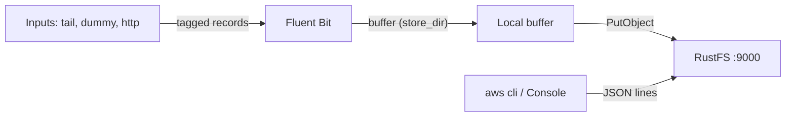

Ce guide connecte [Fluent Bit](https://github.com/fluent/fluent-bit) — le processeur et transmetteur de journaux de la CNCF — à **RustFS** comme destination de journaux. Vous allez exécuter Fluent Bit avec sa sortie `s3`, mettre les enregistrements en tampon sur disque, les téléverser dans un bucket RustFS, puis lire un fichier de journal livré. Le workflow a été vérifié avec `fluent/fluent-bit:3.2.10` écrivant dans un bucket RustFS via l'adressage path-style.

Vous avez besoin de Docker. Ce déploiement est destiné aux tests d'intégration locaux, pas à la production.

## Architecture



La sortie S3 met en tampon les enregistrements étiquetés dans `store_dir` et téléverse un fichier dès qu'il atteint `total_file_size`, ou quand `upload_timeout` expire — selon ce qui survient en premier. Chaque objet téléversé est un fichier de lignes JSON.

## 1. Créer le bucket

La sortie S3 ne crée jamais de bucket, et les téléversements échouent avec `NoSuchBucket` quand le bucket est absent. Créez-le d'abord, en remplaçant tous les paramètres fictifs :

```bash
aws s3 mb s3://my-bucket \
  --endpoint-url http://<your-rustfs-endpoint>:9000
```

## 2. Configurer la sortie S3

Créez la configuration Fluent Bit :

```text title="fluent-bit.conf"
[SERVICE]
    Flush 2
    Log_Level info

[INPUT]
    Name dummy
    Tag rustfs.test
    Rate 200

[OUTPUT]
    Name s3
    Match *
    endpoint http://<your-rustfs-endpoint>:9000
    region us-east-1
    bucket my-bucket
    total_file_size 1M
    use_put_object On
    upload_timeout 30s
    store_dir /tmp/flb-store
    json_date_key date
    json_date_format iso8601
```

`use_put_object On` téléverse chaque fichier tamponné avec un seul appel `PutObject`. `upload_timeout` force un téléversement après 30 secondes même si le tampon n'a pas atteint `total_file_size` — les entrées à faible volume en ont besoin, sinon leurs enregistrements restent sur le disque local.

:::note[Les points de terminaison personnalisés utilisent path-style par défaut]

Fluent Bit 3.2 n'a pas d'option `s3_force_path_style` — le plugin la rejette comme propriété inconnue. Quand `endpoint` désigne un service S3 personnalisé, les requêtes adressent le bucket en path-style, ce qui correspond aux défauts de RustFS. Aucun indicateur supplémentaire n'est nécessaire.

:::

## 3. Exécuter Fluent Bit

Démarrez le conteneur en passant les identifiants via les variables d'environnement AWS standard :

```bash
docker run -d --name fluent-bit \
  -e AWS_ACCESS_KEY_ID=<your-access-key> \
  -e AWS_SECRET_ACCESS_KEY=<your-secret-key> \
  -v "$PWD/fluent-bit.conf:/fluent-bit/etc/fluent-bit.conf:ro" \
  fluent/fluent-bit:3.2.10
```

Attendez le premier téléversement et confirmez le démarrage du worker :

```bash
docker logs fluent-bit 2>&1 | grep "worker #0 started"
```

```text
[output:s3:s3.0] worker #0 started
```

## 4. Vérifier les objets téléversés

Listez le bucket — la disposition de clés par défaut est `fluent-bit-logs/<tag>/YYYY/MM/DD/HH/MM/` :

```bash
aws s3 ls s3://my-bucket/ --recursive \
  --endpoint-url http://<your-rustfs-endpoint>:9000
```

```text
2026-10-25 01:13:28  1021326 fluent-bit-logs/rustfs.test/2026/10/25/01/13/59-objectbmjH9744
2026-10-25 01:16:05   333735 fluent-bit-logs/rustfs.test/2026/10/25/01/15/34-objectKfCq13io
```

Lisez un objet en retour — chaque ligne est un enregistrement JSON :

```bash
aws s3 cp s3://my-bucket/fluent-bit-logs/rustfs.test/2026/10/25/01/13/59-objectbmjH9744 - \
  --endpoint-url http://<your-rustfs-endpoint>:9000 | head -2
```

```json
{"date":"2026-10-25T01:13:59.204844Z","message":"dummy"}
{"date":"2026-10-25T01:13:59.206396Z","message":"dummy"}
```


## 5. Arrêter ou réinitialiser

Pour démonter la démo tout en conservant les objets du bucket :

```bash
docker rm -f fluent-bit
```

Pour supprimer les journaux téléversés :

```bash
aws s3 rm s3://my-bucket/fluent-bit-logs --recursive \
  --endpoint-url http://<your-rustfs-endpoint>:9000
```

## Dépannage

### `PutObject request failed` avec `NoSuchBucket`

Le bucket de sortie n'existe pas. Créez-le comme indiqué à l'étape 1 — le plugin ne crée jamais de bucket.

### `[config] s3: unknown configuration property 's3_force_path_style'`

Cette option n'existe pas dans Fluent Bit 3.2. Supprimez-la ; les points de terminaison personnalisés utilisent déjà l'adressage path-style.

### Les objets n'apparaissent jamais et le journal reste silencieux

Le tampon n'a pas atteint `total_file_size` et aucun `upload_timeout` n'est défini. Ajoutez `upload_timeout 30s` pour que les entrées à faible volume se transfèrent périodiquement.

### `InvalidAccessKeyId` dans le journal Fluent Bit

Les variables d'environnement d'identifiants manquent dans le conteneur ou sont erronées. La sortie S3 lit `AWS_ACCESS_KEY_ID` et `AWS_SECRET_ACCESS_KEY`.

## Prochaines étapes

- Consultez les [notes de compatibilité S3](/administration/protocols/s3) avant d'activer les téléversements multiparties ou la compression sur cette sortie.
- Créez des identifiants de production dédiés avec la [gestion des clés d'accès](/security-compliance/iam/access-token).
- Suivez la [documentation de la sortie S3 de Fluent Bit](https://docs.fluentbit.io/manual/pipeline/outputs/s3) pour `s3_key_format`, la compression et le réglage de l'entrée `tail` sur le même bucket.
