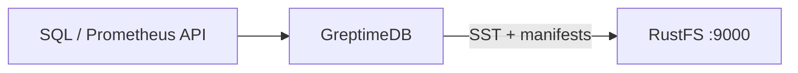

Ce guide connecte [GreptimeDB](https://github.com/GreptimeTeam/greptimedb) — la base de données de séries temporelles open source et cloud native — à **RustFS** comme backend de stockage objet. Vous allez démarrer une instance autonome dont la section `[storage]` pointe vers un compartiment (bucket) RustFS, écrire des lignes de séries temporelles via l’API SQL, puis confirmer les fichiers Parquet et les manifestes dans le compartiment. Le flux a été validé avec `greptime/greptimedb` (branche main, commit `179ff8e5`) face à `rustfs/rustfs-x86-musl:v2.3.1`.

Vous avez besoin de Docker, ou d’un binaire GreptimeDB local. Ce déploiement est destiné aux tests d’intégration locaux, pas à la production.

## Schéma d’architecture



GreptimeDB conserve localement son journal d’écriture anticipée et les données récentes, puis persiste les SSTables (Parquet) et les manifestes de table vers le stockage objet. Pointer le backend de stockage vers RustFS fait du compartiment l’emplacement durable de toutes les données de tables.

## 1. Configurer le backend de stockage

Créez le compartiment et un fichier de configuration avec une section de stockage S3, en remplaçant toutes les valeurs de connexion indicatives :

```toml title="greptimedb.toml"
[storage]
type = "S3"
bucket = "<your-bucket>"
root = "greptimedb"
access_key_id = "<your-access-key>"
secret_access_key = "<your-secret-key>"
endpoint = "http://<your-rustfs-endpoint>:9000"
region = "us-east-1"
```

GreptimeDB utilise par défaut des requêtes en adressage de type chemin (path-style) pour les points de terminaison personnalisés ; l’adressage de type hôte virtuel doit être activé explicitement avec `enable_virtual_host_style`, si bien qu’aucun indicateur supplémentaire n’est nécessaire pour RustFS.

## 2. Exécuter GreptimeDB

Démarrez une instance autonome avec le fichier de configuration :

```bash
docker run -d --name greptimedb --network oo-rustfs_default -p 4000:4000 -p 4002:4002 \
  -v "$PWD/greptimedb.toml":/etc/greptimedb/greptimedb.toml:ro \
  greptime/greptimedb:latest standalone start \
  --http-addr 0.0.0.0:4000 \
  --mysql-addr 0.0.0.0:4002 \
  --config-file /etc/greptimedb/greptimedb.toml
```

Le port `4000` sert le point de terminaison SQL HTTP, et le port `4002` le protocole MySQL.

## 3. Écrire et interroger des séries temporelles

Créez une table, insérez des lignes et relisez-les. Le point de terminaison SQL HTTP accepte des requêtes encodées en formulaire :

```bash
curl -s -X POST "http://localhost:4000/v1/sql" \
  --data-urlencode "sql=CREATE TABLE rustfs_demo (host STRING, cpu DOUBLE, mem DOUBLE, ts TIMESTAMP TIME INDEX)"

curl -s -X POST "http://localhost:4000/v1/sql" \
  --data-urlencode "sql=INSERT INTO rustfs_demo VALUES (\"node-1\", 0.31, 0.62, 1790681000000), (\"node-1\", 0.35, 0.63, 1790681060000), (\"node-2\", 0.51, 0.71, 1790681000000)"
```

```text
{"output":[{"affectedrows":3}],"execution_time_ms":2}
```

Relisez les lignes :

```bash
curl -s -X POST "http://localhost:4000/v1/sql" \
  --data-urlencode "sql=SELECT * FROM rustfs_demo ORDER BY ts"
```

```text
{"output":[{"records":{"rows":[["node-2",0.51,0.71,1790681000000],["node-1",0.35,0.63,1790681060000]],"total_rows":2}}]}
```

## 4. Vérifier les objets dans RustFS

Listez le compartiment — après le vidage des memtables, le compartiment contient des SSTables Parquet et des manifestes JSON :

```bash
rc ls rustfs/<your-bucket>/ -r
```

```text
greptimedb/data/greptime/public/1024/1024_0000000000/manifest/00000000000000000000.json
greptimedb/data/greptime/greptime_private/1025/1025_0000000000/b11e8b25-5763-4f05-bcab-b6ee0a756a69.parquet
greptimedb/data/greptime/greptime_private/1025/1025_0000000000/manifest/00000000000000000001.json
```

Chaque base de données obtient un répertoire sous `data/`, et les fichiers `manifest/*.json` de chaque région décrivent les SSTables que GreptimeDB relit pendant les requêtes.


## 5. Arrêter ou réinitialiser

Pour arrêter la démonstration tout en conservant les objets du compartiment :

```bash
docker rm -f greptimedb
```

Pour supprimer les données stockées :

```bash
rc rm rustfs/<your-bucket>/ --recursive --force
```

## Dépannage

### `Form requests must have Content-Type: application/x-www-form-urlencoded`

Le point de terminaison HTTP `/v1/sql` n’accepte que les corps encodés en formulaire. Transmettez le SQL avec `curl --data-urlencode "sql=..."` (ou `application/x-www-form-urlencoded`), et non comme un corps JSON.

### Le compartiment reste vide

GreptimeDB vide les memtables vers le stockage objet de façon asynchrone. Exécutez quelques insertions supplémentaires et attendez quelques secondes, ou déclenchez un vidage manuel, puis listez de nouveau le compartiment.

### Le démarrage échoue avec une erreur S3

Vérifiez que `endpoint` inclut le schéma, que le compartiment existe, et que `access_key_id`/`secret_access_key` correspondent à une clé d’accès RustFS. La valeur `root` est facultative, mais elle conserve l’arborescence des tables sous un préfixe connu.

## Étapes suivantes

- Consultez les [notes de compatibilité S3](/fr/administration/protocols/s3) avant d’adopter d’autres options de stockage GreptimeDB.
- Créez des identifiants de production dédiés avec la [gestion des clés d’accès](/fr/security-compliance/iam/access-token).
- Suivez la [référence de configuration GreptimeDB](https://docs.greptime.com/operational-guide/configure/configure-datanode/) pour régler les intervalles de vidage et les couches de cache des charges de production.
