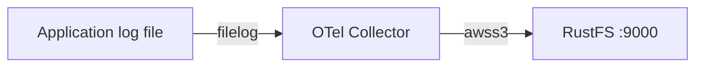
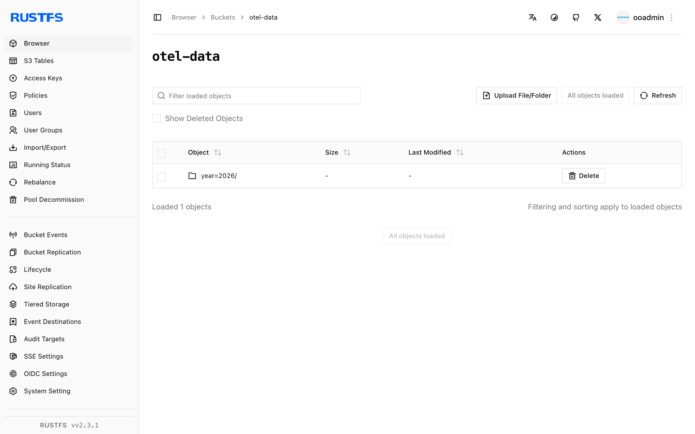

Ce guide connecte l’[OpenTelemetry Collector](https://opentelemetry.io/docs/collector/) — le pipeline de télémétrie de la CNCF — à **RustFS** via l’exporteur `awss3` du collecteur. Vous allez exécuter le collecteur contrib avec un récepteur `filelog`, envoyer les lignes de journal d’un fichier dans le compartiment (bucket) `otel-data`, puis vérifier les objets partitionnés dans RustFS. Le flux a été validé avec `otel/opentelemetry-collector-contrib:0.138.0` et `rustfs/rustfs-x86-musl:v2.3.1`.

Vous avez besoin de Docker. Ce déploiement est destiné aux tests d’intégration locaux, pas à la production.

## Schéma d’architecture



Le récepteur `filelog` suit la fin du fichier de journal, et l’exporteur `awss3` charge (upload) les lots vers le compartiment, partitionnés en préfixes temporels. Les métriques et les traces peuvent être acheminées par le même exporteur, avec leurs propres pipelines.

## 1. Créer les fichiers du projet

Créez d’abord le compartiment — l’exporteur ne crée pas les compartiments :

```bash
rc alias set rustfs http://<your-rustfs-endpoint>:9000 <your-access-key> <your-secret-key>
rc mb rustfs/otel-data
```

Créez la configuration du collecteur, en remplaçant les deux valeurs d’identifiants indicatives :

```yaml title="config.yaml"
receivers:
  filelog:
    include: [/var/log/app.log]
    start_at: beginning

exporters:
  awss3:
    s3uploader:
      region: us-east-1
      s3_bucket: otel-data
      endpoint: http://rustfs:9000
      s3_force_path_style: true
      disable_ssl: true
      file_prefix: logs/app
    marshaler: body

service:
  pipelines:
    logs:
      receivers: [filelog]
      exporters: [awss3]
```

L’exporteur lit les identifiants dans les variables d’environnement standard `AWS_ACCESS_KEY_ID`, `AWS_SECRET_ACCESS_KEY` et `AWS_REGION`. `marshaler: body` écrit chaque ligne de journal en texte brut ; omettez-le pour stocker du JSON OTLP à la place. `s3_force_path_style` et `disable_ssl` sont requis pour un point de terminaison non AWS en HTTP non chiffré.

Créez le fichier Compose :

```yaml title="compose.yaml"
services:
  collector:
    image: otel/opentelemetry-collector-contrib:0.138.0
    command: ["--config=/etc/otelcol-contrib/config.yaml"]
    environment:
      AWS_ACCESS_KEY_ID: <your-access-key>
      AWS_SECRET_ACCESS_KEY: <your-secret-key>
      AWS_REGION: us-east-1
    volumes:
      - ./config.yaml:/etc/otelcol-contrib/config.yaml:ro
      - ./app.log:/var/log/app.log
    networks:
      - otel

networks:
  otel:
```

## 2. Démarrer le collecteur et produire des journaux

Démarrez la pile et ajoutez des lignes au fichier surveillé :

```bash
echo "otel demo log line one" > app.log
docker compose up -d
echo "second line after start" >> app.log
```

Le collecteur suit le fichier depuis le début et charge chaque tampon lorsque la partition bascule ; attendez donc environ une minute après la dernière ligne avant de vérifier.

## 3. Vérifier les objets dans RustFS

Listez le compartiment :

```bash
rc ls rustfs/otel-data/ -r
```

Les enregistrements de journal sont chargés sous des partitions temporelles, avec le préfixe de fichier configuré :

```text
year=2026/month=09/day=21/hour=15/minute=53/logs/applogs_288361608.txt
```

Relisez un objet pour confirmer que les lignes sont arrivées intactes :

```bash
rc cat rustfs/otel-data/year=2026/month=09/day=21/hour=15/minute=53/logs/applogs_288361608.txt
```

```text
otel demo log line one
second line after start
```



## 4. Arrêter ou réinitialiser le déploiement

Arrêtez le collecteur en conservant les données :

```bash
docker compose down
```

Les objets restent dans le compartiment `otel-data`. Pour les supprimer, supprimez le compartiment :

```bash
rc rb rustfs/otel-data --force
```

## Dépannage

### `has invalid keys` au démarrage du collecteur

Le schéma de l’exporteur `awss3` diffère selon les versions du collecteur. La version 0.138 imbrique les réglages de chargement sous `s3uploader`, comme ci-dessus ; la clé du point de terminaison est `endpoint` (et non `s3_endpoint`). Les versions plus récentes déplacent ces clés au premier niveau — consultez le README de votre version exacte du collecteur.

### Rien n’apparaît dans le compartiment

Vérifiez que les variables d’environnement d’identifiants sont définies sur le conteneur du collecteur, que `s3_force_path_style` vaut `true`, et que l’exporteur peut joindre `http://rustfs:9000` depuis l’intérieur du réseau Compose. Activez l’exporteur `debug` sur le même pipeline pour voir si des enregistrements circulent.

## Étapes suivantes

- Consultez les [notes de compatibilité S3](/fr/administration/protocols/s3) avant d’adopter d’autres opérations du collecteur.
- Créez des identifiants de production dédiés avec la [gestion des clés d’accès](/fr/security-compliance/iam/access-token).
- Suivez la [documentation de l’exporteur AWS S3](https://github.com/open-telemetry/opentelemetry-collector-contrib/tree/main/exporter/awss3exporter) pour ajouter des pipelines de métriques et de traces.
