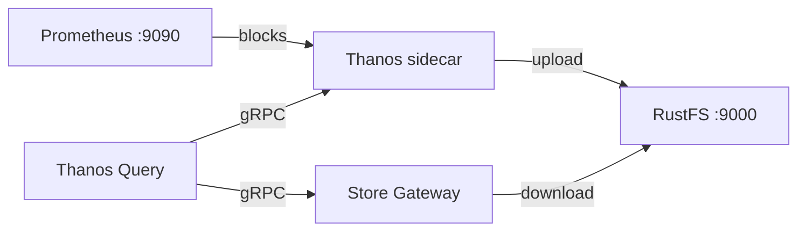

Ce guide connecte [Thanos](https://github.com/thanos-io/thanos) — l’architecture Prometheus hautement disponible, avec stockage à long terme — à **RustFS** comme stockage objet. Vous allez exécuter Prometheus avec un sidecar Thanos qui charge (upload) les blocs TSDB vers RustFS, puis interroger de nouveau les données historiques via une Store Gateway et un frontal Query. Le flux a été validé avec `thanosio/thanos:v0.37.2`, `prom/prometheus:v2.53.1` et `rustfs/rustfs-x86-musl:v2.3.1`.

Vous avez besoin de Docker avec le plugin Compose. Ce déploiement est destiné aux tests d’intégration locaux, pas à la production.

## Schéma d’architecture



Le sidecar surveille le répertoire TSDB de Prometheus et charge chaque bloc de deux heures vers le compartiment (bucket) `thanos-data` dans RustFS. La Store Gateway lit le même compartiment et répond aux requêtes sur les blocs historiques, si bien que Query résout à la fois les données en direct via le sidecar et les anciennes données via la Store Gateway.

## 1. Créer les fichiers du projet

Créez un répertoire de travail :

```bash
mkdir rustfs-thanos
cd rustfs-thanos
```

Créez un fichier d’environnement et remplacez les deux valeurs d’identifiants indicatives :

```ini title=".env"
RUSTFS_ACCESS_KEY=<your-access-key>
RUSTFS_SECRET_KEY=<your-secret-key>
```

Utilisez des identifiants dédiés pour le compartiment `thanos-data`. N’ajoutez pas le fichier `.env` au dépôt (ne le versionnez pas).

Créez la configuration Prometheus avec un label externe — Thanos l’exige pour dédupliquer les blocs :

```yaml title="prometheus.yml"
global:
  scrape_interval: 5s
  external_labels:
    monitor: rustfs-demo

scrape_configs:
  - job_name: prometheus
    static_configs:
      - targets: ["localhost:9090"]
  - job_name: rustfs
    metrics_path: /metrics
    static_configs:
      - targets: ["rustfs:9000"]
```

Créez la configuration du stockage objet Thanos :

```yaml title="bucket.yml"
type: S3
config:
  bucket: thanos-data
  endpoint: rustfs:9000
  access_key: ${RUSTFS_ACCESS_KEY}
  secret_key: ${RUSTFS_SECRET_KEY}
  insecure: true
```

Thanos n’interpole pas lui-même les fichiers `.env`. Avant de démarrer la pile, remplacez les valeurs indicatives par les mêmes valeurs que dans `.env` :

```bash
sed -i.bak "s|\${RUSTFS_ACCESS_KEY}|$(grep RUSTFS_ACCESS_KEY .env | cut -d= -f2)|;s|\${RUSTFS_SECRET_KEY}|$(grep RUSTFS_SECRET_KEY .env | cut -d= -f2)|" bucket.yml
```

Créez le fichier Compose :

```yaml title="compose.yaml"
services:
  rustfs:
    image: rustfs/rustfs-x86-musl:v2.3.1
    environment:
      RUSTFS_ACCESS_KEY: ${RUSTFS_ACCESS_KEY}
      RUSTFS_SECRET_KEY: ${RUSTFS_SECRET_KEY}
      RUSTFS_VOLUMES: /data
      RUSTFS_ADDRESS: ":9000"
      RUSTFS_CONSOLE_ADDRESS: ":9001"
      RUSTFS_CONSOLE_ENABLE: "true"
    volumes:
      - rustfs-data:/data
    ports:
      - "9000:9000"
      - "9001:9001"
    healthcheck:
      test: ["CMD", "curl", "-sf", "http://127.0.0.1:9000/health"]
      interval: 10s
      timeout: 5s
      retries: 6
      start_period: 10s
    networks:
      - thanos

  create-bucket:
    image: rustfs/rc:latest
    depends_on:
      rustfs:
        condition: service_healthy
    environment:
      RUSTFS_ACCESS_KEY: ${RUSTFS_ACCESS_KEY}
      RUSTFS_SECRET_KEY: ${RUSTFS_SECRET_KEY}
    entrypoint:
      - /bin/sh
      - -c
      - |
        /usr/bin/rc alias set rustfs http://rustfs:9000 "$${RUSTFS_ACCESS_KEY}" "$${RUSTFS_SECRET_KEY}"
        /usr/bin/rc mb --ignore-existing rustfs/thanos-data
    networks:
      - thanos

  prometheus:
    image: prom/prometheus:v2.53.1
    command:
      - --config.file=/etc/prometheus/prometheus.yml
      - --storage.tsdb.path=/prometheus
      - --storage.tsdb.min-block-duration=2h
      - --storage.tsdb.max-block-duration=2h
      - --web.enable-lifecycle
    volumes:
      - ./prometheus.yml:/etc/prometheus/prometheus.yml:ro
      - prom-data:/prometheus
    ports:
      - "9090:9090"
    networks:
      - thanos

  sidecar:
    image: thanosio/thanos:v0.37.2
    command:
      - sidecar
      - --tsdb.path=/prometheus
      - --prometheus.url=http://prometheus:9090
      - --objstore.config-file=/etc/thanos/bucket.yml
    volumes:
      - ./bucket.yml:/etc/thanos/bucket.yml:ro
      - prom-data:/prometheus
    depends_on:
      create-bucket:
        condition: service_completed_successfully
    networks:
      - thanos

  store:
    image: thanosio/thanos:v0.37.2
    command:
      - store
      - --objstore.config-file=/etc/thanos/bucket.yml
      - --data-dir=/data
    volumes:
      - ./bucket.yml:/etc/thanos/bucket.yml:ro
      - store-data:/data
    depends_on:
      create-bucket:
        condition: service_completed_successfully
    networks:
      - thanos

  query:
    image: thanosio/thanos:v0.37.2
    command:
      - query
      - --http-address=0.0.0.0:9090
      - --store=sidecar:10901
      - --store=store:10901
    ports:
      - "9091:9090"
    depends_on:
      - sidecar
      - store
    networks:
      - thanos

networks:
  thanos:

volumes:
  rustfs-data:
  prom-data:
  store-data:
```

Les indicateurs `--storage.tsdb.min-block-duration` et `--storage.tsdb.max-block-duration` désactivent la compaction Prometheus. Le sidecar refuse d’expédier les blocs d’un TSDB en cours de compaction, car les blocs locaux ne correspondraient plus à ceux qui ont été chargés.

## 2. Valider et démarrer le déploiement

Vérifiez le fichier Compose avant de démarrer les conteneurs :

```bash
docker compose config
```

Démarrez la pile et attendez que le sidecar se déclare prêt :

```bash
docker compose up -d
docker compose logs sidecar | grep -m1 "status=ready"
```

Vérifiez que le sidecar a pris en compte les labels externes de Prometheus :

```bash
docker compose logs sidecar | grep "external labels"
```

L’interface Thanos Query répond sur `http://localhost:9091`, et la Console RustFS tourne à l’adresse `http://localhost:9001`.

## 3. Charger un bloc vers RustFS

Le sidecar charge un bloc lorsque Prometheus en compacte un, ce qui se produit à la frontière d’un bloc de deux heures. Pour produire un bloc immédiatement, prenez un instantané du TSDB via l’API d’administration — avec la compaction désactivée, le sidecar expédie directement l’instantané du bloc de tête :

```bash
curl -s -XPOST http://localhost:9090/api/v1/admin/tsdb/snapshot | head -c 200
```

Attendez le chargement, puis vérifiez l’état du shipper dans Prometheus :

```bash
sleep 60
docker compose exec prometheus cat /prometheus/thanos.shipper.json
```

La liste `uploaded` devrait contenir un ID de bloc :

```json
{
	"version": 1,
	"uploaded": [
		"01M31EPTZC5E0SETZTP0SPFY79"
	]
}
```

## 4. Interroger les données historiques depuis RustFS

La Store Gateway synchronise périodiquement le compartiment. Confirmez qu’elle a téléchargé le bloc chargé :

```bash
docker compose logs store | grep "loaded new block"
```

Interrogez une série via le frontal Query sur la plage temporelle du bloc :

```bash
START=$(date -u -d '2 hours ago' +%s)
END=$(date -u +%s)
curl -s "http://localhost:9091/api/v1/query_range?query=up%7Bjob%3D%22prometheus%22%7D&start=$START&end=$END&step=30" | head -c 300
```

La Store Gateway sert la réponse à partir des blocs qu’elle a téléchargés depuis RustFS, tandis que le sidecar répond pour la tête active — les deux chemins aboutissent au même point de terminaison Query.

## 5. Vérifier les objets dans RustFS

Listez le compartiment :

```bash
docker compose exec rustfs /usr/bin/rc ls local/thanos-data/ -r
```

Chaque bloc est stocké sous forme de trois objets — les fichiers de chunks, l’index et `meta.json` :

```text
01M31EPTZC5E0SETZTP0SPFY79/chunks/000001
01M31EPTZC5E0SETZTP0SPFY79/index
01M31EPTZC5E0SETZTP0SPFY79/meta.json
```


## 6. Arrêter ou réinitialiser le déploiement

Arrêtez les conteneurs en conservant toutes les données :

```bash
docker compose down
```

Le volume RustFS conserve les blocs chargés, si bien que la Store Gateway sert de nouveau les requêtes historiques après un redémarrage. Pour tout supprimer, y compris les blocs dans RustFS, ajoutez `--volumes`.

## Dépannage

### Le sidecar journalise `Compaction needs to be disabled`

Prometheus doit s’exécuter avec `--storage.tsdb.min-block-duration` égal à `--storage.tsdb.max-block-duration` — définissez les deux à `2h`, comme dans le fichier Compose. Sinon, le sidecar ne peut pas garantir que les blocs locaux restent inchangés et refuse le chargement.

### `The specified bucket does not exist`

Thanos ne crée pas les compartiments. Vérifiez que le service `create-bucket` s’est terminé avec succès :

```bash
docker compose logs create-bucket
```

### Les requêtes ne renvoient aucune donnée historique

Vérifiez que la Store Gateway a chargé au moins un bloc (`docker compose logs store | grep "loaded new block"`) et que la plage temporelle de votre requête tombe dans la fenêtre du bloc chargé — consultez le `meta.json` du bloc dans la Console RustFS pour `minTime` et `maxTime`.

## Étapes suivantes

- Consultez les [notes de compatibilité S3](/fr/administration/protocols/s3) avant d’adopter d’autres composants Thanos.
- Créez des identifiants de production dédiés avec la [gestion des clés d’accès](/fr/security-compliance/iam/access-token).
- Suivez la [documentation Thanos](https://thanos.io/tip/thanos/getting-started.md) pour ajouter Compactor, Ruler ou Receive dans une topologie de production.
