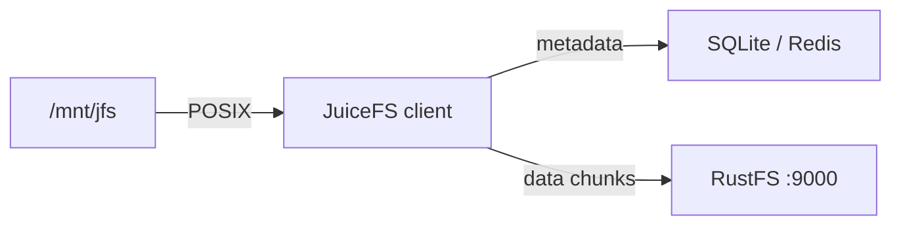

Ce guide connecte [JuiceFS](https://github.com/juicedata/juicefs) — le système de fichiers POSIX distribué cloud native — à **RustFS** comme backend de stockage objet. Vous allez formater un volume dont les chunks de données résident dans un compartiment (bucket) RustFS, le monter localement, puis lire et écrire des fichiers via le point de montage. Le flux a été validé avec `juicefs v1.3.1` (édition communautaire, moteur de métadonnées SQLite) et `rustfs/rustfs-x86-musl:v2.3.1`.

Vous avez besoin du binaire JuiceFS, d’un moteur de métadonnées et de FUSE (`fuse3` sous Linux). Ce déploiement est destiné aux tests d’intégration locaux, pas à la production.

## Schéma d’architecture



JuiceFS découpe chaque fichier en chunks et les stocke comme objets sous `chunks/` dans le compartiment, tandis que le moteur de métadonnées suit les noms, les inodes et la disposition. Le système de fichiers se comporte comme un disque local, mais ne conserve aucune donnée localement.

## 1. Formater le volume

Créez le compartiment et formatez un volume JuiceFS adossé à RustFS, en remplaçant toutes les valeurs indicatives de connexion. L’URL du compartiment porte le point de terminaison, ce qui sélectionne l’adressage de type chemin (path-style) :

```bash
rc mb rustfs/jfs-demo

juicefs format \
  --storage s3 \
  --bucket http://<your-rustfs-endpoint>:9000/jfs-demo \
  --access-key <your-access-key> \
  --secret-key <your-secret-key> \
  sqlite3:///opt/juicefs/jfs.db \
  rustfs-jfs
```

```text
Data use s3://<your-rustfs-endpoint>:9000/jfs-demo/rustfs-jfs/
<STATUS> OK, rustfs-jfs is ready
```

`sqlite3:///opt/juicefs/jfs.db` est le moteur de métadonnées de ce test. En production, utilisez plutôt Redis, MySQL ou PostgreSQL, afin que plusieurs clients puissent monter le même volume.

## 2. Monter le volume

Montez le système de fichiers avec la même URL de métadonnées :

```bash
mkdir -p /mnt/jfs
juicefs mount -d sqlite3:///opt/juicefs/jfs.db /mnt/jfs
```

```text
OK, rustfs-jfs is ready at /mnt/jfs
```

L’option `-d` exécute le montage en arrière-plan. Le volume est désormais un système de fichiers POSIX.

## 3. Lire et écrire des fichiers

Utilisez le point de montage comme n’importe quel autre répertoire :

```bash
echo "hello rustfs jfs" > /mnt/jfs/hello.txt
dd if=/dev/urandom of=/mnt/jfs/blob.bin bs=1M count=3
mkdir -p /mnt/jfs/dir1 && echo nested > /mnt/jfs/dir1/nested.txt
cat /mnt/jfs/hello.txt
```

```text
hello rustfs jfs
```

Inspectez le volume avec `juicefs info` :

```text
/mnt/jfs :
  inode: 1
  files: 2
   dirs: 2
 length: 3.00 MiB
```

## 4. Vérifier les chunks dans RustFS

Listez les préfixes du compartiment :

```bash
rc ls rustfs/jfs-demo/ -r
```

Chaque fichier a été découpé en objets chunk adressés par leur contenu :

```text
rustfs-jfs/chunks/0/0/1_0_17
rustfs-jfs/chunks/0/0/3_0_3145728
rustfs-jfs/chunks/0/0/4_0_7
```

Le nom du chunk encode l’inode, l’index du chunk et la taille — par exemple, `3_0_3145728` est le fichier de 3 MiB écrit à l’étape 3.


## 5. Arrêter ou réinitialiser

Démontez le volume, puis effacez si besoin les métadonnées du volume et les données du compartiment :

```bash
juicefs umount /mnt/jfs
juicefs destroy --force sqlite3:///opt/juicefs/jfs.db rustfs-jfs
rc rm rustfs/jfs-demo/ --recursive --force
```

## Dépannage

### `unknown option: --daemon`

L’option d’arrière-plan prend un seul tiret : `juicefs mount -d`. Sans elle, le montage reste au premier plan (utile pour le débogage).

### `fusermount3: mount failed: Permission denied`

Le montage exige le périphérique FUSE. Dans un conteneur, ajoutez `--device /dev/fuse --cap-add SYS_ADMIN` (ou `--privileged`) ; sur un hôte, installez `fuse3` et vérifiez que `/dev/fuse` existe.

### Le montage reste bloqué ou n’atteint pas le stockage

Le client doit joindre à la fois le moteur de métadonnées et le point de terminaison du compartiment. Comme l’URL du compartiment contient le point de terminaison, vérifiez-la depuis l’hôte de montage avec `curl` avant le formatage.

## Étapes suivantes

- Consultez les [notes de compatibilité S3](/fr/administration/protocols/s3) avant d’adopter d’autres backends de stockage JuiceFS.
- Créez des identifiants de production dédiés avec la [gestion des clés d’accès](/fr/security-compliance/iam/access-token).
- Suivez la [documentation JuiceFS](https://juicefs.com/docs/community/quick_start_guide/) pour passer le moteur de métadonnées à Redis et monter le volume depuis plusieurs clients.
