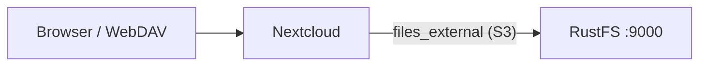
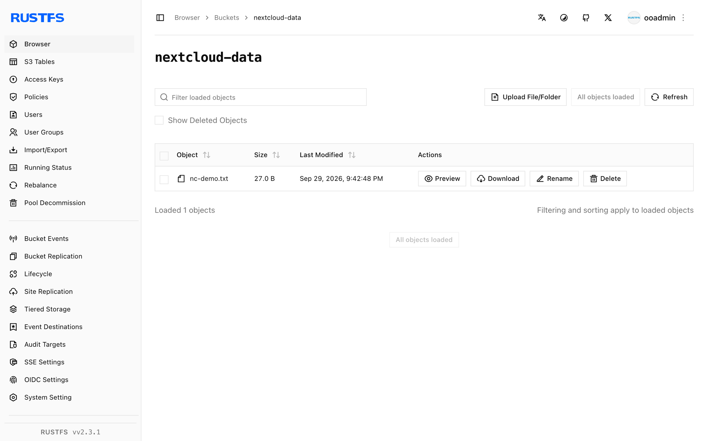

Ce guide connecte [Nextcloud](https://github.com/nextcloud/server) — la plateforme auto-hébergée de collaboration sur le contenu — à **RustFS** via son application External Storage et le backend S3. Vous allez activer `files_external`, monter un compartiment (bucket) RustFS dans la vue des fichiers de chaque utilisateur, puis charger (upload) un fichier via WebDAV qui arrive directement dans le compartiment. Le flux a été validé avec `nextcloud:32.0.15` (SQLite, conteneur unique) et `rustfs/rustfs-x86-musl:v2.3.1`.

Vous avez besoin de Docker, ou d’une instance Nextcloud existante avec un accès à `occ`. Ce déploiement est destiné aux tests d’intégration locaux, pas à la production.

## Schéma d’architecture



Nextcloud relaie les opérations sur les fichiers du point de montage vers le backend S3. Les objets sont stockés sous leurs chemins relatifs au montage, de sorte que le compartiment reflète les noms vus par les utilisateurs.

## 1. Installer Nextcloud

Exécutez Nextcloud avec un compte administrateur, en remplaçant toutes les valeurs indicatives de connexion. SQLite rend le test autonome ; en production, utilisez MariaDB ou PostgreSQL :

```bash
docker run -d --name nextcloud --network oo-rustfs_default -p 8080:80 \
  -e NEXTCLOUD_ADMIN_USER=<admin-user> \
  -e NEXTCLOUD_ADMIN_PASSWORD=<admin-password> \
  nextcloud:32.0.15
```

Si l’interface web affiche encore l’installateur après le démarrage, terminez l’installation manuellement :

```bash
docker exec -u www-data nextcloud php occ maintenance:install \
  --admin-user <admin-user> --admin-password <admin-password>
```

## 2. Activer l’application External Storage

L’application `files_external` est livrée avec Nextcloud, mais elle démarre désactivée, et ses commandes `occ` n’existent qu’une fois l’application activée :

```bash
docker exec -u www-data nextcloud php occ app:enable files_external
```

```text
files_external 1.24.1 enabled
```

## 3. Monter le compartiment RustFS

Créez un stockage externe de type de backend `amazons3`, avec le backend d’authentification `amazons3::accesskey`. Remplacez toutes les valeurs indicatives de connexion :

```bash
docker exec -u www-data nextcloud php occ files_external:create \
  /rustfs amazons3 amazons3::accesskey \
  --user <admin-user> \
  --config bucket=<your-bucket> \
  --config hostname=<your-rustfs-endpoint> \
  --config port=9000 \
  --config use_ssl=false \
  --config use_path_style=true \
  --config key=<your-access-key> \
  --config secret=<your-secret-key>
```

```text
Storage created with id 1
```

Le point de montage `/rustfs` apparaît dans la vue des fichiers de l’utilisateur indiqué. `use_path_style=true` est obligatoire pour un point de terminaison autre qu’AWS. Vérifiez la connexion avant de l’utiliser :

```bash
docker exec -u www-data nextcloud php occ files_external:verify 1
```

```text
  - status: ok
  - code: 0
```

## 4. Charger un fichier et vérifier

Chargez le fichier via le point de terminaison WebDAV, qui écrit à travers le stockage externe :

```bash
echo "nextcloud writes to rustfs" > /tmp/nc-demo.txt

curl -u <admin-user>:<admin-password> \
  -T /tmp/nc-demo.txt \
  http://localhost:8080/remote.php/dav/files/<admin-user>/rustfs/nc-demo.txt \
  -o /dev/null -w "%{http_code}\n"
```

```text
201
```

Relisez-le par le même chemin, puis confirmez l’objet dans RustFS :

```bash
rc ls rustfs/<your-bucket>/ -r
```

```text
[2026-09-29 13:42:48]       27 B nc-demo.txt
```

La clé d’objet correspond au chemin à l’intérieur du montage, de sorte que les fichiers chargés via Nextcloud peuvent aussi être lus directement avec n’importe quel client S3.



## 5. Arrêter ou réinitialiser

Pour supprimer le montage sans toucher au compartiment :

```bash
docker exec -u www-data nextcloud php occ files_external:delete 1
```

Pour supprimer le contenu du compartiment :

```bash
rc rm rustfs/<your-bucket>/ --recursive --force
```

## Dépannage

### `There are no commands defined in the "files_external" namespace`

L’application n’est pas encore activée. Exécutez d’abord `occ app:enable files_external` ; les commandes `occ files_external:*` ne s’enregistrent qu’ensuite.

### `Not enough arguments (missing: "authentication_backend")`

`files_external:create` prend le backend de stockage et le backend d’authentification comme deux arguments distincts : `amazons3 amazons3::accesskey`. Les identifiants de backend sont listés par `occ files_external:backends`.

### Le montage s’affiche, mais reste vide, ou les chargements échouent

Vérifiez que `hostname` est joignable depuis le conteneur Nextcloud (utilisez le nom sur le réseau de conteneurs, et non `localhost`), que `use_path_style` vaut `true` et que le compartiment existe. `occ files_external:verify <id>` indique l’erreur de connexion exacte.

## Étapes suivantes

- Consultez les [notes de compatibilité S3](/fr/administration/protocols/s3) avant d’adopter d’autres backends de stockage externe.
- Créez des identifiants de production dédiés avec la [gestion des clés d’accès](/fr/security-compliance/iam/access-token).
- Suivez la [documentation du stockage externe Nextcloud](https://docs.nextcloud.com/server/latest/admin_manual/configuration_files/external_storage_configuration_gui.html) pour partager le montage avec des groupes et activer la gestion des versions.
