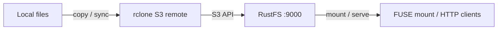

Ce guide connecte [rclone](https://github.com/rclone/rclone) — l’outil en ligne de commande qui synchronise des fichiers vers et depuis le stockage cloud — à **RustFS** via son backend S3. Vous allez configurer un remote S3 pour RustFS, copier et synchroniser des fichiers, relire des objets, publier un compartiment en HTTP avec `rclone serve`, puis monter le compartiment comme système de fichiers local avec `rclone mount`. Le flux a été validé avec `rclone v1.75.1` et `rustfs/rustfs-x86-musl:v2.3.1`.

Vous avez besoin de Docker, ou d’un binaire rclone local. Ce déploiement est destiné aux tests d’intégration locaux, pas à la production.

## Schéma d’architecture



Une seule définition de remote pilote toutes les commandes rclone : le transfert de données, le montage et le service utilisent la même connexion S3.

## 1. Configurer le remote

Créez un fichier de configuration rclone avec un remote S3 pour RustFS, en remplaçant toutes les valeurs indicatives de connexion. Le fournisseur `Other` désactive les comportements propres à AWS, et l’adressage de type chemin (path-style) est utilisé automatiquement pour les points de terminaison personnalisés :

```ini title="rclone.conf"
[rustfs]
type = s3
provider = Other
access_key_id = <your-access-key>
secret_access_key = <your-secret-key>
endpoint = http://<your-rustfs-endpoint>:9000
region = us-east-1
```

## 2. Copier et lire des objets

Créez le compartiment et chargez (upload) un répertoire avec `rclone copy` :

```bash
rc mb rustfs/rclone-demo
rclone copy /data rustfs:rclone-demo/seed
```

Listez, puis relisez :

```bash
rclone ls rustfs:rclone-demo/seed
rclone cat rustfs:rclone-demo/seed/hello.txt
```

```text
  3145728 blob.bin
       18 hello.txt
hello from rclone
```

`rclone lsd rustfs:` liste tous les compartiments du point de terminaison.

## 3. Synchroniser un répertoire

`rclone sync` rend la destination identique à la source, y compris les suppressions. Supprimez un fichier local, puis synchronisez :

```bash
rm /data/hello.txt
rclone sync /data rustfs:rclone-demo/seed
rclone lsf rustfs:rclone-demo/seed
```

```text
blob.bin
```

`hello.txt` disparaît du compartiment. Ajoutez d’abord `--dry-run` pour prévisualiser les modifications sans toucher au compartiment.

## 4. Servir un compartiment en HTTP

Publiez le contenu du compartiment comme serveur de fichiers HTTP :

```bash
rclone serve http --addr 0.0.0.0:8080 rustfs:rclone-demo/seed
```

N’importe quel client HTTP peut alors télécharger les objets :

```bash
curl -s http://localhost:8080/blob.bin -o /dev/null -w "%{http_code} %{size_download} bytes\n"
```

```text
200 3145728 bytes
```

`rclone serve` prend aussi en charge les points de terminaison WebDAV, SFTP et S3 sur le même remote.

## 5. Monter le compartiment comme système de fichiers

Lorsque FUSE est disponible, montez le compartiment localement et utilisez-le comme un répertoire :

```bash
rclone mount rustfs:rclone-demo /mnt/rclone --daemon
ls /mnt/rclone/seed
echo test > /mnt/rclone/write-test.txt
cat /mnt/rclone/write-test.txt
```

Les fichiers écrits à travers le montage apparaissent dans RustFS comme des objets ordinaires :

```bash
rc ls rustfs/rclone-demo/ -r
```

```text
[2026-09-29 11:12:41]        5 B write-test.txt
```

Démontez avec `fusermount -u /mnt/rclone` une fois l’opération terminée.

## 6. Arrêter ou réinitialiser

rclone ne conserve aucun état côté serveur. Pour supprimer les données de la démonstration :

```bash
rclone purge rustfs:rclone-demo
```

## Dépannage

### `Access Denied` ou listages vides

Vérifiez que `endpoint` inclut le schéma et que la paire de clés correspond à une clé d’accès RustFS. La valeur `region` est exigée par le signataire S3, même si RustFS l’ignore ; conservez `us-east-1`.

### Le montage échoue avec `fusermount3: mount failed: Permission denied`

Le montage exige le périphérique FUSE et des privilèges élevés. Dans un conteneur, exécutez avec `--device /dev/fuse --cap-add SYS_ADMIN` — et utilisez `--privileged` si l’assistant de montage échoue encore. Sur un hôte, vérifiez que `fuse3` est installé et que `/dev/fuse` existe.

### La synchronisation n’a rien supprimé sur la destination

`rclone copy` ne supprime jamais rien. Seuls `rclone sync` (ou `rclone delete`) suppriment des objets sur la destination, et `--dry-run` est le moyen sûr de prévisualiser l’une ou l’autre commande.

## Étapes suivantes

- Consultez les [notes de compatibilité S3](/fr/administration/protocols/s3) avant d’adopter d’autres backends rclone.
- Créez des identifiants de production dédiés avec la [gestion des clés d’accès](/fr/security-compliance/iam/access-token).
- Suivez la [documentation S3 de rclone](https://rclone.org/s3/) pour les options telles que `--transfers`, les limites de bande passante et les surcouches crypt.
