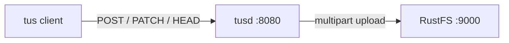
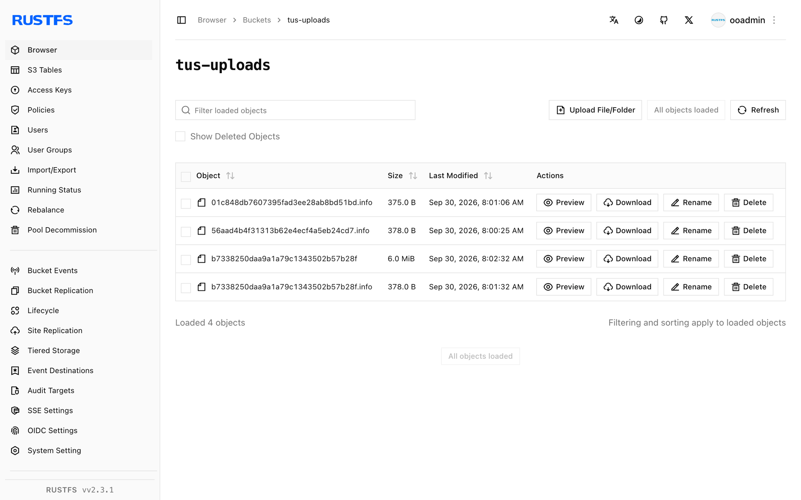

Ce guide connecte [tusd](https://github.com/tus/tusd) — l’implémentation de référence officielle du protocole de chargement reprisable tus — à **RustFS** comme backend de stockage S3. Vous allez exécuter tusd face à un compartiment (bucket) RustFS, créer un chargement (upload) avec le protocole tus, envoyer le fichier en deux fragments avec une interruption entre les deux, reprendre à partir de l’offset indiqué, puis vérifier l’objet assemblé dans le compartiment. Le flux a été validé avec `tusproject/tusd:v2.10.1` et `rustfs/rustfs-x86-musl:v2.3.1`.

Vous avez besoin de Docker, ou d’un binaire tusd local. Ce déploiement est destiné aux tests d’intégration locaux, pas à la production.

## Schéma d’architecture



tusd stocke chaque chargement en cours sous forme de parties de chargement partitionné S3 dans le compartiment. Un client qui perd sa connexion demande au serveur le dernier offset confirmé avec `HEAD`, puis reprend à partir de là — les données déjà reçues ne sont jamais envoyées deux fois.

## 1. Exécuter tusd

Créez le compartiment et démarrez tusd avec le backend S3, en remplaçant toutes les valeurs indicatives de connexion. La région AWS doit être définie, même si RustFS l’ignore :

```bash
rc mb rustfs/tus-uploads

docker run -d --name tusd --network oo-rustfs_default -p 8080:8080 \
  -e AWS_ACCESS_KEY_ID=<your-access-key> \
  -e AWS_SECRET_ACCESS_KEY=<your-secret-key> \
  -e AWS_REGION=us-east-1 \
  tusproject/tusd:latest \
  -s3-bucket tus-uploads \
  -s3-endpoint http://<your-rustfs-endpoint>:9000
```

Vérifiez que le serveur répond correctement :

```bash
curl -s -o /dev/null -w "%{http_code}\n" http://localhost:8080/health
```

```text
200
```

## 2. Créer le chargement

Créez un chargement de 6 MiB et lisez l’en-tête `Location` :

```bash
curl -s -D - -o /dev/null -X POST http://localhost:8080/files/ \
  -H "Upload-Length: 6291456" -H "Tus-Resumable: 1.0.0" \
  | grep -i "^Location:"
```

```text
Location: http://localhost:8080/files/b7338250daa9...+NGVmNDRhZjEt...
```

L’URL de chargement contient l’identifiant de fichier et une étiquette d’authentification de message. Supprimez le schéma et l’hôte avant de la renvoyer (le serveur renvoie tel quel l’en-tête `Host` qu’il a reçu, qui peut ne pas être joignable depuis le client suivant).

## 3. Charger par fragments, avec une interruption

Envoyez les premiers 2,5 MB, puis arrêtez — c’est à ce moment qu’un client mobile perdrait sa connexion :

```bash
head -c 2500000 demo.bin > part1.bin

curl -s -o /dev/null -w "%{http_code}\n" -X PATCH "http://localhost:8080${LOC}" \
  -H "Upload-Offset: 0" -H "Tus-Resumable: 1.0.0" \
  -H "Content-Type: application/offset+octet-stream" \
  --data-binary @part1.bin
```

```text
204
```

Demandez au serveur la quantité réellement reçue — c’est le cœur du chargement reprisable :

```bash
curl -s -X HEAD "http://localhost:8080${LOC}" \
  -H "Tus-Resumable: 1.0.0" -D - -o /dev/null | grep -i upload-offset
```

```text
Upload-Offset: 2500000
```

## 4. Reprendre et terminer

Reprenez à partir de l’offset 2500000 avec les octets restants :

```bash
tail -c 3791456 demo.bin > part2.bin

curl -s -o /dev/null -w "%{http_code}\n" -X PATCH "http://localhost:8080${LOC}" \
  -H "Upload-Offset: 2500000" -H "Tus-Resumable: 1.0.0" \
  -H "Content-Type: application/offset+octet-stream" \
  --data-binary @part2.bin
```

```text
204
```

Téléchargez le chargement terminé via tusd et comparez les sommes de contrôle avec la source :

```bash
curl -s -o download.bin "http://localhost:8080${LOC}"
sha1sum demo.bin download.bin
```

```text
d9016032ced6c7515b67a0c556e006c4b25a5858  demo.bin
d9016032ced6c7515b67a0c556e006c4b25a5858  download.bin
```

## 5. Vérifier les objets dans RustFS

Listez le compartiment :

```bash
rc ls rustfs/tus-uploads/ -r
```

Le compartiment contient l’objet assemblé et un fichier de métadonnées `.info` par chargement — qu’il soit en cours ou terminé :

```text
b7338250daa9a1a79c1343502b57b28f       6 MiB
b7338250daa9a1a79c1343502b57b28f.info  378 B
```

La clé d’objet est l’identifiant de chargement, et le corps de l’objet est le fichier chargé octet pour octet. N’importe quel client S3 peut donc lire les chargements terminés directement depuis le compartiment.



## 6. Arrêter ou réinitialiser

Pour arrêter le serveur tout en conservant les objets du compartiment :

```bash
docker rm -f tusd
```

Pour supprimer les chargements stockés :

```bash
rc rm rustfs/tus-uploads/ --recursive --force
```

## Dépannage

### `CreateMultipartUpload ... A region must be set when sending requests to S3`

tusd construit son client S3 à partir de l’environnement AWS, et la région est obligatoire pour la résolution du point de terminaison. Exportez `AWS_REGION=us-east-1` à côté des identifiants, comme à l’étape 1.

### `PATCH` renvoie `404` ou se connecte au mauvais hôte

L’URL `Location` renvoie l’en-tête `Host` de la requête de création. Lorsque votre client et le serveur utilisent des noms d’hôte différents (nom du conteneur et port publié), supprimez le schéma et l’hôte de l’URL et envoyez le chemin vers l’adresse que le client peut joindre.

### Le chargement disparaît après un redémarrage du serveur

Le backend S3 conserve les fichiers `.info` dans le compartiment, les chargements survivent donc aux redémarrages. Si vous exécutez tusd sur un compartiment vide qu’un autre processus purge, les métadonnées sont perdues — protégez le préfixe `tus-uploads` des tâches de nettoyage.

## Étapes suivantes

- Consultez les [notes de compatibilité S3](/fr/administration/protocols/s3) avant d’adopter d’autres backends tusd.
- Créez des identifiants de production dédiés avec la [gestion des clés d’accès](/fr/security-compliance/iam/access-token).
- Suivez la [documentation du protocole tus](https://tus.io/protocols/resumable-upload) pour la création avec chargement, la terminaison et les extensions de somme de contrôle que tusd prend en charge en plus du protocole de base.
