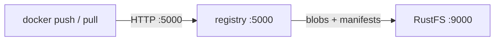

Ce guide connecte la [Docker Registry](https://github.com/distribution/distribution) open source (distribution) à **RustFS** comme backend de stockage S3. Vous allez exécuter un registre qui stocke toutes les couches et tous les manifestes dans un compartiment (bucket) RustFS, puis pousser une image et la tirer (pull). Le flux a été validé avec `registry:2` et `rustfs/rustfs-x86-musl:v2.3.1`.

Vous avez besoin de Docker sur l’hôte du registre.

## Schéma d’architecture



Le registre stocke chaque blob (couches et configurations) et chaque manifeste comme objets sous `docker/registry/v2/` dans le compartiment. Le conteneur lui-même est sans état, de sorte que les nœuds du registre peuvent être mis à l’échelle horizontalement face au même compartiment.

## 1. Exécuter le registre

Configurez entièrement le pilote S3 au moyen de variables d’environnement. `REGISTRY_STORAGE_S3_REGIONENDPOINT` oriente le SDK AWS vers RustFS :

```bash
docker run -d --name registry --network oo-rustfs_default -p 5000:5000 \
  -e REGISTRY_STORAGE=s3 \
  -e REGISTRY_STORAGE_S3_ACCESSKEY=<your-access-key> \
  -e REGISTRY_STORAGE_S3_SECRETKEY=<your-secret-key> \
  -e REGISTRY_STORAGE_S3_REGION=us-east-1 \
  -e REGISTRY_STORAGE_S3_BUCKET=registry-demo \
  -e REGISTRY_STORAGE_S3_REGIONENDPOINT=http://<your-rustfs-endpoint>:9000 \
  registry:2
```

Vérifiez que l’API v2 répond :

```bash
curl -s -o /dev/null -w "%{http_code}\n" http://localhost:5000/v2/
```

```text
200
```

## 2. Pousser une image

Étiquetez n’importe quelle image locale pour le registre, puis poussez-la :

```bash
docker pull alpine:3.20
docker tag alpine:3.20 localhost:5000/rustfs-demo/alpine:3.20
docker push localhost:5000/rustfs-demo/alpine:3.20
```

```text
3.20: digest: sha256:c64c687cbea9300178b30c95835354e34c4e4febc4badfe27102879de0483b5e
```

## 3. Vérifier les objets dans RustFS

```bash
rc ls rustfs/registry-demo/docker/registry/v2/repositories/rustfs-demo/alpine/ -r | head -4
```

```text
_repositories/rustfs-demo/alpine/_layers/sha256/25f1d6b1.../link
_repositories/rustfs-demo/alpine/_manifests/revisions/sha256/c64c687c.../link
_repositories/rustfs-demo/alpine/_manifests/tags/3.20/current/link
```

Chaque lien `_layers` pointe vers un objet blob stocké dans le même compartiment — les données de l’image elles-mêmes se trouvent dans RustFS, et non sur l’hôte du registre.


## 4. Tirer l’image

Supprimez la copie locale et tirez l’image depuis le registre — les couches reviennent depuis RustFS :

```bash
docker rmi localhost:5000/rustfs-demo/alpine:3.20
docker pull localhost:5000/rustfs-demo/alpine:3.20
```

```text
3.20: Pulling from rustfs-demo/alpine
Digest: sha256:c64c687cbea9300178b30c95835354e34c4e4febc4badfe27102879de0483b5e
Status: Downloaded newer image for localhost:5000/rustfs-demo/alpine:3.20
```

## 5. Arrêter ou réinitialiser

```bash
docker rm -f registry
rc rm rustfs/registry-demo/ --recursive --force
```

## Dépannage

### Le push échoue avec `unknown` ou un digest vide

Vérifiez que `REGISTRY_STORAGE_S3_REGIONENDPOINT` est défini — sans cela, le registre envoie les requêtes vers le véritable AWS. Vérifiez aussi que le compartiment existe.

### `InvalidAccessKeyId` au moment du push

La clé d’accès et la clé secrète doivent être transmises avec `REGISTRY_STORAGE_S3_ACCESSKEY` / `SECRETKEY` ; le registre ne lit pas la chaîne d’identifiants de l’environnement AWS dans ce pilote.

### La récupération renvoie `manifest unknown` après le redémarrage du registre

Les manifestes et les blobs résident dans le compartiment, un redémarrage ne peut donc pas les perdre. Vérifiez que les deux instances du registre pointent vers le même `REGISTRY_STORAGE_S3_BUCKET` et le même `REGIONENDPOINT`.

## Étapes suivantes

- Comparez avec le guide [Harbor](/fr/developer/integration/registry/harbor) lorsque vous avez besoin d’une interface, du RBAC ou de la réplication sur le même compartiment.
- Créez des identifiants de production dédiés avec la [gestion des clés d’accès](/fr/security-compliance/iam/access-token).
- Suivez la [documentation distribution](https://distribution.github.io/distribution/) pour le réglage du pilote de stockage et les configurations de cache proxy.
