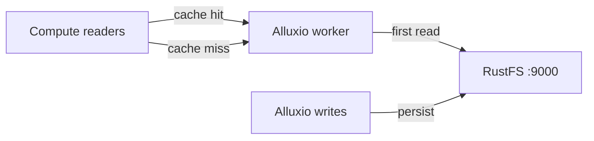

Ce guide connecte [Alluxio](https://github.com/Alluxio/alluxio) — la couche distribuée d’orchestration de données — à **RustFS** comme système de fichiers sous-jacent (under filesystem, UFS). Vous allez exécuter un cluster Alluxio autonome dans Docker, monter un compartiment RustFS, lire un objet via le cache, puis écrire un fichier dans le compartiment via Alluxio. Le flux a été validé avec Alluxio 2.9.4 et `rustfs/rustfs-x86-musl:v2.3.1`.

Vous avez besoin de Docker avec une capacité `--shm-size 2g` (le worker utilise un disque mémoire tmpfs).

## Schéma d’architecture



Les objets lus une seule fois sont mis en cache dans le disque mémoire du worker ; les lectures répétées sont servies depuis la mémoire. Les écritures effectuées via Alluxio arrivent dans le compartiment comme des objets ordinaires.

## 1. Exécuter le master et le worker

L’image autonome démarre un processus par invocation. Exécutez d’abord le master, puis le worker :

```bash
docker run -d --name alluxio-master --hostname alluxio --network oo-rustfs_default \
  -p 19998:19998 -p 19999:19999 --shm-size 2g \
  -e ALLUXIO_JAVA_OPTS="-Dalluxio.master.hostname=alluxio -Dalluxio.worker.ramdisk.size=1G" \
  alluxio/alluxio:2.9.4 master

docker exec alluxio /entrypoint.sh worker &
```

```text
Capacity information for all workers:
    Total Capacity: 1024.00MB
```

Si le worker s’arrête immédiatement avec `tmpfs is smaller than the configured size`, le conteneur a été démarré sans `--shm-size`.

## 2. Monter le compartiment RustFS

Les options d’identifiants doivent utiliser les noms de clés complets `alluxio.underfs.s3.*` — les clés courtes `s3a.*` ou `aws.*` sont acceptées par la CLI, mais ignorées par le client UFS :

```bash
docker exec alluxio alluxio fs mount \
  --option alluxio.underfs.s3.accessKeyId=<your-access-key> \
  --option alluxio.underfs.s3.secretKey=<your-secret-key> \
  --option alluxio.underfs.s3.endpoint=http://<your-rustfs-endpoint>:9000 \
  --option alluxio.underfs.s3.disable.dns.buckets=true \
  --option alluxio.underfs.s3.path.style.access=true \
  /rustfs s3://alluxio-demo/
```

```text
Mounted s3://alluxio-demo/ at /rustfs
```

`disable.dns.buckets` impose l’adressage de type chemin (path-style), exigé par le point de terminaison de type adresse IP.

## 3. Lire via le cache

Listez le point de montage et lisez un objet préchargé :

```bash
docker exec alluxio alluxio fs ls /rustfs
docker exec alluxio alluxio fs cat /rustfs/rustfs-test.txt
```

```text
-rw-r--r--  rustfs  rustfs   15  PERSISTED ... /rustfs/rustfs-test.txt
hello from s3fs
```

`PERSISTED` signifie que la source de vérité est dans RustFS ; le worker met les blocs en cache après la première lecture.

## 4. Écrire via Alluxio

Copiez un fichier local dans le point de montage :

```bash
echo "written via alluxio cache to rustfs" > /tmp/rt.txt
docker cp /tmp/rt.txt alluxio:/tmp/rt.txt
docker exec alluxio alluxio fs copyFromLocal /tmp/rt.txt /rustfs/alluxio-write.txt
```

```text
Copied 'file:///tmp/rt.txt' to '/rustfs/alluxio-write.txt'
```

Vérifiez l’objet dans RustFS :

```bash
rc ls rustfs/alluxio-demo/
rc cat rustfs/alluxio-demo/alluxio-write.txt
```

```text
[2026-10-07 04:07:25]       36 B alluxio-write.txt
[2026-10-07 04:01:01]       15 B rustfs-test.txt
written via alluxio cache to rustfs
```


## 5. Arrêter ou réinitialiser

```bash
docker exec alluxio alluxio fs unmount /rustfs
docker rm -f alluxio
rc rm rustfs/alluxio-demo/ --recursive --force
```

## Dépannage

### Le worker s’arrête avec `tmpfs is smaller than the configured size`

Le worker place son disque mémoire dans `/dev/shm`, que Docker limite à 64 MB par défaut. Démarrez le conteneur avec `--shm-size 2g`, ou réduisez `alluxio.worker.ramdisk.size`.

### Le montage réussit, mais `fs ls` renvoie `InvalidAccessKeyId`

Les options de montage ont utilisé des noms de clés courts (`s3a.*`, `aws.*`). Le client UFS d’Alluxio ne reconnaît que les clés complètes `alluxio.underfs.s3.*` indiquées à l’étape 2.

### `S3 client v2 does not support global bucket access`

L’adressage de type chemin est désactivé. Ajoutez `--option alluxio.underfs.s3.disable.dns.buckets=true` — le point de terminaison RustFS de type adresse IP l’exige.

## Étapes suivantes

- Consultez les [notes de compatibilité S3](/fr/administration/protocols/s3) avant d’adopter d’autres types d’UFS Alluxio.
- Créez des identifiants de production dédiés avec la [gestion des clés d’accès](/fr/security-compliance/iam/access-token).
- Suivez la [documentation Alluxio](https://docs.alluxio.io/os/user/stable/ufs/S3.html) pour les politiques de cache, les TTL et le stockage multi-niveaux sur le même compartiment.
