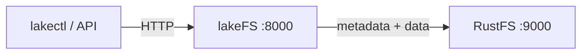
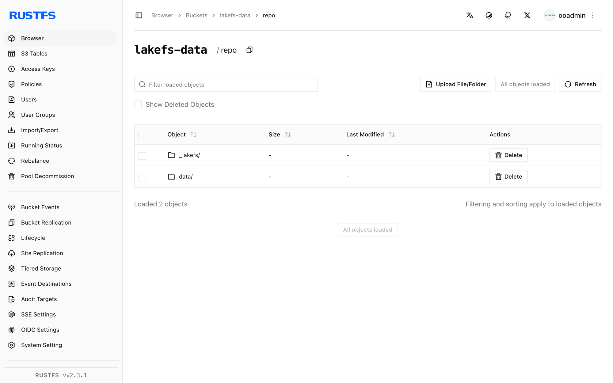

Ce guide connecte [lakeFS](https://github.com/treeverse/lakeFS) — la couche de versionnement des lacs de données, sur le modèle de Git — à **RustFS** comme magasin de blocs S3 (blockstore). Vous allez démarrer lakeFS, créer un dépôt dont l’espace de noms de stockage pointe vers un compartiment (bucket) RustFS, créer un commit pour un objet, puis vérifier que les métadonnées lakeFS et les fichiers de données résident dans RustFS. Le flux a été validé avec `treeverse/lakefs:1.58.0` et `rustfs/rustfs-x86-musl:v2.3.1`.

Vous avez besoin de Docker. Ce déploiement est destiné aux tests d’intégration locaux, pas à la production.

## Schéma d’architecture



lakeFS stocke les métadonnées du dépôt et les fichiers de données enregistrés dans un commit, dans le magasin de blocs, sous l’espace de noms de stockage. Le compartiment contient un préfixe `repo/` qui regroupe les métadonnées `_lakefs/` et les objets `data/` ; lakeFS les lit et les écrit via l’API S3.

## 1. Créer les fichiers du projet

Créez le compartiment, puis la configuration lakeFS :

```bash
rc alias set rustfs http://<your-rustfs-endpoint>:9000 <your-access-key> <your-secret-key>
rc mb rustfs/lakefs-data
```

```yaml title="config.yaml"
database:
  type: local
  local:
    path: /lakefs/data

blockstore:
  type: s3
  s3:
    endpoint: http://rustfs:9000
    region: us-east-1
    force_path_style: true

auth:
  encrypt:
    secret_key: change-me-to-a-random-string

gateways:
  s3:
    domain_name: rustfs-gateway.local

logging:
  format: text
  level: info
```

`force_path_style: true` est obligatoire — sans cette option, lakeFS construit `lakefs-data.<hostname>` comme nom d’hôte et chaque requête échoue avec une erreur DNS. Les identifiants sont fournis par les variables d’environnement standard `AWS_ACCESS_KEY_ID` et `AWS_SECRET_ACCESS_KEY`.

Créez le fichier d’environnement pour les identifiants du service et l’utilisateur administrateur initial, en remplaçant les valeurs indicatives :

```ini title=".env"
AWS_ACCESS_KEY_ID=<your-access-key>
AWS_SECRET_ACCESS_KEY=<your-secret-key>
LAKEFS_INSTALLATION_USER_NAME=admin
LAKEFS_INSTALLATION_ACCESS_KEY_ID=<your-lakefs-access-key>
LAKEFS_INSTALLATION_SECRET_ACCESS_KEY=<your-lakefs-secret-key>
LAKEFS_STATS_ENABLED=false
```

## 2. Démarrer lakeFS

```bash
docker run -d --name lakefs --network oo-rustfs_default \
  -p 8000:8000 \
  -v "$PWD/config.yaml":/etc/lakefs/config.yaml:ro \
  --env-file .env \
  treeverse/lakefs:1.58.0 run
```

Attendez que `http://localhost:8000/api/healthcheck` renvoie `200`, puis créez un dépôt dont l’espace de noms de stockage se trouve dans le compartiment :

```bash
curl -s -u <your-lakefs-access-key>:<your-lakefs-secret-key> \
  -X POST http://localhost:8000/api/v1/repositories \
  -H "Content-Type: application/json" \
  -d '{"name": "rustfs-demo", "storage_namespace": "s3://lakefs-data/repo"}'
```

## 3. Créer un commit pour un objet

Chargez un fichier (upload) sur la branche `main`, puis créez le commit :

```bash
echo "hello from lakefs on rustfs" > hello.txt

curl -s -u <your-lakefs-access-key>:<your-lakefs-secret-key> \
  -X POST "http://localhost:8000/api/v1/repositories/rustfs-demo/branches/main/objects?path=hello.txt" \
  --data-binary @hello.txt

curl -s -u <your-lakefs-access-key>:<your-lakefs-secret-key> \
  -X POST "http://localhost:8000/api/v1/repositories/rustfs-demo/branches/main/commits" \
  -H "Content-Type: application/json" \
  -d '{"message": "add hello"}'
```

Relisez l’objet via la référence de branche — le corps de la réponse est le contenu du commit :

```bash
curl -s -u <your-lakefs-access-key>:<your-lakefs-secret-key> \
  "http://localhost:8000/api/v1/repositories/rustfs-demo/refs/main/objects?path=hello.txt"
```

## 4. Vérifier les objets dans RustFS

Listez le compartiment :

```bash
rc ls rustfs/lakefs-data/ -r
```

La sortie montre les objets de métadonnées lakeFS et le fichier de données du commit, sous le préfixe du dépôt :

```text
repo/_lakefs/19b2b26e37cb20fc6763c527f88eb5151891b04a2c8c9ddd32870c5c3f353281
repo/data/fueia10jdra000e1c480/daots7ojdra000e1c490
```



## 5. Arrêter ou réinitialiser le déploiement

Arrêtez lakeFS tout en conservant les données :

```bash
docker rm -f lakefs
```

Les métadonnées et les données du dépôt restent dans le compartiment `lakefs-data`. Un redémarrage de lakeFS avec la même configuration rétablit donc le dépôt. Pour tout supprimer, supprimez le compartiment :

```bash
rc rb rustfs/lakefs-data --force
```

## Dépannage

### `failed to create repository: failed to access storage` avec une erreur DNS

lakeFS utilise l’adressage de type hôte virtuel. Définissez `force_path_style: true` sous `blockstore.s3` — dans le schéma de configuration 1.x, l’ancienne clé `path_style` est rejetée au démarrage.

### `missing required keys: [auth.encrypt.secret_key]`

lakeFS 1.x exige une clé de chiffrement pour la base de données locale. Ajoutez le bloc `auth.encrypt.secret_key`, comme dans la configuration ci-dessus.

### `mkdir /lakefs: permission denied`

Le conteneur s’exécute avec un utilisateur non root et ne peut pas créer le répertoire de la base de données. Pour les tests locaux, exécutez le conteneur avec `-u 0`, ou montez un répertoire accessible en écriture sur le chemin configuré.

## Étapes suivantes

- Consultez les [notes de compatibilité S3](/fr/administration/protocols/s3) avant d’adopter d’autres opérations lakeFS.
- Créez des identifiants de production dédiés avec la [gestion des clés d’accès](/fr/security-compliance/iam/access-token).
- Suivez la [documentation du magasin de blocs S3 de lakeFS](https://docs.lakefs.io/howto/using-s3.html) pour configurer la passerelle S3 destinée aux outils qui parlent le protocole S3.
