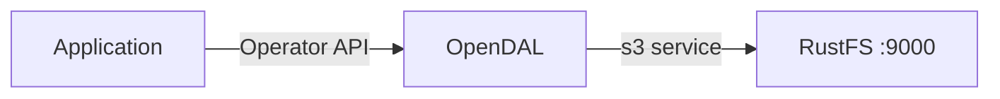

Ce guide connecte [Apache OpenDAL](https://github.com/apache/opendal) — la couche unifiée d’accès aux données — à **RustFS** via son service `s3`. Vous allez exécuter le binding Python d’OpenDAL face à RustFS, écrire un objet, le lire, lister un préfixe, puis le supprimer. Le flux a été validé avec le paquet Python `opendal` 0.46 sur `python:3.12-slim` et `rustfs/rustfs-x86-musl:v2.3.1`.

Vous avez besoin de Docker et de Python 3.9 ou ultérieur. OpenDAL prend en charge le même service `s3` depuis les bindings Rust, Java, Node.js et Go, avec des réglages équivalents.

## Schéma d’architecture



Un `Operator` OpenDAL lié au service `s3` expose une API uniforme — `write`, `read`, `stat`, `list`, `delete` — sur le compartiment (bucket). Le même code fonctionne ainsi face à S3, à RustFS ou à tout autre service pris en charge, en changeant les paramètres de connexion.

## 1. Préparer le projet

Installez le binding Python :

```bash
pip install opendal
```

Créez le script, en remplaçant toutes les valeurs indicatives de connexion :

```python title="opendal_demo.py"
import opendal

op = opendal.Operator(
    "s3",
    endpoint="http://<your-rustfs-endpoint>:9000",
    bucket="my-bucket",
    access_key_id="<your-access-key>",
    secret_access_key="<your-secret-key>",
    region="us-east-1",
)
op.write("opendal-demo/hello.txt", b"hello from opendal against rustfs")
print("read-back:", op.read("opendal-demo/hello.txt"))
print("content_length:", op.stat("opendal-demo/hello.txt").content_length)
for entry in op.list("opendal-demo/"):
    print("listed:", entry.path)
op.delete("opendal-demo/hello.txt")
print("deleted:", not op.exists("opendal-demo/hello.txt"))
```

Les noms des options d’identifiants sont `access_key_id` et `secret_access_key` — les noms plus courts `access_key` n’existent pas et provoquent une erreur de signature. L’adressage de type chemin (path-style) est le comportement par défaut pour les points de terminaison autres qu’AWS.

## 2. Exécuter la démonstration

Exécutez le script depuis une machine qui peut joindre RustFS :

```bash
python opendal_demo.py
```

```text
read-back: b"hello from opendal against rustfs"
content_length: 33
listed: opendal-demo/hello.txt
deleted: True
```

L’aller-retour couvre le cycle complet des opérations sur l’objet : l’écriture charge les octets (upload), `read` les relit, `stat` renvoie la taille de l’objet, `list` énumère le préfixe et `delete` supprime l’objet.

## 3. Vérifier les objets dans RustFS

Commentez la dernière ligne `op.delete`, exécutez de nouveau le script, puis listez le préfixe dans RustFS :

```bash
rc ls rustfs/my-bucket/opendal-demo/ -r
```

```text
hello.txt
data/rows.csv
```


Les objets visibles dans la Console RustFS sont exactement les chemins écrits par l’API OpenDAL.

## 4. Arrêter ou réinitialiser

OpenDAL est une bibliothèque et ne conserve aucun état propre. Pour supprimer les objets de la démonstration :

```bash
rc rm rustfs/my-bucket/opendal-demo/ --recursive --force
```

## Dépannage

### `failed to load signing credential`

L’opérateur n’a reçu aucun identifiant utilisable. Utilisez les noms d’options exacts `access_key_id` et `secret_access_key` ; les autres orthographes sont ignorées en silence, puis la signature échoue.

### Erreurs de connexion ou DNS à l’écriture

Vérifiez que le point de terminaison inclut le schéma et le port, et qu’il est joignable depuis l’application. À l’intérieur d’un réseau Compose, le nom d’hôte est `rustfs` ; depuis l’hôte, utilisez `http://localhost:9000`.

## Étapes suivantes

- Consultez les [notes de compatibilité S3](/fr/administration/protocols/s3) avant d’adopter d’autres opérations OpenDAL.
- Créez des identifiants de production dédiés avec la [gestion des clés d’accès](/fr/security-compliance/iam/access-token).
- Suivez la [documentation OpenDAL](https://opendal.apache.org/docs/) pour utiliser le même opérateur depuis Rust, Java ou Node.js.
