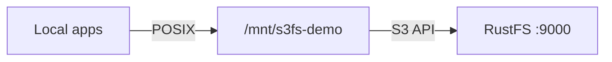
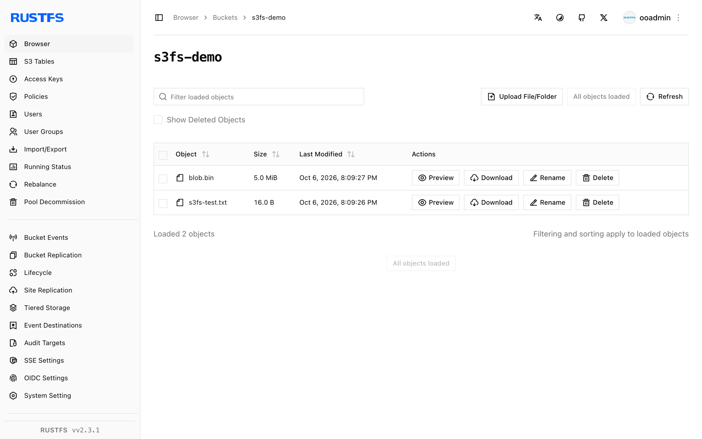

Ce guide connecte [s3fs-fuse](https://github.com/s3fs-fuse/s3fs-fuse) — le système de fichiers S3 fondé sur FUSE — à **RustFS**. Vous allez monter un compartiment comme répertoire local, écrire des fichiers via le point de montage, le démonter, puis confirmer que les objets persistent dans le compartiment. Le flux a été validé avec s3fs v1.93 et `rustfs/rustfs-x86-musl:v2.3.1` sur Ubuntu 24.04.

Vous avez besoin d’un hôte Linux avec FUSE (paquet `fuse3`) et le binaire `s3fs`.

## Schéma d’architecture



Chaque fichier créé sous le point de montage devient un objet du compartiment, dont la clé est son chemin relatif — une correspondance directe 1 pour 1, sans couche de cache.

## 1. Installer

```bash
apt-get install -y s3fs
s3fs --version
```

```text
Amazon Simple Storage Service File System V1.93 ...
```

## 2. Enregistrer les identifiants

Écrivez la clé d’accès et la clé secrète dans le fichier de mots de passe attendu par s3fs :

```bash
echo "<your-access-key>:<your-secret-key>" > ~/.passwd-s3fs
chmod 600 ~/.passwd-s3fs
```

## 3. Monter le compartiment

```bash
mkdir -p /mnt/s3fs-demo
s3fs s3fs-demo /mnt/s3fs-demo \
  -o passwd_file=~/.passwd-s3fs \
  -o url=http://<your-rustfs-endpoint>:9000 \
  -o endpoint=us-east-1 \
  -o use_path_request_style \
  -o allow_other -o umask=000
```

`use_path_request_style` sélectionne l’adressage de type chemin (path-style), celui que sert RustFS. `allow_other` permet aux utilisateurs non root de lire le montage.

## 4. Écrire et lire des fichiers

```bash
echo "hello from s3fs" > /mnt/s3fs-demo/s3fs-test.txt
dd if=/dev/urandom of=/mnt/s3fs-demo/blob.bin bs=1M count=5
cat /mnt/s3fs-demo/s3fs-test.txt
```

```text
hello from s3fs
```

## 5. Vérifier les objets et la persistance

Démontez, puis remontez — les objets persistent dans le compartiment :

```bash
fusermount -u /mnt/s3fs-demo
s3fs s3fs-demo /mnt/s3fs-demo -o passwd_file=~/.passwd-s3fs \
  -o url=http://<your-rustfs-endpoint>:9000 -o endpoint=us-east-1 \
  -o use_path_request_style
ls /mnt/s3fs-demo/
```

```text
blob.bin  s3fs-test.txt
```

Listez le compartiment pour voir les mêmes objets du côté S3 :

```bash
rc ls rustfs/s3fs-demo/
```

```text
[2026-10-06 12:09:27]      5 MiB blob.bin
[2026-10-06 12:09:26]       16 B s3fs-test.txt
```



## 6. Arrêter ou réinitialiser

```bash
fusermount -u /mnt/s3fs-demo
rc rm rustfs/s3fs-demo/ --recursive --force
```

## Dépannage

### `fuse: device not found` dans un conteneur

Passez `--device /dev/fuse --cap-add SYS_ADMIN` à `docker run`, ou `--privileged` si l’assistant de montage échoue encore.

### `Permission denied` lors de la lecture du montage par un autre utilisateur

Les montages s3fs sont privés pour l’utilisateur qui effectue le montage, par défaut. Ajoutez `-o allow_other -o umask=000` (ou un umask plus restrictif) au moment du montage.

### Le montage réussit, mais le listage est vide sur un autre client

s3fs ne partage aucun cache de métadonnées entre les montages, mais les clients et les opérations de listage sont à cohérence à terme. Remontez, ou relistez après quelques secondes.

## Étapes suivantes

- Consultez les [notes de compatibilité S3](/fr/administration/protocols/s3) avant d’adopter d’autres options FUSE.
- Créez des identifiants de production dédiés avec la [gestion des clés d’accès](/fr/security-compliance/iam/access-token).
- Suivez la [documentation s3fs-fuse](https://github.com/s3fs-fuse/s3fs-fuse/wiki/Fuse-Over-https) pour les options de réglage des performances, telles que `-o multipart` et `-o parallel_count`.
