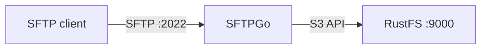

Ce guide connecte [SFTPGo](https://github.com/drakkan/sftpgo) — le serveur SFTP, WebDAV et FTP complet — à **RustFS** comme backend S3 par utilisateur. Vous allez créer un utilisateur SFTP dont le répertoire personnel est un préfixe de compartiment RustFS, charger (upload) des fichiers en SFTP, puis vérifier les objets dans le compartiment. Le flux a été validé avec SFTPGo 2.7.6 et `rustfs/rustfs-x86-musl:v2.3.1`.

Vous avez besoin de Docker et d’un client SFTP (`sftp` est fourni avec OpenSSH).

## Schéma d’architecture



SFTPGo projette les chemins virtuels de l’utilisateur sur des préfixes de compartiment. Les fichiers chargés en SFTP deviennent des objets sous le `key_prefix` configuré — rien n’est stocké sur l’hôte SFTPGo lui-même.

## 1. Exécuter SFTPGo

```bash
docker run -d --name sftpgo --hostname sftpgo --network oo-rustfs_default \
  -p 2022:2022 -p 8080:8080 \
  -e SFTPGO_COMMON__TEMP_PATH=/tmp \
  drakkan/sftpgo:latest
```

`SFTPGO_COMMON__TEMP_PATH` est important : pour les backends S3, SFTPGo fait transiter les chargements par un fichier tube local, et le chemin temporaire par défaut peut ne pas exister ou ne pas être accessible en écriture.

## 2. Créer l’utilisateur administrateur

L’image ne crée pas l’administrateur automatiquement. Ouvrez une fois `http://localhost:8080/web/admin/setup` et envoyez le formulaire, ou pilotez-le avec curl :

```bash
FORM=$(curl -s -c /tmp/sg-cookie.txt http://localhost:8080/web/admin/setup)
FT=$(echo "$FORM" | grep -oE "name=\"_form_token\" value=\"[^\"]+\"" | sed "s/.*value=\"//;s/\"//")
curl -s -b /tmp/sg-cookie.txt -X POST http://localhost:8080/web/admin/setup \
  --data-urlencode "username=admin" \
  --data-urlencode "password=<admin-password>" \
  --data-urlencode "confirm_password=<admin-password>" \
  --data-urlencode "_form_token=$FT" \
  -o /dev/null -w "setup: %{http_code}\n"
```

```text
setup: 302
```

## 3. Créer un utilisateur adossé à S3

Obtenez un jeton d’API et créez l’utilisateur. Trois détails comptent : `home_dir` doit être un répertoire existant et accessible en écriture dans le conteneur (`/tmp` convient), `force_path_style` doit valoir `true` pour RustFS, et `access_secret` est un objet KMS — passez le secret dans `{"status": "Plain", "payload": ...}` :

```json title="sftpgo-user.json"
{
  "username": "demo",
  "password": "<user-password>",
  "home_dir": "/tmp",
  "status": 1,
  "permissions": { "/": ["*"] },
  "filesystem": {
    "provider": 1,
    "s3config": {
      "bucket": "sftpgo-demo",
      "region": "us-east-1",
      "access_key": "<your-access-key>",
      "access_secret": { "status": "Plain", "payload": "<your-secret-key>" },
      "endpoint": "http://<your-rustfs-endpoint>:9000",
      "key_prefix": "home/demo/",
      "force_path_style": true
    }
  }
}
```

```bash
TOKEN=$(curl -s "http://localhost:8080/api/v2/token" -u "admin:<admin-password>" \
  | python3 -c "import json,sys; print(json.load(sys.stdin)['access_token'])")
curl -s -X POST http://localhost:8080/api/v2/users \
  -H "Authorization: Bearer $TOKEN" -H "Content-Type: application/json" \
  --data-binary @sftpgo-user.json -o /dev/null -w "create-user: %{http_code}\n"
```

```text
create-user: 201
```

## 4. Charger et lire des fichiers en SFTP

```bash
printf "uploaded via sftpgo to rustfs\n" > /tmp/sftp-test.txt
printf "up1\n" > /tmp/sftp-batch.txt
echo "put /tmp/sftp-test.txt" >> /tmp/sftp-batch.txt
echo "ls" >> /tmp/sftp-batch.txt

sshpass -p <user-password> sftp \
  -o StrictHostKeyChecking=no -o UserKnownHostsFile=/dev/null -P 2022 \
  demo@localhost < /tmp/sftp-batch.txt
```

```text
sftp> put /tmp/sftp-test.txt
Uploading /tmp/sftp-test.txt to /sftp-test.txt
sftp> ls
sftp-big.bin    sftp-test.txt
```

## 5. Vérifier les objets dans RustFS

```bash
rc ls rustfs/sftpgo-demo/home/demo/ -r
rc cat rustfs/sftpgo-demo/home/demo/sftp-test.txt
```

```text
[2026-10-06 12:28:02]      4 MiB home/demo/sftp-big.bin
[2026-10-06 12:28:02]       30 B home/demo/sftp-test.txt
uploaded via sftpgo to rustfs
```

La clé d’objet est le chemin virtuel de l’utilisateur sous `key_prefix` — une correspondance directe.


## 6. Arrêter ou réinitialiser

```bash
docker rm -f sftpgo
rc rm rustfs/sftpgo-demo/ --recursive --force
```

## Dépannage

### `create resource error` / `InvalidAccessKeyId` au chargement

Vérifiez trois points, dans l’ordre : `force_path_style` doit valoir `true` (le SDK AWS de SFTPGo utilise par défaut l’adressage de type hôte virtuel, qui ne fonctionne pas avec les points de terminaison IP), `access_secret` doit utiliser la forme d’objet KMS, et `home_dir` doit pointer vers un répertoire accessible en écriture (SFTPGo y fait transiter les chargements S3).

### `unknown command init` / connexion administrateur refusée

Le compte administrateur n’existe qu’après l’envoi unique du formulaire de configuration web. Reprenez l’étape 2 ; ne réutilisez pas un ancien fichier de cookies du navigateur.

### L’API renvoie `405 Method Not allowed` pour le jeton

Le point de terminaison du jeton n’accepte que `GET` avec une authentification de base : `GET /api/v2/token`.

## Étapes suivantes

- Consultez les [notes de compatibilité S3](/fr/administration/protocols/s3) avant d’adopter d’autres backends SFTPGo.
- Créez des identifiants de production dédiés avec la [gestion des clés d’accès](/fr/security-compliance/iam/access-token).
- Suivez la [documentation SFTPGo](https://github.com/drakkan/sftpgo/blob/main/README.md) pour ajouter des écouteurs WebDAV et FTP, des quotas par utilisateur et une authentification à deux facteurs sur le même compartiment.
