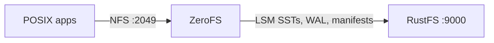

Ce guide connecte [ZeroFS](https://github.com/Barre/ZeroFS) — le système de fichiers structuré en journal qui sert les compartiments S3 comme systèmes de fichiers POSIX — à **RustFS** comme backend de stockage objet. Vous allez exécuter ZeroFS avec son arbre LSM enraciné dans un compartiment RustFS, monter le système de fichiers via NFS sur un hôte Linux, écrire des fichiers via le point de montage, puis vérifier qu’ils survivent à un redémarrage de ZeroFS sous forme d’objets dans le compartiment. Le flux a été validé avec ZeroFS v2.3.5 (ghcr.io/barre/zerofs) et `rustfs/rustfs-x86-musl:v2.3.1`.

Vous avez besoin de Docker et d’un hôte Linux doté d’un client NFS (`nfs-common`). Ce déploiement est destiné aux tests d’intégration locaux, pas à la production.

## Schéma d’architecture



ZeroFS traduit les opérations du système de fichiers en un arbre clé-valeur LSM stocké dans le compartiment : les écritures arrivent dans un journal d’écriture anticipée, sont vidées dans des segments SST, et la compaction s’exécute en arrière-plan. Les clients voient une arborescence de répertoires ordinaire via NFS (ou 9P/NBD).

## 1. Générer la configuration

Créez le compartiment et le fichier de configuration, en remplaçant toutes les valeurs indicatives de connexion :

```bash
rc mb rustfs/zerofs-demo

docker run --rm -u root:root -v /opt/zerofs:/cfg -w /cfg \
  --entrypoint /bin/sh ghcr.io/barre/zerofs:latest -c "zerofs init"
```

Modifiez ensuite `zerofs.toml` pour que les sections storage et AWS pointent vers RustFS :

```toml title="zerofs.toml"
[cache]
dir = "/cache"
disk_size_gb = 5.0

[storage]
url = "s3://zerofs-demo/zerofs-data"
encryption_password = "${ZEROFS_PASSWORD}"

[servers.nfs]
addresses = ["0.0.0.0:2049"]

[servers.rpc]
addresses = ["0.0.0.0:7000"]

[aws]
access_key_id = "${AWS_ACCESS_KEY_ID}"
secret_access_key = "${AWS_SECRET_ACCESS_KEY}"
endpoint = "http://<your-rustfs-endpoint>:9000"
default_region = "us-east-1"
allow_http = "true"
```

C’est le couple `endpoint` et `allow_http` qui redirige ZeroFS d’AWS vers RustFS. Les points de terminaison personnalisés utilisent l’adressage de type chemin (path-style) ; aucune option supplémentaire n’est donc nécessaire.

## 2. Exécuter ZeroFS

Exécutez le serveur avec le fichier de configuration, les identifiants et un répertoire de cache accessible en écriture (l’image s’exécute sous l’UID 1001) :

```bash
mkdir -p /opt/zerofs/cache && chown -R 1001:1001 /opt/zerofs/cache

docker run -d --name zerofs --network oo-rustfs_default -p 2049:2049 \
  -e ZEROFS_PASSWORD=<encryption-password> \
  -e AWS_ACCESS_KEY_ID=<your-access-key> \
  -e AWS_SECRET_ACCESS_KEY=<your-secret-key> \
  -v /opt/zerofs/zerofs.toml:/zerofs.toml:ro \
  -v /opt/zerofs/cache:/cache \
  ghcr.io/barre/zerofs:latest run -c /zerofs.toml
```

```text
INFO zerofs::nfs: NFS server listening on 0.0.0.0:2049
```

## 3. Monter via NFS

Sur l’hôte, montez l’export avec les options recommandées par ZeroFS :

```bash
apt-get install -y nfs-common
mkdir -p /mnt/zerofs

mount -t nfs -o async,nolock,rsize=1048576,wsize=1048576,tcp,port=2049,mountport=2049,hard \
  127.0.0.1:/ /mnt/zerofs
```

Le montage est un système de fichiers POSIX ordinaire :

```bash
echo "written via zerofs nfs mount on rustfs" > /mnt/zerofs/hello.txt
dd if=/dev/urandom of=/mnt/zerofs/data/inner/blob.bin bs=1M count=8
```

## 4. Vérifier la persistance et les objets dans RustFS

Forcez l’envoi des écritures en attente vers le compartiment, puis redémarrez ZeroFS et remontez :

```bash
docker exec zerofs zerofs flush -c /zerofs.toml
umount /mnt/zerofs
docker restart zerofs
mount -t nfs -o async,nolock,rsize=1048576,wsize=1048576,tcp,port=2049,mountport=2049,hard \
  127.0.0.1:/ /mnt/zerofs
```

Tout ce qui a été écrit avant le redémarrage est encore présent :

```bash
cat /mnt/zerofs/hello.txt
sha1sum /mnt/zerofs/data/inner/blob.bin
```

```text
written via zerofs nfs mount on rustfs
645faaefe499f9ebda8edceeeb1a6261999aece7  /mnt/zerofs/data/inner/blob.bin
```

Listez le compartiment pour voir où les fichiers résident réellement :

```bash
rc ls rustfs/zerofs-demo/ -r | head -4
```

```text
zerofs-data/compacted/01M40Q1RA0X3AVG76VC0SBYE58.sst
zerofs-data/manifest/0000000000000000.json
zerofs-data/wal/00000000000000000001.sst
```

Les fichiers ne sont pas stockés selon une correspondance 1 pour 1 — ce sont des clés et des valeurs dans l’arbre LSM, ce qui permet à ZeroFS de servir un compartiment comme système de fichiers.


## 5. Arrêter ou réinitialiser

Pour arrêter la démonstration tout en conservant les objets du compartiment :

```bash
umount /mnt/zerofs
docker rm -f zerofs
```

Pour supprimer les données stockées (cela efface le système de fichiers lui-même) :

```bash
rc rm rustfs/zerofs-demo/ --recursive --force
```

## Dépannage

### `Failed to parse config file: missing field uid` dans `[servers.webui]`

ZeroFS v2.3.5 exige `uid` et `gid` dans la section `[servers.webui]` lorsqu’elle est présente. Ajoutez `uid = 1000` et `gid = 1000`, ou supprimez entièrement la section si vous n’avez pas besoin de l’interface web.

### `Permission denied` à la création du répertoire de cache

Le conteneur s’exécute sous l’UID 1001. Après avoir monté le volume de cache, exécutez `chown -R 1001:1001 <cache-dir>` avant de démarrer le conteneur.

### Le montage échoue ou reste bloqué

Vérifiez que le paquet client NFS est installé (`nfs-common`) et que ZeroFS écoute sur `0.0.0.0:2049` dans un réseau que votre client peut joindre. Les options `port=2049,mountport=2049` comptent, car ZeroFS sert le trafic mountd sur le même port.

### Les écritures disparaissent après un plantage du conteneur

ZeroFS met les écritures en mémoire tampon et les vide périodiquement. Pour la démonstration, exécutez `docker exec zerofs zerofs flush -c /zerofs.toml` ; en production, les clients qui exigent une durabilité stricte devraient appeler fsync (ou utiliser le montage 9P, dont le fsync attend un stockage stable).

## Étapes suivantes

- Consultez les [notes de compatibilité S3](/fr/administration/protocols/s3) avant d’adopter d’autres backends ZeroFS.
- Créez des identifiants de production dédiés avec la [gestion des clés d’accès](/fr/security-compliance/iam/access-token).
- Suivez le [guide de configuration ZeroFS](https://www.zerofs.net/configuration) pour le dimensionnement du cache, le service 9P/NBD et la réplication à haute disponibilité sur le même compartiment.
