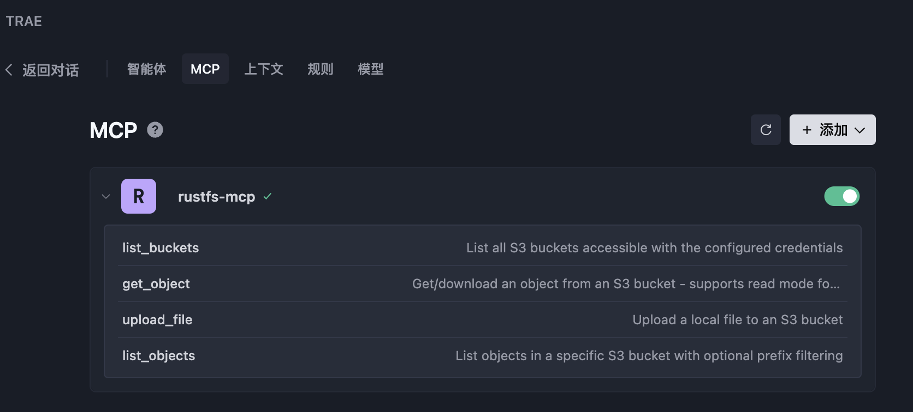

Le **RustFS MCP Server** est un serveur [Model Context Protocol (MCP)](https://www.anthropic.com/news/model-context-protocol) qui donne aux assistants d’IA, tels que Claude Desktop, un accès à un stockage objet compatible avec S3.

### Qu’est-ce que MCP ?

Le Model Context Protocol est une norme ouverte qui permet aux applications d’IA d’établir des connexions sécurisées et contrôlées avec des systèmes externes. Ce serveur fait le lien entre les outils d’IA et les services de stockage compatibles avec S3 : il offre un accès structuré aux opérations sur les fichiers, tout en conservant la sécurité et l’observabilité.

## Fonctionnalités

### Opérations S3 prises en charge

- **Lister les compartiments** : liste tous les compartiments (buckets) S3 accessibles.
- **Lister les objets** : parcourt le contenu d’un compartiment, avec un filtrage facultatif par préfixe.
- **Charger des fichiers** : charge (upload) des fichiers locaux, avec détection automatique du type MIME et contrôle de cache.
- **Obtenir des objets** : récupère des objets du stockage S3, en lecture ou en téléchargement.

## Installation

:::warning[Les instructions de compilation peuvent être obsolètes]

La crate `rustfs-mcp` ne fait plus partie de la branche principale actuelle de `rustfs/rustfs`. Les commandes de compilation ci-dessous peuvent donc échouer sur un clone récent. Consultez l’[organisation GitHub RustFS](https://github.com/rustfs) pour connaître l’emplacement actuel du serveur MCP avant de compiler depuis les sources.

:::

### Prérequis

- Rust 1.75+ (pour une compilation depuis les sources)
- Identifiants AWS configurés (via des variables d’environnement, l’AWS CLI ou des rôles IAM)
- Accès à des services de stockage compatibles avec S3

### Compilation depuis les sources

```bash
# Clone the repository
git clone https://github.com/rustfs/rustfs.git
cd rustfs

# Build the MCP server
cargo build --release -p rustfs-mcp

# Binary will be available at
./target/release/rustfs-mcp
```

## Configuration

### Variables d’environnement

```bash
# AWS credentials (required)
export AWS_ACCESS_KEY_ID=your_access_key
export AWS_SECRET_ACCESS_KEY=your_secret_key
export AWS_REGION=us-east-1  # optional, defaults to us-east-1

# Optional: Custom S3 endpoint (for MinIO, etc.)
export AWS_ENDPOINT_URL=http://localhost:9000

# Log level (optional)
export RUST_LOG=info
```

### Options de ligne de commande

```bash
rustfs-mcp --help
```

Le serveur propose plusieurs options de ligne de commande pour adapter son comportement :

- `--access-key-id` : ID de clé d’accès AWS pour l’authentification S3
- `--secret-access-key` : clé secrète AWS pour l’authentification S3
- `--region` : région AWS pour les opérations S3 (valeur par défaut : us-east-1)
- `--endpoint-url` : URL de point de terminaison S3 personnalisée (pour MinIO, LocalStack, etc.)
- `--log-level` : niveau de journalisation (valeur par défaut : rustfs_mcp_server=info)

## Utilisation

### Démarrage du serveur

```bash
# Start the MCP server
rustfs-mcp

# Or with custom options
rustfs-mcp --log-level debug --region us-east-1
```

### Intégration avec les clients de discussion

#### Option 1 : arguments de ligne de commande

```json
{
  "mcpServers": {
    "rustfs-mcp": {
      "command": "/path/to/rustfs-mcp",
      "args": [
        "--access-key-id", "your_access_key",
        "--secret-access-key", "your_secret_key",
        "--region", "us-east-1",
        "--log-level", "info"
      ]
    }
  }
}
```

#### Option 2 : variables d’environnement

```json
{
  "mcpServers": {
    "rustfs-mcp": {
      "command": "/path/to/rustfs-mcp",
      "env": {
        "AWS_ACCESS_KEY_ID": "your_access_key",
        "AWS_SECRET_ACCESS_KEY": "your_secret_key",
        "AWS_REGION": "us-east-1"
      }
    }
  }
}
```

### Utilisation avec Docker

RustFS MCP fournit un [Dockerfile officiel](https://github.com/rustfs/rustfs/tree/main/crates/mcp) que vous pouvez utiliser pour construire une image de conteneur.

```bash
# Clone RustFS repository code
git clone https://github.com/rustfs/rustfs.git

# Build Docker image
docker build -f crates/mcp/Dockerfile -t rustfs/rustfs-mcp .
```

Une fois la construction réussie, ajoutez le serveur à la configuration MCP de votre IDE.

#### Configuration de MCP dans les IDE d’IA

De nombreux IDE d’IA, tels que Cursor, Windsurf et Trae, prennent en charge MCP. Dans Trae, par exemple, ajoutez le contenu suivant à la configuration MCP (**MCP --> Add**) :

```json
{
  "mcpServers": {
    "rustfs-mcp": {
      "command": "docker",
      "args": [
        "run",
        "--rm",
        "-i",
        "-e",
        "AWS_ACCESS_KEY_ID",
        "-e",
        "AWS_SECRET_ACCESS_KEY",
        "-e",
        "AWS_REGION",
        "-e",
        "AWS_ENDPOINT_URL",
        "rustfs/rustfs-mcp"
      ],
      "env": {
        "AWS_ACCESS_KEY_ID": "rustfs_access_key",
        "AWS_SECRET_ACCESS_KEY": "rustfs_secret_key",
        "AWS_REGION": "us-east-1",
        "AWS_ENDPOINT_URL": "rustfs_instance_url"
      }
    }
  }
}
```

> `AWS_ACCESS_KEY_ID` et `AWS_SECRET_ACCESS_KEY` sont des clés d’accès RustFS. Pour les créer, consultez la [gestion des clés d’accès](../security-compliance/iam/access-token.md).

Si le serveur est ajouté avec succès, la page de configuration MCP liste ses [outils disponibles](#outils-disponibles).



Pour invoquer un outil MCP dans Trae, saisissez une invite dans la discussion. Par exemple :

```text
List the buckets in this RustFS instance.
```

Trae renvoie la réponse suivante :


Trae utilise le mode **Builder with MCP** (générateur avec MCP) et appelle l’outil `list_buckets` pour lister tous les compartiments de l’instance RustFS configurée. Les autres outils fonctionnent de la même manière.

## Outils disponibles

Le serveur MCP expose les outils suivants, que les assistants d’IA peuvent utiliser :

### `list_buckets`

Liste tous les compartiments S3 accessibles avec les identifiants configurés.

**Paramètres** : aucun

### `list_objects`

Liste les objets d’un compartiment S3, avec un filtrage facultatif par préfixe.

**Paramètres** :

- `bucket_name` (chaîne) : nom du compartiment S3
- `prefix` (chaîne, facultatif) : préfixe pour filtrer les objets

### `upload_file`

Charge un fichier local vers S3, avec détection automatique du type MIME.

**Paramètres** :

- `local_file_path` (chaîne) : chemin du fichier local
- `bucket_name` (chaîne) : compartiment S3 cible
- `object_key` (chaîne) : clé d’objet S3 (chemin cible)
- `content_type` (chaîne, facultatif) : type de contenu (détecté automatiquement s’il n’est pas fourni)
- `storage_class` (chaîne, facultatif) : classe de stockage S3
- `cache_control` (chaîne, facultatif) : en-tête de contrôle de cache

### `get_object`

Récupère des objets depuis S3 selon deux modes : lecture directe du contenu, ou téléchargement vers un fichier.

**Paramètres** :

- `bucket_name` (chaîne) : compartiment S3 source
- `object_key` (chaîne) : clé d’objet S3
- `version_id` (chaîne, facultatif) : ID de version pour les objets versionnés
- `mode` (chaîne, facultatif) : mode d’opération. « read » (valeur par défaut) renvoie le contenu directement ; « download » l’enregistre dans un fichier local
- `local_path` (chaîne, facultatif) : chemin du fichier local (obligatoire lorsque le mode est « download »)
- `max_content_size` (nombre, facultatif) : taille maximale du contenu en mode lecture, en octets (valeur par défaut : 1MB)

### `create_bucket`

Crée un nouveau compartiment RustFS.

**Paramètres** :

- `bucket_name` (chaîne) : nom du compartiment à créer.

### `delete_bucket`

Supprime le compartiment RustFS indiqué.

**Paramètres** :

- `bucket_name` (chaîne) : nom du compartiment à supprimer.

## Architecture

Le serveur MCP repose sur une architecture modulaire :

```text
rustfs-mcp/
├── src/
│   ├── main.rs          # Entry point, CLI parsing and server initialization
│   ├── server.rs        # MCP server implementation and tool handlers
│   ├── s3_client.rs     # S3 client wrapper with async operations
│   ├── config.rs        # Configuration management and CLI options
│   └── lib.rs           # Library exports and public API
└── Cargo.toml           # Dependencies, metadata and binary configuration
```
