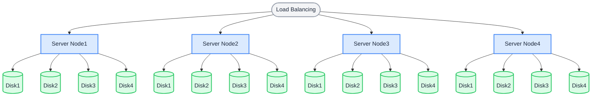
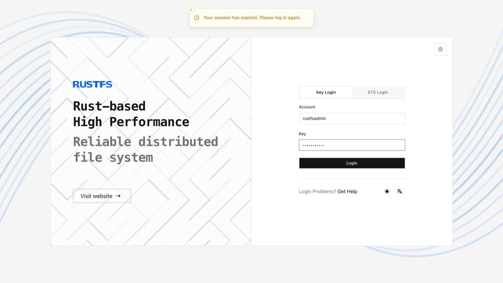

Le mode nœuds multiples, disques multiples (MNMD) est le déploiement de production pour les clusters qui s’étendent sur plusieurs serveurs. Il faut au minimum **4 serveurs**, chacun avec au moins 1 disque, pour démarrer de façon fiable un cluster de stockage objet distribué.

## Topologie et planification

Dans l’architecture suivante, les requêtes sont réparties entre les serveurs par équilibrage de charge. Avec la disposition de codage d’effacement par défaut 12 + 4, chaque objet est découpé en 12 fragments de données et 4 fragments de parité, stockés sur des disques différents de serveurs différents :

- Le cluster reste disponible et ne perd aucune donnée si un seul serveur tombe en panne ou est arrêté pour maintenance.
- Le cluster peut tolérer la perte de 4 disques au maximum sans perte de données.



Avant l’installation, consultez les [listes de contrôle préalables à l’installation](../requirement/checklists/index.md) et assurez-vous que chaque élément répond aux exigences de production.

## Noms d’hôte

Un cluster RustFS exige des noms d’hôte qui suivent un schéma cohérent et numéroté en séquence (par exemple de `node1` à `node4`). Deux méthodes permettent d’obtenir des noms d’hôte séquentiels :

**1. Configuration DNS :**

Créez des enregistrements DNS pour que chaque nom d’hôte séquentiel soit résolu vers le nœud correspondant.

**2. Configuration de `/etc/hosts` :**

Ajoutez les entrées suivantes à `/etc/hosts` sur chaque nœud :

```text title="/etc/hosts"
127.0.0.1 localhost localhost.localdomain localhost4 localhost4.localdomain4
::1 localhost localhost.localdomain localhost6 localhost6.localdomain6
192.168.1.1 node1
192.168.1.2 node2
192.168.1.3 node3
192.168.1.4 node4
```

## Prérequis et configuration du service

Sur **chaque nœud**, terminez les [prérequis communs et la configuration du service](./prerequisites-and-service.md) — système d’exploitation, pare-feu, synchronisation de l’heure, formatage des disques, utilisateur du service, téléchargement du binaire et unité systemd — puis poursuivez ci-dessous. Tous les nœuds doivent utiliser le même port d’écoute et avoir des horloges synchronisées.

## Configurer les variables d’environnement

1. Créez le même fichier de configuration sur chaque nœud. `RUSTFS_VOLUMES` utilise l’expansion d’accolades pour énumérer tous les nœuds et tous les points de montage (cet exemple : 4 nœuds × 4 disques) :

```ini title="/etc/default/rustfs"
# Use a unique access key and a strong, random secret (e.g. openssl rand -base64 24)
RUSTFS_ACCESS_KEY=<your-access-key>
RUSTFS_SECRET_KEY=<your-secret-key>
RUSTFS_VOLUMES="http://node{1...4}:9000/data/rustfs{0...3}"
RUSTFS_ADDRESS=":9000"
RUSTFS_CONSOLE_ENABLE=true
RUSTFS_CONSOLE_ADDRESS=":9001"
RUSTFS_OBS_LOGGER_LEVEL=error
RUSTFS_OBS_LOG_DIRECTORY="/var/log/rustfs/"
```

:::note

La clé d’accès, la clé secrète et la valeur de `RUSTFS_VOLUMES` doivent être identiques sur tous les nœuds. Les noms d’hôte (`node1` – `node4`) doivent correspondre à la configuration DNS ou `/etc/hosts` ci-dessus.

:::

2. Créez les répertoires de stockage et de journaux sur chaque nœud :

```bash
sudo mkdir -p /data/rustfs{0..3} /var/log/rustfs /opt/tls
sudo chmod -R 750 /data/rustfs* /var/log/rustfs
```

## Démarrer et vérifier le service

1. Démarrez le service sur chaque nœud et activez le démarrage automatique au lancement du système :

```bash
sudo systemctl enable --now rustfs
```

2. Vérifiez l’état du service :

```bash
systemctl status rustfs
```

3. Vérifiez le port du service :

```bash
netstat -ntpl
```

4. Consultez les fichiers journaux :

```bash
tail -f /var/log/rustfs/rustfs*.log
```

5. Accédez à la Console : saisissez l’adresse IP de n’importe quel nœud (ou l’adresse de l’équilibreur de charge) et le port de la Console (9001 par défaut) dans un navigateur. Vous devriez voir :



## Étapes suivantes

- Placez un équilibreur de charge devant le cluster — consultez le [guide d’intégration Nginx](/fr/developer/integration/reverse-proxy/nginx).
- Activez TLS pour le trafic de production — consultez la [configuration TLS](../../integration/tls-configured.md).
- Consultez l’[extension du pool de stockage](../../operations/scaling/storage-pool-expansion.md) avant d’étendre le cluster.
