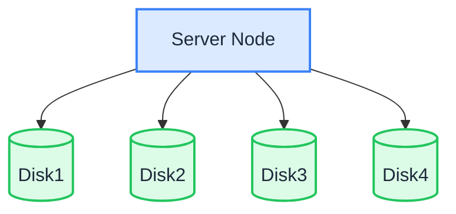

En mode nœud unique, disques multiples (SNMD), un serveur répartit les données en fragments sur plusieurs disques de données. Chaque objet est découpé en K fragments de données et M fragments de parité (codage d’effacement) : la perte d’au plus M disques n’entraîne pas de perte de données.

:::warning

Le mode SNMD convient aux charges moyennes et non critiques. Le déploiement peut perdre jusqu’à M disques sans perte de données, mais si le serveur entier tombe en panne, ou si plus de M disques sont endommagés, les données seront perdues. Conservez des sauvegardes des données importantes. Pour une tolérance aux pannes au niveau du nœud, utilisez le mode [MNMD](./multiple-node-multiple-disk.md).

:::

## Topologie et planification



- 1 serveur avec plusieurs disques de données (cet exemple utilise 4 disques montés de `/data/rustfs0` à `/data/rustfs3`).
- Le codage d’effacement répartit les fragments de données et de parité sur les disques. La tolérance aux pannes se limite aux pannes de disque du nœud unique.
- Formatez chaque disque en XFS et montez-le séparément (par exemple avec les étiquettes `RUSTFS0` – `RUSTFS3`), comme décrit sur la page des prérequis.
- Pour les déploiements de production, consultez aussi les [listes de contrôle préalables à l’installation](../requirement/checklists/index.md).

## Prérequis et configuration du service

Terminez les [prérequis communs et la configuration du service](./prerequisites-and-service.md) — système d’exploitation, pare-feu, synchronisation de l’heure, formatage des disques, utilisateur du service, téléchargement du binaire et unité systemd — puis poursuivez ci-dessous.

## Configurer les variables d’environnement

1. Créez le fichier de configuration. `RUSTFS_VOLUMES` utilise l’expansion d’accolades pour énumérer les quatre points de montage :

```ini title="/etc/default/rustfs"
# Use a unique access key and a strong, random secret (e.g. openssl rand -base64 24)
RUSTFS_ACCESS_KEY=<your-access-key>
RUSTFS_SECRET_KEY=<your-secret-key>
RUSTFS_VOLUMES="/data/rustfs{0...3}"
RUSTFS_ADDRESS=":9000"
RUSTFS_CONSOLE_ENABLE=true
RUSTFS_CONSOLE_ADDRESS=":9001"
RUSTFS_OBS_LOGGER_LEVEL=error
RUSTFS_OBS_LOG_DIRECTORY="/var/log/rustfs/"
```

2. Créez les répertoires de stockage et de journaux :

```bash
sudo mkdir -p /data/rustfs{0..3} /var/log/rustfs /opt/tls
sudo chmod -R 750 /data/rustfs* /var/log/rustfs
```

## Démarrer et vérifier le service

1. Démarrez le service et activez son lancement au démarrage du système :

```bash
sudo systemctl enable --now rustfs
```

2. Vérifiez l’état du service :

```bash
systemctl status rustfs
```

3. Vérifiez le port du service :

```bash
netstat -ntpl
```

4. Consultez les fichiers journaux :

```bash
tail -f /var/log/rustfs/rustfs*.log
```

5. Accédez à la Console : saisissez l’adresse IP du serveur et le port de la Console (9001 par défaut) dans un navigateur. Vous devriez voir :


## Étapes suivantes

- Vous avez besoin d’une tolérance aux pannes au niveau du nœud et d’une évolutivité horizontale ? Consultez le [mode nœuds multiples, disques multiples (MNMD)](./multiple-node-multiple-disk.md).
- Vous ne faites qu’expérimenter ? Le [mode nœud unique, disque unique (SNSD)](./single-node-single-disk.md) est plus simple à mettre en place.
