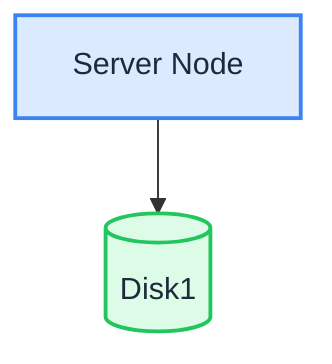

En mode nœud unique, disque unique (SNSD), un serveur stocke toutes les données sur un seul disque de données. C’est le mode de déploiement le plus simple, et la même topologie que celle mise en place par le script du [démarrage rapide Linux](./quick-start.md).

:::warning

Un seul disque n’offre aucune redondance : si le disque tombe en panne, les données sont perdues. Le mode SNSD convient au développement, aux tests et aux petites charges non critiques. Pour un usage en production, effectuez des sauvegardes régulières, ou choisissez le mode [SNMD](./single-node-multiple-disk.md) ou [MNMD](./multiple-node-multiple-disk.md).

:::

## Topologie et planification



- 1 serveur, 1 disque de données (par exemple un disque formaté en XFS monté sur `/data/rustfs0`).
- Pas de codage d’effacement entre les disques : la tolérance aux pannes repose entièrement sur les sauvegardes.
- Pour les déploiements de production, consultez aussi les [listes de contrôle préalables à l’installation](../requirement/checklists/index.md).

## Prérequis et configuration du service

Terminez les [prérequis communs et la configuration du service](./prerequisites-and-service.md) — système d’exploitation, pare-feu, synchronisation de l’heure, formatage des disques, utilisateur du service, téléchargement du binaire et unité systemd — puis poursuivez ci-dessous.

## Configurer les variables d’environnement

1. Créez le fichier de configuration avec le chemin du volume à disque unique :

```ini title="/etc/default/rustfs"
# Use a unique access key and a strong, random secret (e.g. openssl rand -base64 24)
RUSTFS_ACCESS_KEY=<your-access-key>
RUSTFS_SECRET_KEY=<your-secret-key>
RUSTFS_VOLUMES="/data/rustfs0"
RUSTFS_ADDRESS=":9000"
RUSTFS_CONSOLE_ENABLE=true
RUSTFS_CONSOLE_ADDRESS=":9001"
RUSTFS_OBS_LOGGER_LEVEL=error
RUSTFS_OBS_LOG_DIRECTORY="/var/log/rustfs/"
```

2. Créez les répertoires de stockage et de journaux :

```bash
sudo mkdir -p /data/rustfs0 /var/log/rustfs /opt/tls
sudo chmod -R 750 /data/rustfs* /var/log/rustfs
```

## Démarrer et vérifier le service

1. Démarrez le service et activez son lancement au démarrage du système :

```bash
sudo systemctl enable --now rustfs
```

2. Vérifiez l’état du service :

```bash
systemctl status rustfs
```

3. Vérifiez le port du service :

```bash
netstat -ntpl
```

4. Consultez les fichiers journaux :

```bash
tail -f /var/log/rustfs/rustfs*.log
```

5. Ouvrez la Console : dans un navigateur, accédez à `http://<server-ip>:9001`. Vous devriez voir :


## Étapes suivantes

- Vous avez besoin de redondance au niveau du disque sur un seul serveur ? Consultez le [mode nœud unique, disques multiples (SNMD)](./single-node-multiple-disk.md).
- Vous avez besoin d’un cluster de production ? Consultez le [mode nœuds multiples, disques multiples (MNMD)](./multiple-node-multiple-disk.md).
