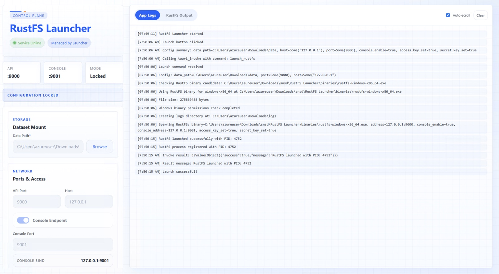

Ce guide présente deux façons d’exécuter **RustFS** sur Windows : utiliser **RustFS Launcher** graphique, ou télécharger et exécuter le binaire serveur autonome depuis PowerShell. Les deux méthodes créent une instance locale à nœud unique, adaptée à l’évaluation, au développement et aux tests.

:::warning[Développement et débogage uniquement]

La version Windows de RustFS est destinée uniquement au développement et au débogage. Elle **n’est pas recommandée pour les déploiements en production**. Nous recommandons [Linux](/fr/installation/linux) pour les charges de production.

Ces procédures exécutent RustFS comme un processus de bureau, et non comme un service Windows. Pour un déploiement de production ou distribué, utilisez les [guides d’installation Linux](/fr/installation/linux).

:::

## 1. Vérifier les prérequis

Avant de commencer, vérifiez que :

- Vous utilisez Windows 64 bits sur un processeur x86-64. Launcher embarque actuellement le binaire RustFS Windows x86-64.
- Vous avez le droit d’installer ou d’exécuter des applications et d’écrire dans le répertoire de données choisi.
- Les ports TCP `9000` et `9001` sont disponibles, ou vous avez choisi deux autres ports libres.
- Vous avez créé un répertoire de données dédié, par exemple `D:\rustfs\data`.

:::warning[Protégez le répertoire de données]

Utilisez un répertoire vide sur un disque disposant de suffisamment d’espace libre. Ne stockez pas de fichiers sans rapport dans ce répertoire, et ne modifiez pas les fichiers de données RustFS pendant que le serveur est en cours d’exécution.

:::

## 2. Choisir une méthode d’installation

| Méthode | Utilisez-la lorsque | Modèle de gestion |
| --- | --- | --- |
| RustFS Launcher | Vous souhaitez une configuration graphique et une visionneuse de journaux intégrée. | Launcher démarre et arrête le processus RustFS embarqué. |
| Binaire autonome | Vous souhaitez des commandes PowerShell explicites ou des scripts. | La session PowerShell possède le processus RustFS. |

## Installer avec RustFS Launcher

### 3. Télécharger et installer Launcher

1. Ouvrez la [page des versions de RustFS Launcher](https://github.com/rustfs/launcher/releases).
2. Sélectionnez la dernière version et téléchargez son installateur Windows x86-64 depuis **Assets** (fichiers de la version). Ne téléchargez pas **Source code** (code source), qui sert à compiler Launcher à partir du code source.
3. Double-cliquez sur l’installateur et suivez les invites.
4. Ouvrez **RustFS Launcher** depuis le menu Démarrer s’il ne s’ouvre pas automatiquement.

Si Microsoft Defender SmartScreen affiche un avertissement, vérifiez que l’installateur provient de la page officielle des versions de `rustfs/launcher` avant de l’autoriser à s’exécuter. Ne désactivez pas globalement les fonctions de sécurité de Windows.

### 4. Configurer Launcher

Configurez les champs de la fenêtre Launcher :

| Section | Champ | Valeur recommandée | Description |
| --- | --- | --- | --- |
| Dataset Mount | Data Path | `D:\rustfs\data` | Répertoire existant dans lequel RustFS stocke les données d’objets. |
| Ports & Access | API Port | `9000` | Port de l’API compatible avec S3. |
| Ports & Access | Host | `127.0.0.1` | Limite l’accès à cet ordinateur. |
| Ports & Access | Console Endpoint | Enabled | Active la Console web. Launcher la désactive par défaut. |
| Ports & Access | Console Port | `9001` | Port de la Console, qui doit être différent du port de l’API. |
| Credentials | Access Key | `<your-access-key>` | Clé d’accès d’administrateur pour cette instance. |
| Credentials | Secret Key | `<your-secret-key>` | Clé secrète d’administrateur pour cette instance. |

Sélectionnez le répertoire de données avec **Browse** (Parcourir), ou faites-le glisser dans Launcher. Launcher exige que le répertoire existe avant le démarrage.

Remplacez les identifiants indicatifs par vos propres valeurs. Launcher affiche d’abord les identifiants par défaut d’un test local. Ne les conservez pas sur un ordinateur accessible à d’autres utilisateurs.

:::warning[Exposition réseau]

Laissez **Host** défini sur `127.0.0.1`, sauf si un autre ordinateur doit se connecter à RustFS. Une adresse autre que l’adresse de bouclage expose l’API et la Console sur les interfaces réseau correspondantes. Configurez Windows Defender Firewall et des identifiants robustes avant d’autoriser un accès distant.

:::

### 5. Démarrer et vérifier RustFS

1. Sélectionnez **Launch RustFS** (démarrer RustFS).
2. Attendez que Launcher indique que le point de terminaison configuré est en ligne.
3. Ouvrez `http://localhost:9001` et connectez-vous avec la clé d’accès et la clé secrète que vous avez configurées.
4. Utilisez `http://localhost:9000` comme point de terminaison pour les clients compatibles avec S3.



Si vous avez modifié l’hôte ou les ports, utilisez ces valeurs. L’URL de la Console n’est disponible que lorsque **Console Endpoint** est activé.

Launcher verrouille sa configuration tant qu’il gère un processus en cours d’exécution. Il crée aussi un répertoire `logs` à côté du répertoire de données. Par exemple, un chemin de données `D:\rustfs\data` place les fichiers journaux du serveur sous `D:\rustfs\logs`.

### 6. Arrêter ou quitter Launcher

Sélectionnez **Stop RustFS** (arrêter RustFS) avant de modifier la configuration, de déconnecter le disque de données ou d’éteindre Windows.

Fermer la fenêtre de Launcher la masque dans la zone de notification de Windows. Cela n’arrête pas RustFS. Pour arrêter le processus géré et quitter Launcher, cliquez avec le bouton droit sur l’icône de la zone de notification et sélectionnez **Quit** (quitter). Sélectionnez **Show** (afficher), ou cliquez avec le bouton gauche sur l’icône, pour restaurer la fenêtre.

## Installer le binaire autonome

### 7. Télécharger et extraire le binaire

1. Ouvrez la [page des versions de RustFS](https://github.com/rustfs/rustfs/releases).
2. Sélectionnez la version requise et téléchargez l’archive ZIP Windows x86-64 depuis **Assets**. Le nom du fichier commence par `rustfs-windows-x86_64`.
3. Ouvrez PowerShell et créez les répertoires du programme et de ses données :

```powershell
New-Item -ItemType Directory -Force -Path C:\rustfs\bin
New-Item -ItemType Directory -Force -Path D:\rustfs\data
```

4. Extrayez l’archive téléchargée. Remplacez `<version>` par la version figurant dans le nom du fichier téléchargé :

```powershell
Expand-Archive -Path "$HOME\Downloads\rustfs-windows-x86_64-<version>.zip" -DestinationPath C:\rustfs\bin -Force
```

5. Confirmez que le binaire extrait s’exécute :

```powershell
Set-Location C:\rustfs\bin
.\rustfs.exe --help
```

Si l’archive extrait `rustfs.exe` dans un répertoire imbriqué, placez-vous dans ce répertoire ou déplacez l’exécutable dans `C:\rustfs\bin` avant de continuer.

### 8. Démarrer le serveur autonome

Définissez les identifiants uniquement pour la session PowerShell en cours, puis démarrez RustFS avec des adresses explicites :

```powershell
$env:RUSTFS_ACCESS_KEY = "<your-access-key>"
$env:RUSTFS_SECRET_KEY = "<your-secret-key>"

Set-Location C:\rustfs\bin
.\rustfs.exe server `
	--address "127.0.0.1:9000" `
	--console-enable true `
	--console-address "127.0.0.1:9001" `
	"D:\rustfs\data"
```

Laissez la fenêtre PowerShell ouverte pendant l’exécution de RustFS. Appuyez sur `Ctrl+C` dans cette fenêtre pour arrêter le serveur.

:::tip[Gestion des identifiants]

Les variables d’environnement de session évitent de placer les identifiants directement sur la ligne de commande. Pour un usage répété ou automatisé, préférez les variables d’environnement `RUSTFS_ACCESS_KEY_FILE` et `RUSTFS_SECRET_KEY_FILE`, et protégez ces fichiers avec les contrôles d’accès Windows.

:::

### 9. Vérifier le serveur autonome

Ouvrez `http://localhost:9001` et connectez-vous avec les identifiants configurés. Utilisez `http://localhost:9000` comme point de terminaison pour les clients compatibles avec S3. RustFS utilise par défaut l’adressage de type chemin (path-style) : configurez les clients en conséquence.

Pour une vérification de bout en bout, créez un compartiment (bucket) nommé `my-bucket`, chargez (upload) `hello.txt`, puis confirmez que l’objet apparaît dans le compartiment.

## Confirmer une installation réussie

Que vous ayez utilisé Launcher ou le binaire autonome, une connexion réussie à la Console ouvre la page **Buckets** (compartiments). Depuis cette page, vous pouvez créer `my-bucket` et commencer à stocker des objets.


## Dépannage

### Windows bloque l’installateur ou l’exécutable

Confirmez que le fichier provient de l’organisation GitHub officielle de RustFS. Examinez la boîte de dialogue **Properties** (Propriétés) du fichier et, lorsque Windows propose l’option, sélectionnez **Unblock** (débloquer) seulement après avoir vérifié la source.

### Le chemin de données est rejeté

Confirmez que le répertoire existe et que votre compte Windows dispose d’un accès en lecture et en écriture. Launcher ne crée pas pour vous le répertoire de données sélectionné.

### Le port de l’API ou de la Console est indisponible

Les ports doivent être des nombres de `1` à `65535`, doivent être différents l’un de l’autre et ne doivent pas être déjà utilisés. Inspectez les ports par défaut dans PowerShell :

```powershell
Get-NetTCPConnection -LocalPort 9000,9001 -ErrorAction SilentlyContinue
```

Arrêtez l’application en conflit ou choisissez des ports libres, puis redémarrez RustFS.

### La Console ne s’ouvre pas

Pour Launcher, confirmez que **Console Endpoint** est activé. Pour le binaire autonome, confirmez que le processus est toujours en cours d’exécution et que `--console-enable true` est présent. Le port par défaut actuel de la Console est `9001`. Le port `7001` n’est pas utilisé par la configuration actuelle de Launcher.

### Launcher signale un processus RustFS externe

Un autre processus écoute sur l’adresse API configurée, mais Launcher ne l’a pas démarré. Arrêtez ce processus ou choisissez un autre port d’API. Launcher ne peut pas arrêter un processus qu’il ne gère pas.

### RustFS s’arrête après le lancement

Dans Launcher, examinez les onglets de l’application et de RustFS dans la visionneuse de journaux intégrée. Pour une installation autonome, examinez la sortie de PowerShell. Les causes courantes sont un répertoire de données manquant, des droits insuffisants ou un conflit de port.

## Étapes suivantes

- Consultez le [guide de l’API S3](/fr/administration/protocols/s3) avant de connecter un client.
- Apprenez à [créer un compartiment](/fr/administration/data/bucket/creation).
- Consultez les [vérifications d’état](/fr/operations/status-check) pour d’autres méthodes de vérification.
- Utilisez les [guides d’installation Linux](/fr/installation/linux) pour un déploiement orienté production.
