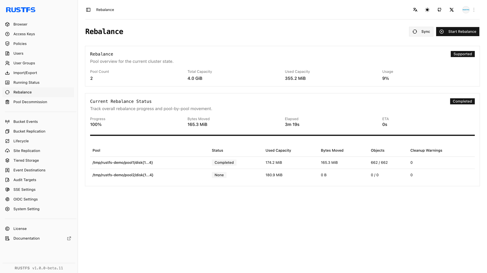

## Vue d’ensemble

### Prérequis

- Installez [`rc`](/fr/operations/rc) sur l’hôte d’administration avant d’utiliser le flux `rc` de ce guide.
- Configurez des identifiants disposant de l’autorisation d’administration du rééquilibrage.

Après une [extension de pool](./storage-pool-expansion.md), les nouvelles écritures peuvent utiliser la capacité ajoutée, mais les objets existants restent dans leurs pools d’origine. Le **rééquilibrage** déplace les objets existants sur l’ensemble des pools actifs afin que leurs ratios de capacité utilisée convergent.

Le rééquilibrage exige au moins deux pools actifs. RustFS refuse un nouveau rééquilibrage tant qu’un autre rééquilibrage ou une mise hors service de pool est en cours. L’arrêt d’un rééquilibrage ne ramène pas les objets déjà déplacés vers leurs pools d’origine.

Avant de commencer, vérifiez que tous les nœuds et tous les disques sont sains, qu’aucune mise hors service n’est active et que le cluster dispose d’assez de capacité libre pour les écritures normales pendant l’opération. Planifiez l’opération pendant une période de plus faible trafic, car le déplacement des objets consomme des ressources disque, réseau et processeur.

## Opération

### Démarrer le rééquilibrage dans la Console

1. Connectez-vous à la Console RustFS avec un compte disposant de l’autorisation d’administration du rééquilibrage.
2. Ouvrez **Rebalance** (rééquilibrage).
3. Examinez les pools actifs et leurs ratios de capacité utilisée.
4. Sélectionnez **Start Rebalance** (démarrer le rééquilibrage) et confirmez l’opération.
5. Laissez la page ouverte, ou revenez-y périodiquement, pour suivre la progression de chaque pool.
6. Utilisez **Stop Rebalance** (arrêter le rééquilibrage) uniquement lorsque vous devez interrompre l’opération. Les données déjà déplacées restent dans leur nouveau pool.


### Démarrer le rééquilibrage avec rc

Configurez l’alias du cluster s’il n’existe pas déjà :

```bash
rc alias set rustfs http://<server-ip>:9000 <your-access-key> <your-secret-key>
```

Démarrez le rééquilibrage :

```bash
rc admin rebalance start rustfs
```

Contrôlez la progression :

```bash
rc admin rebalance status rustfs
```

Le statut comprend l’ID de l’opération et, pour chaque pool, l’utilisation, les octets déplacés, le nombre d’objets et de versions, les compartiments (bucket) restants, le temps écoulé et, lorsqu’elle est disponible, l’heure de fin estimée.

Pour arrêter un rééquilibrage en cours :

```bash
rc admin rebalance stop rustfs
```

`rc admin expand start|status|stop` et l’alias `scale` exposent le même flux de rééquilibrage après une extension.

## Vérification

### Vérifier le rééquilibrage dans la Console

Attendez que la page **Rebalance** indique `Completed`. Confirmez que :



- Aucun pool ne signale un état d’échec ou d’arrêt.
- Les ratios de capacité utilisée se rapprochent entre les pools actifs.
- Tous les nœuds et tous les disques restent en ligne.
- Les lectures et les écritures d’objets habituelles réussissent.

### Vérifier le rééquilibrage avec rc

Exécutez :

```bash
rc admin rebalance status rustfs
rc admin pool list rustfs
```

Vérifiez que le statut du rééquilibrage est `Completed`, que les nombres de compartiments restants sont nuls et qu’aucun échec n’est signalé. Comparez les ratios d’utilisation de chaque pool aux valeurs relevées avant l’opération, puis lisez un objet existant et écrivez un nouvel objet de test par le point de terminaison S3.
