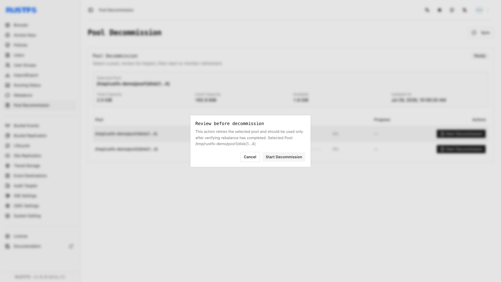
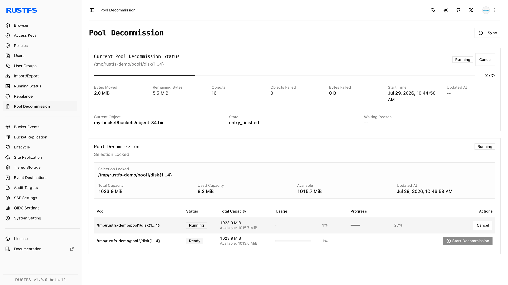

## Vue d’ensemble

### Prérequis

- Installez [`rc`](/fr/operations/rc) sur l’hôte d’administration avant d’utiliser le flux `rc` de ce guide.
- Configurez des identifiants disposant de l’autorisation d’administration de la mise hors service.

La **mise hors service d’un pool** déplace les objets d’un pool sélectionné vers les pools actifs restants, afin de pouvoir retirer le pool cible du déploiement. Utilisez-la pour mettre du matériel hors service, remplacer un pool ou consolider la capacité.

La mise hors service diffère du [rééquilibrage](./data-rebalancing.md) : le rééquilibrage conserve chaque pool actif, tandis que la mise hors service vide le pool sélectionné, puis le retire du déploiement. Les deux opérations ne peuvent pas s’exécuter en même temps.

Avant de commencer :

- Conservez au moins un pool actif après l’opération.
- Vérifiez que les pools restants disposent d’assez de capacité libre. RustFS exige que leur espace libre couvre les octets utilisés en cours de vidage, plus une marge de 30 %.
- Confirmez que chaque nœud et chaque disque est sain, et qu’aucun rééquilibrage n’est en cours.
- Sauvegardez les données critiques et planifiez l’opération pendant une période de plus faible trafic.
- Notez l’ID exact du pool et l’expression de volumes avant de sélectionner la cible.

L’annulation d’une mise hors service n’annule pas les déplacements déjà effectués. Les objets déjà relocalisés restent dans les pools de destination.

## Opération

### Démarrer la mise hors service dans la Console

1. Connectez-vous à la Console RustFS avec un compte disposant de l’autorisation d’administration de la mise hors service.
2. Ouvrez **Pool Decommission** (mise hors service du pool).
3. Repérez le pool à mettre hors service et vérifiez son ID, son expression de volumes, sa capacité utilisée et son statut.

   

4. Sélectionnez **Start Decommission** (démarrer la mise hors service) pour ce pool.
5. Examinez attentivement la boîte de dialogue de confirmation, puis sélectionnez **Start Decommission**.

   

6. Utilisez **Sync** (synchroniser) pour actualiser l’état du pool et les compteurs de déplacement jusqu’à la fin de l’opération.

   

Une fois l’opération terminée, retirez l’expression du pool vidé de `RUSTFS_VOLUMES` sur chaque nœud restant et redémarrez RustFS avec la même topologie ordonnée. Avec Helm, mettez le pool hors service avant de retirer son entrée de `pools.list` ; ne retirez ni ne réordonnez jamais une entrée de pool encore en service.


### Démarrer la mise hors service avec rc

Configurez l’alias du cluster si nécessaire, puis listez les pools :

```bash
rc alias set rustfs http://<server-ip>:9000 <your-access-key> <your-secret-key>
rc admin pool list rustfs
```

Démarrez la mise hors service du pool `0` à l’aide de son ID à base zéro :

```bash
rc admin decommission start rustfs 0 --by-id
```

Vous pouvez aussi transmettre l’expression de volumes exacte du pool, sans `--by-id` :

```bash
rc admin decommission start rustfs 'http://rustfs-node1:9000/data/rustfs{1...4}/mnmd'
```

Surveillez tous les pools, ou seulement le pool cible :

```bash
rc admin decommission status rustfs
rc admin decommission status rustfs 0 --by-id
```

Pour annuler une opération en cours, utilisez :

```bash
rc admin decommission cancel rustfs 0 --by-id
```

Si une mise hors service a échoué ou a été annulée, effacez ses métadonnées avant de réessayer :

```bash
rc admin decommission clear rustfs 0 --by-id
```

Lorsque la cible indique `complete`, retirez son expression de `RUSTFS_VOLUMES` sur chaque nœud restant et redémarrez RustFS avec la topologie réduite.

## Vérification

### Vérifier la mise hors service dans la Console

Confirmez que le pool cible indique `Completed`, avec zéro objet en échec et zéro octet en échec. Après avoir retiré le pool de la topologie de démarrage et redémarré RustFS, vérifiez que :


- Le pool mis hors service n’apparaît plus comme pool actif.
- Chaque nœud et chaque disque restant est en ligne.
- Les pools restants affichent les données déplacées et disposent d’une capacité libre suffisante.
- Les objets existants peuvent toujours être listés, lus et téléchargés.

### Vérifier la mise hors service avec rc

Avant de retirer le pool de la topologie, exécutez :

```bash
rc admin decommission status rustfs 0 --by-id
```

Confirmez que le statut est `complete` et que les compteurs d’objets et d’octets en échec sont à zéro. Après avoir mis à jour `RUSTFS_VOLUMES` et redémarré RustFS, exécutez :

```bash
rc admin pool list rustfs
```

Vérifiez que seuls les pools actifs prévus subsistent. Lisez des objets qui résidaient auparavant sur le pool mis hors service, puis écrivez un nouvel objet de test par le point de terminaison S3.
