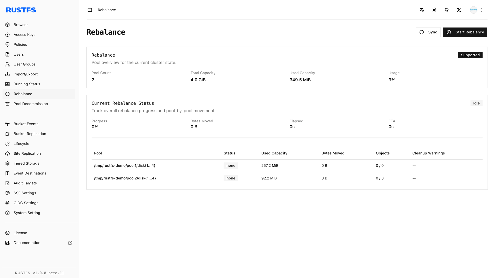

## Vue d’ensemble

### Prérequis

- Installez [`rc`](/fr/operations/rc) sur l’hôte d’administration avant d’utiliser le flux `rc` de ce guide.
- Configurez des identifiants autorisés à lire l’état du cluster et des pools RustFS.

RustFS étend la capacité en ajoutant un **pool de serveurs** à la topologie du cluster. Chaque pool correspond à une expression de volumes, séparée par des espaces, dans `RUSTFS_VOLUMES`. Une fois la topologie étendue appliquée, les nouvelles écritures peuvent utiliser la capacité ajoutée ; les objets existants restent dans leurs pools actuels jusqu’à ce que vous lanciez un [rééquilibrage](./data-rebalancing.md).

Ce guide utilise l’exemple à deux pools suivant :

```ini title="/etc/default/rustfs"
RUSTFS_VOLUMES="http://rustfs-node1:9000/data/rustfs{1...4}/mnmd http://rustfs-node2:9000/data/rustfs{1...4}/mnmd"
```

Avant d’étendre :

- Sauvegardez les données critiques et exécutez le flux pendant une fenêtre de maintenance.
- Utilisez la même version de RustFS, les mêmes identifiants et la valeur complète de `RUSTFS_VOLUMES` sur chaque nœud.
- Vérifiez la résolution de noms, la synchronisation de l’heure et la connectivité du port `9000` entre tous les anciens et les nouveaux nœuds.
- Préparez le nouveau pool avec le nombre de disques et la spécification de stockage prévus.

:::warning[Ajoutez le pool ; ne remplacez pas la topologie]

Chaque nœud doit démarrer avec la liste ordonnée complète des pools. Omettre le pool existant, ou utiliser une expression différente sur un nœud, crée une topologie incohérente.

:::

## Opération

### Étendre avec l’aide de la Console

La Console affiche les pools de stockage, mais elle n’ajoute pas de pool à la topologie de démarrage du serveur. Utilisez ce flux assisté par la Console :

1. Relevez les pools existants et leur utilisation depuis **Rebalance** (rééquilibrage) ou **Pool Decommission** (mise hors service du pool).
2. Installez la même version de RustFS et la même configuration de service sur le ou les nœuds du nouveau pool.
3. Ajoutez l’expression du nouveau pool à `RUSTFS_VOLUMES` sur chaque nœud existant et nouveau. Conservez les expressions existantes inchangées et dans le même ordre.
4. Redémarrez RustFS sur tous les nœuds, afin que chaque processus démarre avec la même topologie étendue.
5. Attendez que tous les nœuds soient prêts, puis actualisez la liste des pools dans la Console.



Pour un déploiement Helm, ajoutez la nouvelle entrée à `pools.list` et appliquez `helm upgrade`. Ne retirez ni ne réordonnez les entrées existantes.

### Inspecter l’extension avec rc

Configurez un alias avec des identifiants capables de lire l’état du cluster et des pools :

```bash
rc alias set rustfs http://<server-ip>:9000 <your-access-key> <your-secret-key>
```

Relevez la topologie actuelle :

```bash
rc admin pool list rustfs
```

Préparez les nouveaux nœuds, ajoutez l’expression du nouveau pool à la valeur complète de `RUSTFS_VOLUMES` sur chaque nœud, puis redémarrez RustFS sur l’ensemble du cluster. `rc` ne modifie pas la topologie de démarrage du serveur.

Lorsque le cluster est de nouveau disponible, listez encore les pools :

```bash
rc admin pool list rustfs
```

Utilisez un ID de pool à base zéro pour inspecter le nouveau pool en détail :

```bash
rc admin pool status rustfs 1 --by-id
```

:::note[Alias de rééquilibrage]

`rc admin expand start`, `status` et `stop` sont des alias du flux de rééquilibrage qui suit une extension. Ils redistribuent les données existantes ; ils n’ajoutent pas de pool à `RUSTFS_VOLUMES`.

:::

## Vérification

### Vérifier l’extension dans la Console

Confirmez que :

- La liste des pools affiche le pool d’origine et le nouveau pool.
- Chaque nœud et chaque disque attendu est en ligne.
- Le nouveau pool indique la capacité totale et la capacité disponible attendues.
- Le cluster ne signale aucun nœud dégradé avant que vous repreniez le trafic normal.

### Vérifier l’extension avec rc

Exécutez :

```bash
rc admin pool list rustfs
rc admin pool status rustfs 1 --by-id
```

Vérifiez que le nouveau pool possède l’expression de ligne de commande attendue et un état actif. Écrivez puis lisez un objet de test par le point de terminaison S3 habituel avant de démarrer un rééquilibrage.
