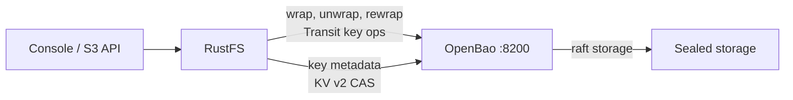
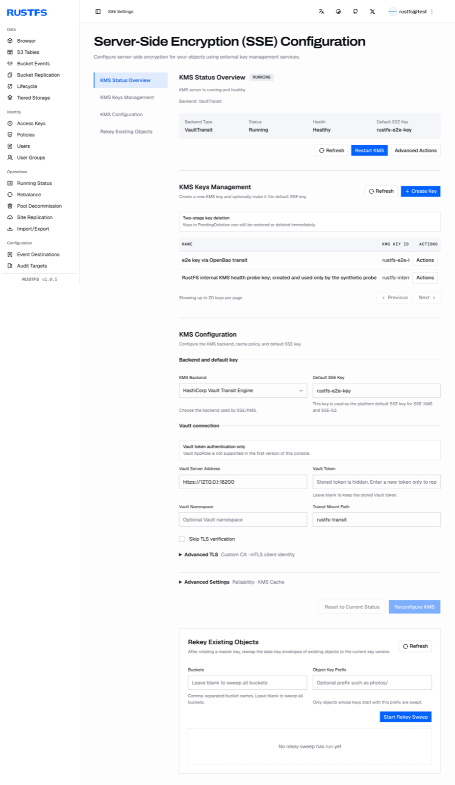

[OpenBao](https://github.com/openbao/openbao) est le fork open source de HashiCorp Vault. RustFS gère les clés SSE-KMS via un KMS externe avec son backend Vault Transit, et OpenBao conserve la même surface d'API — aucune modification du code RustFS n'est nécessaire : l'intégration se fait par la seule configuration. Ce guide déploie OpenBao, prépare les engines de secrets et un jeton à privilèges minimaux, configure RustFS, puis vérifie le SSE-KMS de bout en bout. Le workflow a été vérifié avec RustFS `1.0.5` et OpenBao `2.7.2`.

Vous avez besoin de Docker sur l'hôte OpenBao et d'un serveur RustFS 1.0.5 ou supérieur. Ce guide est un déploiement mono-nœud destiné aux tests d'intégration ; en production, il faut en plus un OpenBao en cluster avec unscell géré, voir les notes de fin.

## Architecture



RustFS génère les clés de données par objet localement et les enveloppe via l'engine Transit d'OpenBao ; les métadonnées de cycle de vie des clés sont conservées dans un montage KV v2 avec des écritures CAS. OpenBao détient les versions des clés maîtresses — si OpenBao devient indisponible, les nouveaux écrits SSE-KMS et les lectures des objets chiffrés s'interrompent jusqu'à ce qu'il soit de nouveau joignable et déscealé.

## 1. Déployer OpenBao avec TLS et le stockage raft

RustFS refuse le HTTP en clair vers le KMS : le démarrage échoue avec `Vault Transit requires HTTPS outside explicit development mode`. Configurez OpenBao avec TLS dès le départ. Créez l'arborescence et une configuration avec le stockage raft intégré :

```bash
mkdir -p /data/openbao/{data,config,tls}
openssl req -x509 -newkey rsa:4096 -sha256 -days 825 -nodes \
  -keyout /data/openbao/tls/ca-key.pem -out /data/openbao/tls/ca.pem \
  -subj "/CN=openbao-demo-ca"
openssl req -newkey rsa:2048 -nodes -keyout /data/openbao/tls/server-key.pem \
  -out /data/openbao/tls/server.csr -subj "/CN=openbao-host"
openssl x509 -req -in /data/openbao/tls/server.csr \
  -CA /data/openbao/tls/ca.pem -CAkey /data/openbao/tls/ca-key.pem \
  -CAcreateserial -out /data/openbao/tls/server-cert.pem -days 825 -sha256 \
  -extfile <(printf "subjectAltName=IP:127.0.0.1,DNS:localhost,DNS:openbao-host")
```

```hcl title="/data/openbao/config/config.hcl"
storage "raft" {
  path    = "/openbao/data"
  node_id = "openbao-1"
}
listener "tcp" {
  address         = "0.0.0.0:8200"
  cluster_address = "0.0.0.0:8201"
  tls_disable     = 0
  tls_cert_file   = "/openbao/tls/server-cert.pem"
  tls_key_file    = "/openbao/tls/server-key.pem"
}
api_addr      = "https://127.0.0.1:8200"
cluster_addr  = "https://127.0.0.1:8201"
disable_mlock = true
ui            = false
```

Démarrez le conteneur avec les répertoires de données, de configuration et TLS montés. Ces montages par liaison doivent être inscriptibles par le processus du conteneur :

```bash
chmod -R a+rX /data/openbao/tls
chmod 777 /data/openbao/data
docker run -d --name openbao --restart unless-stopped \
  -p 127.0.0.1:8200:8200 \
  -v /data/openbao/data:/openbao/data \
  -v /data/openbao/config:/openbao/config \
  -v /data/openbao/tls:/openbao/tls \
  openbao/openbao:2.7.2 server
```

Initialisez avec une seule part de clé et déscealez. Conservez la clé d'unseal et le jeton root en sécurité — ils ne sont affichés qu'une fois :

```bash
docker exec -e BAO_ADDR=https://127.0.0.1:8200 -e BAO_CACERT=/openbao/tls/ca.pem \
  openbao bao operator init -key-shares=1 -key-threshold=1 -format=json
```

Après chaque redémarrage du conteneur, déscealez à nouveau :

```bash
docker exec -e BAO_ADDR=https://127.0.0.1:8200 -e BAO_CACERT=/openbao/tls/ca.pem \
  openbao bao operator unseal <unseal-key>
```

## 2. Activer les engines de secrets et créer un jeton à portée limitée

RustFS a besoin de deux engines : Transit pour les opérations sur les clés, et KV v2 pour les métadonnées de clés qu'il maintient. Créez des montages dédiés :

```bash
docker exec -e BAO_ADDR=https://127.0.0.1:8200 -e BAO_CACERT=/openbao/tls/ca.pem \
  -e BAO_TOKEN=<root-token> openbao \
  bao secrets enable -path=rustfs-transit transit
docker exec -e BAO_ADDR=https://127.0.0.1:8200 -e BAO_CACERT=/openbao/tls/ca.pem \
  -e BAO_TOKEN=<root-token> openbao \
  bao secrets enable -path=rustfs-meta -version=2 kv
```

Écrivez une politique accordant exactement ce dont le client KMS de RustFS a besoin — la gestion des clés Transit y compris LIST (la sonde de démarrage en dépend), les opérations de chiffrement, et les chemins data et metadata KV v2 pour le préfixe configuré :

```hcl title="rustfs-kms.hcl"
path "rustfs-transit/keys" {
  capabilities = ["list"]
}
path "rustfs-transit/keys/*" {
  capabilities = ["create", "read", "update", "delete", "list"]
}
path "rustfs-transit/encrypt/*" {
  capabilities = ["create", "update"]
}
path "rustfs-transit/decrypt/*" {
  capabilities = ["create", "update"]
}
path "rustfs-transit/rewrap/*" {
  capabilities = ["create", "update"]
}
path "rustfs-transit/keys/*/rotate" {
  capabilities = ["update"]
}
path "rustfs-transit/keys/*/config" {
  capabilities = ["read", "update"]
}
path "rustfs-meta/data/rustfs/kms/keys/*" {
  capabilities = ["create", "update", "read"]
}
path "rustfs-meta/metadata/rustfs/kms/keys/*" {
  capabilities = ["read", "list", "delete"]
}
```

Chargez la politique et émettez un jeton orphelin :

```bash
docker cp rustfs-kms.hcl openbao:/tmp/rustfs-kms.hcl
docker exec -e BAO_ADDR=https://127.0.0.1:8200 -e BAO_CACERT=/openbao/tls/ca.pem \
  -e BAO_TOKEN=<root-token> openbao \
  bao policy write rustfs-kms /tmp/rustfs-kms.hcl
docker exec -e BAO_ADDR=https://127.0.0.1:8200 -e BAO_CACERT=/openbao/tls/ca.pem \
  -e BAO_TOKEN=<root-token> openbao \
  bao token create -policy=rustfs-kms -orphan -format=json
```

Stockez le jeton sur l'hôte RustFS. Le fichier doit être lisible par le seul propriétaire et appartenir au compte de service `rustfs` — RustFS refuse les bits de lecture de groupe et autres :

```bash
install -d -m 0755 -o rustfs -g rustfs /data/rustfs/kms
install -m 0600 -o rustfs -g rustfs /dev/null /data/rustfs/kms/openbao-token
# write the token into /data/rustfs/kms/openbao-token
cp /data/openbao/tls/ca.pem /data/rustfs/kms/openbao-ca.pem
```

## 3. Configurer RustFS

Ajoutez les réglages KMS au fichier d'environnement RustFS et redémarrez :

```ini title="/etc/default/rustfs"
RUSTFS_KMS_ENABLE=true
RUSTFS_KMS_BACKEND=vault-transit
RUSTFS_KMS_VAULT_ADDRESS=https://127.0.0.1:8200
RUSTFS_KMS_VAULT_MOUNT_PATH=rustfs-transit
RUSTFS_KMS_VAULT_TOKEN_FILE=/data/rustfs/kms/openbao-token
RUSTFS_KMS_VAULT_TRANSIT_METADATA_KV_MOUNT=rustfs-meta
RUSTFS_KMS_VAULT_TRANSIT_METADATA_PREFIX=rustfs/kms/keys
RUSTFS_KMS_VAULT_CA_CERT=/data/rustfs/kms/openbao-ca.pem
```

```bash
sudo systemctl restart rustfs
```

Si la validation du backend échoue, RustFS refuse de démarrer et nomme le problème exact dans le journal — voir [Dépannage](#dépannage). Une fois démarré, consultez l'état KMS dans la console sous **Paramètres SSE**, ou via l'API d'administration :

```bash
curl -s http://localhost:9000/rustfs/admin/v3/kms/service-status
```

La réponse indique `"backend_type":"VaultTransit"` avec `"healthy":true`, l'adresse configurée, le chemin de montage et l'usage éventuel d'un CA personnalisé.

## 4. Créer une clé et sélectionner la clé par défaut

La console expose le cycle de vie KMS complet sous **Paramètres SSE** : vue d'état, gestion des clés (création, suppression en deux temps), configuration du backend et balayages de re-chiffrement des objets existants.

Créez une clé dans **KMS Keys Management** — RustFS crée ensemble la clé Transit correspondante dans OpenBao et son enregistrement de métadonnées dans le montage KV v2. Définissez ensuite la **clé SSE par défaut** dans la console ou via l'environnement :

```ini title="/etc/default/rustfs"
RUSTFS_KMS_DEFAULT_KEY_ID=rustfs-e2e-key
```

Redémarrez RustFS après avoir changé la clé par défaut. Une clé créée directement dans OpenBao sans passer par RustFS laisse l'enregistrement de métadonnées KV v2 manquant — créez les clés côté RustFS.



## 5. Vérifier le SSE-KMS de bout en bout

Définissez la valeur par défaut du bucket ou transmettez la clé à chaque écriture. La réponse de téléversement renvoie l'algorithme de chiffrement et l'ID de clé, et le téléchargement restitue les octets d'origine :

```bash
aws s3api put-object \
  --endpoint-url http://localhost:9000 \
  --bucket my-bucket --key docs/e2e-check.txt \
  --body ./e2e-check.txt \
  --server-side-encryption aws:kms \
  --ssekms-key-id rustfs-e2e-key
```

```json
{
    "ETag": "\"57a02aed...\"",
    "ServerSideEncryption": "aws:kms",
    "SSEKMSKeyId": "rustfs-e2e-key"
}
```

```bash
aws s3api get-object \
  --endpoint-url http://localhost:9000 \
  --bucket my-bucket --key docs/e2e-check.txt ./e2e-check-back.txt
```

## Résultats de validation

Les vérifications suivantes ont été exécutées sur un déploiement OpenBao 2.7.2 réel et doivent passer sur tout environnement sain :

| Vérification | Résultat attendu |
| --- | --- |
| SSE-KMS PUT/GET avec l'ID de clé | La réponse renvoie `aws:kms` et l'ID de clé ; les octets téléchargés correspondent |
| GET par plage sur un objet chiffré | La plage d'octets est restituée correctement |
| Redémarrage de RustFS | Les métadonnées des clés se rétablissent depuis KV v2 ; les objets chiffrés restent lisibles |
| Redémarrage d'OpenBao (scealed) | Les lectures chiffrées échouent avec `ServiceUnavailable` — aucun repli en clair ; après le désceal, les lectures se rétablissent automatiquement dans l'intervalle de sonde |
| Rotation de la clé Transit | `latest_version` augmente avec les versions antérieures conservées ; les objets enveloppés avant la rotation restent lisibles |
| Ciphertext falsifié sur le stockage | Les lectures échouent et la suppression est refusée ; aucun repli en clair |
| Contexte de chiffrement erroné | Le déchiffrement Transit échoue avec une erreur d'authentification de message |

Note sur la disposition du stockage : les petits objets rangent leurs octets chiffrés en ligne dans le fichier `xl.meta` de chaque disque — un grep du texte clair dans le répertoire de l'objet reste donc vide alors que les données s'y trouvent.

## Dépannage

### Le démarrage échoue avec `Vault Transit requires HTTPS outside explicit development mode`

L'adresse du KMS n'est pas en HTTPS. Configurez TLS sur OpenBao et faites confiance à son CA via `RUSTFS_KMS_VAULT_CA_CERT`. L'échappatoire `RUSTFS_KMS_ALLOW_INSECURE_DEV_DEFAULTS=true` est réservé au développement.

### Le démarrage échoue avec `Vault token file ... has insecure permissions 0o644`

Le fichier de jeton doit être en `0600` sans bits de lecture groupe ni autres, et appartenir au compte de service RustFS :

```bash
chown rustfs:rustfs /data/rustfs/kms/openbao-token
chmod 600 /data/rustfs/kms/openbao-token
```

### Les lectures échouent avec `ServiceUnavailable` tant qu'OpenBao est scealé

Comportement attendu : les lectures chiffrées exigent le KMS externe. Déscealez OpenBao ; RustFS se rétablit automatiquement à sa prochaine sonde KMS — sans redémarrer RustFS.

### Le transit OpenBao déchiffre avec un mauvais paramètre `context`

Pour les clés non dérivées, le transit ignore `context` et lie le contexte de chiffrement S3 comme `associated_data`. Un `associated_data` erroné échoue avec `cipher: message authentication failed`. En testant la liaison manuellement via `bao`, transmettez `associated_data`, pas `context`.

### Un objet chiffré falsifié ne peut être ni lu ni supprimé

Les deux chemins échouent par conception — la suppression vérifie aussi les métadonnées stockées. Retirez les répertoires de l'objet sur chaque disque pendant que RustFS est arrêté, puis redémarrez.

## Notes de production

Le déploiement OpenBao mono-nœud ci-dessus laisse l'unseal manuel et le stockage local. En production : exécutez OpenBao en cluster avec réplication de stockage intégrée ou un mécanisme d'auto-unseal, protégez les éléments d'unseal et la sauvegarde des données raft indépendamment des sauvegardes RustFS, et figez la version d'OpenBao — validez le client vaultrs contre chaque mise à niveau d'OpenBao avant de la déployer.

## Prochaines étapes

- Consultez la vue d'ensemble des backends et le chiffrement par défaut des buckets dans [SSE-KMS](./kms.md).
- Lisez les [notes de compatibilité S3](/administration/protocols/s3) avant d'adopter d'autres fonctions SSE.
- Créez des identifiants de production dédiés avec la [gestion des clés d'accès](/security-compliance/iam/access-token).
