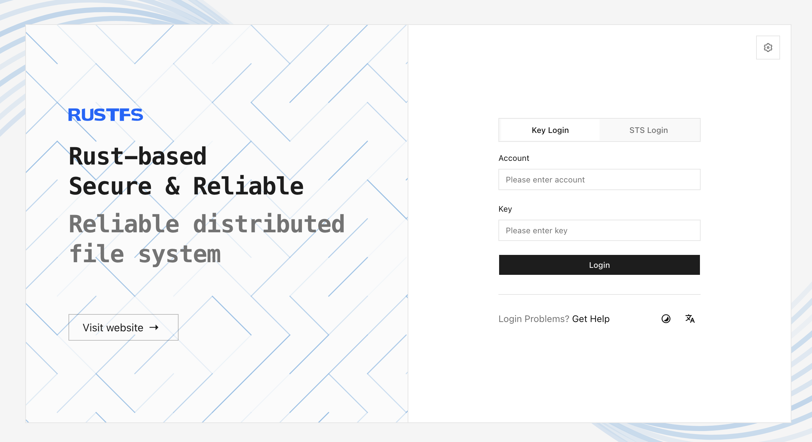

**RustFS Console** は、RustFS の Web 管理インターフェースです。このページでは、Console の有効化、ログインページを開く手順、適切なサインイン方法の選択を説明します。バケット、オブジェクト、アイデンティティ管理の詳しい手順は、それぞれのドキュメントで扱います。

## Console を有効にする

Console は既定で有効であり、ポート `9000` の S3 API とは別に、ポート `9001` で待ち受けます。次の環境変数で、動作を明示的に設定できます。

```ini title="/etc/default/rustfs"
RUSTFS_ADDRESS=":9000"
RUSTFS_CONSOLE_ADDRESS=":9001"
RUSTFS_CONSOLE_ENABLE=true
RUSTFS_OBS_LOGGER_LEVEL=error
RUSTFS_OBS_LOG_DIRECTORY="/var/log/rustfs/"
```

これらの値を変更したあとは、RustFS を再起動します。Console を実行してはならない場合は、`RUSTFS_CONSOLE_ENABLE=false` を設定します。

同等のコマンドラインオプションは `--console-enable` と `--console-address` です。サーバー設定の全体は、[CLI リファレンス](/ja/reference/cli) と [環境変数リファレンス](/ja/reference/environment-variables) を参照します。

## Console を開く

`<server-ip>` を RustFS サーバーのアドレスに置き換えて、次のアドレスを開きます。

```text
http://<server-ip>:9001
```



Windows および macOS のデスクトップランチャーを含むローカルデプロイでは、`http://localhost:9001` を開きます。S3 API はポート `9000` で待ち受けます。

ログインページから対象の RustFS サービスへ到達できない場合は、**Server Configuration**（サーバー設定）を選ぶか、`/config` を開きます。外部から到達できる RustFS サービスのアドレスを入力し、ヘルスチェックが成功してから保存します。**Reset**（リセット）は、保存したアドレスを消去します。**Skip**（スキップ）は、アドレスを変更せずにログインへ戻ります。

## ログイン

表示されるログイン方法は、デプロイの設定によって異なります。

- **Key Login**（キーによるログイン）は、RustFS デプロイに設定したアクセスキーとシークレットキーを使います。ローカル管理者の標準的なログイン方法です。
- **STS Login**（STS ログイン）は、一時的な Security Token Service（STS）の認証情報を使います。アイデンティティのワークフローが有効なセッショントークンを発行している場合にだけ使います。
- **OIDC Login**（OIDC ログイン）は、OpenID Connect（OIDC）プロバイダーを設定しているときに表示されます。プロバイダーを選び、アイデンティティプロバイダーで認証を完了します。

ログインすると、Console はそのアカウントがアクセスできる最初のページを開きます。メニューと操作は、アカウントのポリシーと、有効になっているプラットフォーム機能によって異なります。メニューが表示されないことは、必ずしも Console のエラーを意味しません。

ログインに失敗した場合は、再試行する前に、選択したログイン方法、認証情報、対象サーバーのアドレス、アカウントの状態を確認します。

:::warning[既定の認証情報を公開しない]

カスタムの認証情報を設定していない場合、RustFS は `rustfsadmin` / `rustfsadmin` にフォールバックします。これらの既定値は、使い捨てるローカルテストにだけ使います。ほかのユーザーから Console へ到達できるようにする前に、固有のアクセスキーと強いシークレットキーを設定します。

:::

## 運用上の注意

- 信頼できるネットワークの外へ Console を公開する前に、[TLS](/ja/integration/tls-configured) を使います。
- Console のリスナーへのネットワークアクセスを制限し、クロスオリジンアクセスが必要な場合にだけ [Console の CORS](/ja/administration/cors) を設定します。
- Console のセッションは、サインインしたアイデンティティの権限を継承します。日常の作業には、最小権限のアカウントを使います。
- サインアウトしたとき、またはセッションの有効期限が切れたときは、ログインページに戻ります。共有ブラウザに管理者の認証情報を保存してはなりません。

## 管理ワークフロー

- [バケットを作成して管理する](/ja/administration/data/bucket/creation)
- [オブジェクトをアップロードして管理する](/ja/administration/data/object/creation)
- [アクセスキーを管理する](/ja/security-compliance/iam/access-token)
- [アイデンティティとアクセス管理を設定する](/ja/security-compliance/iam)

## 次のステップ

信頼できるネットワークの外へ Console を公開する前に、[セキュリティチェックリスト](/ja/installation/requirement/checklists/security-checklists) を確認します。OIDC によるログインは、[OIDC 設定ガイド](/ja/security-compliance/oidc) に進みます。
