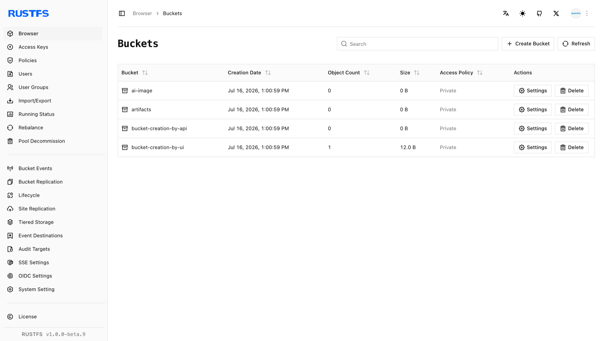

このガイドでは、RustFS の UI、`rc`、または S3 API を使ってバケットを作成する方法を説明します。

## 要件

- 稼働中の RustFS インスタンス（[インストールガイド](../../../installation/index.md) を参照）。
- コマンドラインの手順では、[`rc`](/ja/operations/rc) をインストールし、エイリアスを設定します。

## RustFS Console を使う

1. RustFS Console にログインします。
2. **Buckets**（バケット）のページで、右上の **Create Bucket**（バケットを作成）を選びます。
3. バケット名を入力し、**Create**（作成）を選びます。



## `rc` を使う

インストールとエイリアスの設定は、[`rc` ガイド](/ja/operations/rc) を参照します。

バケットを作成します。

```bash
rc bucket create rustfs/my-bucket
rc bucket list rustfs/
```

```text
✓ Bucket 'rustfs/my-bucket' created successfully.
```

## API を使う

API でバケットを作成します。

```http
PUT /{bucketName} HTTP/1.1
```

S3 リクエストは、AWS 署名バージョン 4 で署名する必要があります。ヘッダーを手作業で組み立てず、S3 クライアントを使います。アクセスキーを設定した [AWS CLI](https://docs.aws.amazon.com/cli/latest/userguide/getting-started-install.html) では、次のように実行します。

```bash
aws s3api create-bucket \
  --bucket bucket-creation-by-api \
  --endpoint-url http://localhost:9000
```

RustFS Console に、そのバケットが表示されることを確認します。
