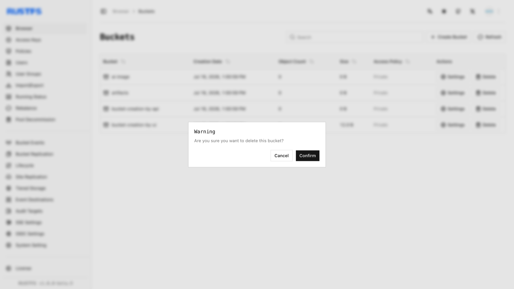

このガイドでは、RustFS の UI、`rc`、または S3 API を使ってバケットを削除する方法を説明します。

## 要件

- コマンドラインの手順を使う前に、[`rc`](/ja/operations/rc) をインストールして設定します。
- 削除する前に対象のバケットを空にするか、削除されるオブジェクトを確認したうえでだけ `--force` を使います。

:::warning[削除は元に戻せません]

バケットの削除は取り消せず、そのバケットに依存するアプリケーションが動作しなくなることがあります。続行する前に、必要なデータをバックアップします。

:::

## RustFS UI を使う

1. RustFS Console にログインします。
2. ホームページで、削除するバケットを選びます。
3. 右端の **Delete**（削除）を選びます。
4. 確認ダイアログで **Confirm**（確認）を選びます。



## `rc` を使う

インストールとエイリアスの設定は、[`rc` ガイド](/ja/operations/rc) を参照します。

バケットを削除します。

```bash
rc bucket remove rustfs/my-bucket
```

```text
✓ Bucket 'rustfs/my-bucket' removed successfully.
```

## API を使う

API でバケットを削除します。

```http
DELETE /{bucketName} HTTP/1.1
```

S3 リクエストは、AWS 署名バージョン 4 で署名する必要があります。ヘッダーを手作業で組み立てず、S3 クライアントを使います。アクセスキーを設定した [AWS CLI](https://docs.aws.amazon.com/cli/latest/userguide/getting-started-install.html) では、次のように実行します。

```bash
aws s3api delete-bucket \
  --bucket bucket-creation-by-api \
  --endpoint-url http://localhost:9000
```

RustFS Console で、バケットが削除されたことを確認します。
