このページでは、オンデマンド移行、開始前の要件、移行手順を説明します。手順の例は Cloudflare R2 です。

## 1. 概要

オンデマンド移行は受信方向の取り込みです。クライアントがローカルバケットにないキーを読むと、RustFS は設定済みソースからそのオブジェクトを読み、クライアントへ返し、ローカルへ保存します。まだクライアントが要求していないキーを取り込むバックフィルも開始できます。有効化フォームには、RustFS がソースへ書き込まず、削除もしないと書かれています。移行ページには、RustFS 上の新しい `PUT` と `DELETE` はソースへ同期されないこと、ソース側のその後の変更はローカルコピーを更新しないことが書かれています。オンデマンド移行は、ソースからの継続的なレプリケーションではありません。

| 目的 | 使う機能 |
| --- | --- |
| 下の一覧のプロバイダーから、読み取りミスまたはバックフィルでオブジェクトを RustFS へ取り込む | オンデマンド移行 |
| RustFS バケットのオブジェクトバージョンを別のバケットへ送る | [バケットレプリケーション](./replication.md) |
| デプロイ間でサイト設定と ID データを同期する | [サイトレプリケーション](/ja/operations/high-availability/site-replication) |

[バケットレプリケーション](./replication.md)はオブジェクトバージョンの送信方向のコピーであり、両方のバケットでバージョニングが必要です。キーがローカルに保存されたあと、オンデマンド移行はソースの変更を追い続けません。

**Source connection** → **Provider** には次のソースが表示されます。名称は Console のラベルそのものです。Google Cloud Storage は HMAC と Native の 2 項目です。

1. Amazon S3
2. S3-compatible storage
3. MinIO
4. RustFS
5. Cloudflare R2
6. Google Cloud Storage (HMAC)
7. Azure Blob Storage (Native)
8. Google Cloud Storage (Native)

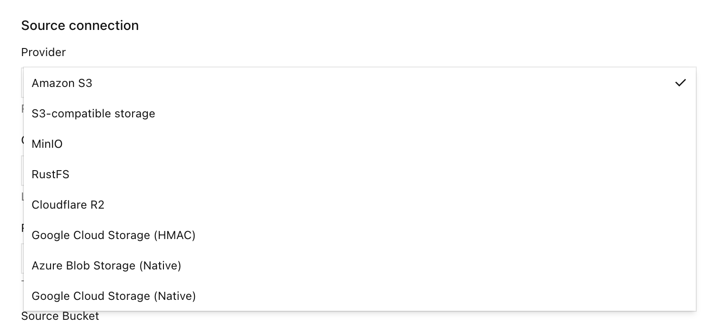

この一覧にないプロバイダーが必要な場合は、公式の確認のため [RustFS リポジトリ](https://github.com/rustfs/rustfs) にプルリクエストを開いてください。

:::warning[レプリケーションの循環を作らない]

このローカルバケットのレプリケーションターゲットになっているバケットを、オンデマンド移行のソースに選ばないでください。

:::

:::note[ソースを有効にしてもデータはコピーされない]

**Migration active** は、バケットがソースに接続された状態です。クライアントが欠落キーを読むか、バックフィルを開始するまで、ランタイムのカウンタは 0 のままです。

:::

## 2. 要件

- インストール済みの RustFS インスタンス。[Linux クイックスタート](/ja/installation/linux/quick-start) に従って RustFS をインストールし、Console にサインインしてバケットを作成します。この手順ではポート `9001` の Console v1.0.3 を使いました。
- ローカルバケットを読み取るホスト上の RustFS CLI [`rc`](/ja/operations/rc)。
- この例で使う [Cloudflare R2](https://developers.cloudflare.com/r2/) バケット。

## 3. 移行

この節は **Cloudflare R2 を例**にします。概要の一覧にある他のプロバイダーからの移行も、同じ流れです。空のローカルバケットを作成し、オンデマンド移行を有効にし、**Provider** を選び、**Test connection** を選び、**Enable migration** を選び、その後 GET ミスまたはバックフィルで取り込みます。プロバイダーごとに変わるのは、エンドポイント、認証情報、バケットのフィールドだけです。

この手順のスクリーンショットでは、R2 のアカウント ID とアクセスキーをプレースホルダーに置き換えています。端末プロンプトのホストは `localhost` です。

この節の認証情報とエンドポイントは、Cloudflare R2 の例です。他のプロバイダーでは、同じ Console フィールドに、そのシステムのエンドポイント、読み取り用の認証情報、バケット名を入力します。

- **On-demand migration** がある RustFS Console。この手順ではポート `9001` の Console v1.0.3 を使いました。
- ローカルバケットの **Settings** を開ける Console アカウント。
- ローカルバケットを読み取るホスト上の RustFS CLI [`rc`](/ja/operations/rc)。
- ソースバケットのオブジェクトを読める Cloudflare R2 API トークン。トークンは可能ならそのバケットに限定します。R2 バケットのパブリックアクセスはこの手順では使いません。
- ソースバケットの R2 S3 エンドポイント `https://<account-id>.r2.cloudflarestorage.com`。バケットが管轄区域にある場合は、R2 ダッシュボードに表示されるエンドポイントをコピーします。

`rc` は R2 ではなく、ローカル RustFS の S3 API を向けます。

```bash
rc alias set rustfs http://localhost:9000 <your-access-key> <your-secret-key> --region us-east-1 --bucket-lookup path
```

この手順のローカルバケットは `migration`、R2 バケットは `dl-rustfs` です。`migration` ではバージョニングが有効、オブジェクトロックは無効でした。オンデマンド移行の有効化にオブジェクトロックは不要で、バージョニングも有効化の前提ではありませんでした。バージョニングが有効なとき、ローカルの削除マーカーでソースキーを隠せます。

:::warning[読み取り専用のソーストークンを使う]

ソースバケットを読めて、そこへ書き込みや削除ができない R2 トークンを作ります。フォームには、RustFS がシークレットを保存し、Console へは返さないと書かれています。

:::

### 1. 空のローカルバケットを作成する

Console で **Browser** → **Buckets** を開き、`migration` というバケットを作成して、オブジェクトがないことを確認します。ソースを接続する準備ができたら、そのバケットの **Settings** を開きます。

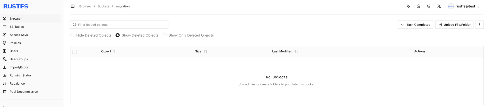

### 2. オンデマンド移行を開く

1. バケット `migration` を開き、**Settings** を選びます。
2. **Automation** を選びます。
3. **On-demand migration** を見つけます。
4. 未設定なら **Open migration settings** または **+ Enable on-demand migration** を選びます。すでに有効なら **Manage migration** を選びます。

この手順の未設定ページには、移行ソースが未設定であることと、**+ Enable on-demand migration** が表示されます。

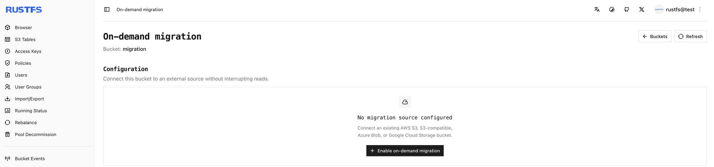

ソースを有効にすると、**Automation** に **Migration active** と **Manage migration** が表示されます。

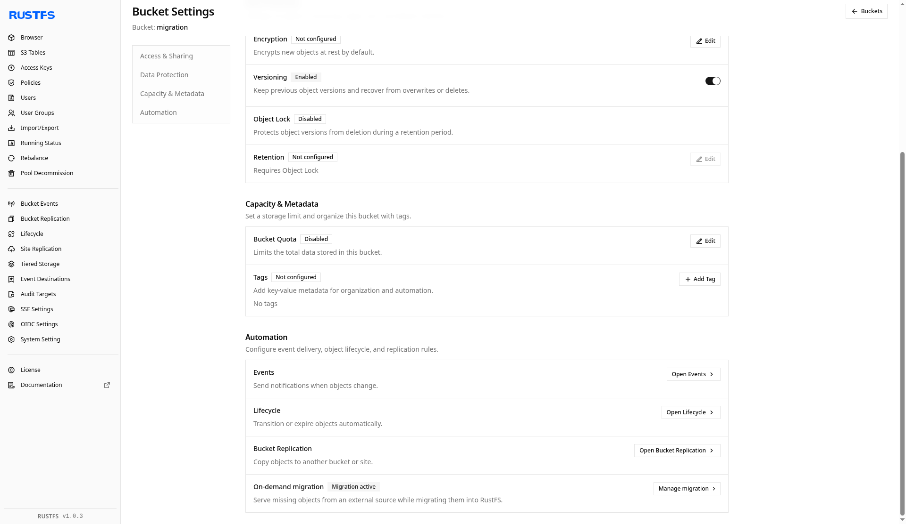

### 3. バケットを Cloudflare R2 に向ける

**Enable on-demand migration** でソースを次のように設定します。アカウント ID とキーは自分の R2 トークンに置き換えます。トークンがセッショントークンを要求しない場合、セッショントークンは空にします。ソース名前空間全体を対象にするには **Local prefix** を空にします。この手順では追加のプレフィックスを保存していません（**All keys**、**No added prefix**）。

| フィールド | この手順での値 |
| --- | --- |
| Source | Cloudflare R2 |
| Endpoint | `https://<account-id>.r2.cloudflarestorage.com` |
| Region | `us-east-1`（フォームは `auto` も受け付けます） |
| Source Bucket | `dl-rustfs` |
| Addressing style | Automatic |
| Access Key | R2 のアクセスキー ID |
| Secret Key | R2 のシークレット |
| Session token | 空 |
| Local prefix | 空 |

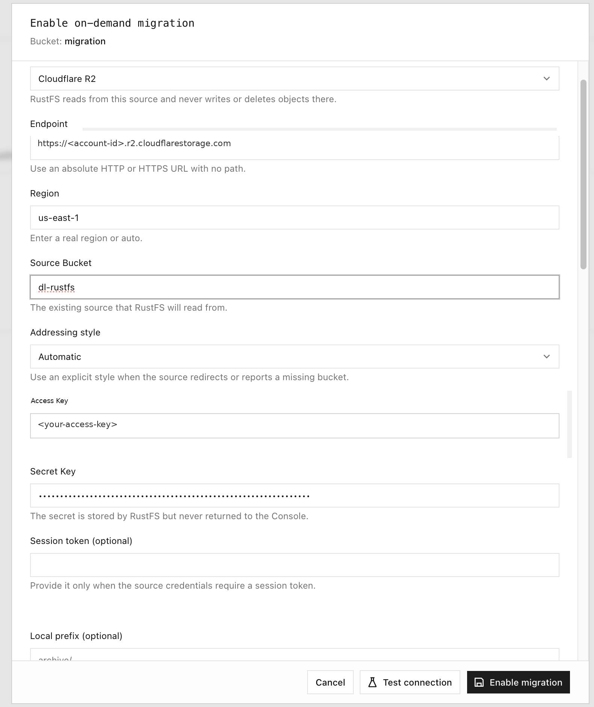

### 4. 接続をテストして移行を有効にする

**Test connection** を選びます。成功すると **Connection test passed** と、ソースバケットのサンプルオブジェクトキーが表示されます。その後 **Enable migration** を選びます。

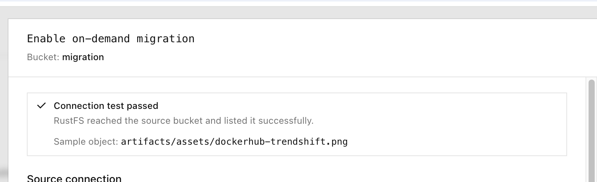

同じ結果はトーストでも表示されます。

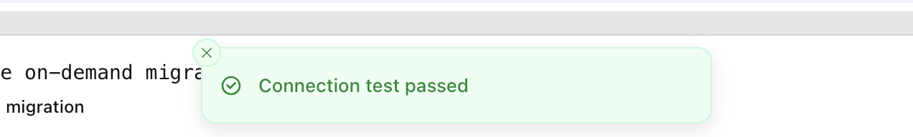

設定状態は **Migration active** になります。読み取りかバックフィルが起きるまで、**Runtime status** の移行済みオブジェクトと移行済みデータは 0 のままです。**Latest job** は **No backfill yet** のままです。

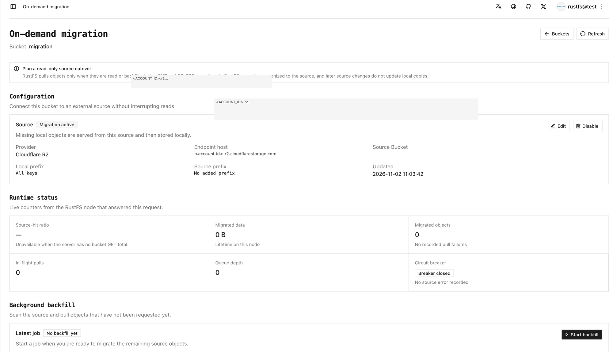

### 5. rc cp でオブジェクトを 1 つ取得する

`rc` でローカルバケットを読みます。このリクエストを R2 エンドポイントへ送らないでください。この手順ではローカルバケットがまだ空で、欠落していたオブジェクトを 1 つ取り込みました。最初のミスはオブジェクトをクライアントへ返し、ローカルへ保存します。同じキーの次の読み取りは RustFS が返します。

```bash
rc cp rustfs/migration/artifacts/rustfs/packages/nightly/rustfs-nightly-2026-11-02.deb /tmp/
```

```text
rustfs/migration/artifacts/rustfs/packages/nightly/rustfs-nightly-2026-11-02.deb -> /tmp/rustfs-nightly-2026-11-02.deb (71.34 MiB)
```

ソースバケットにこのオブジェクトがない場合は、別のキーを使います。端末セッションには、この `rc cp` と、その後のローカル nightly プレフィックスに対する `rc ls` が写っています。一覧はオブジェクトがローカルに存在したあとのプレフィックスです。上の 1 回の `rc cp` が 71.34 MiB の取り込みです。

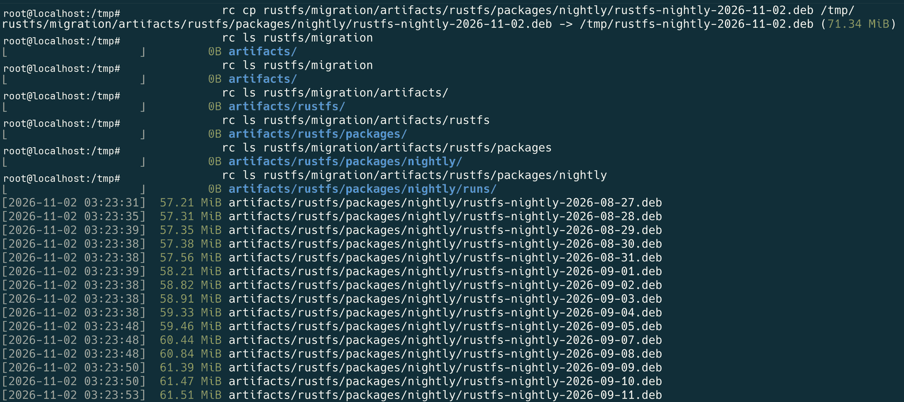

Cloudflare ダッシュボードに表示されていた、ソース側の同じ nightly プレフィックスです。

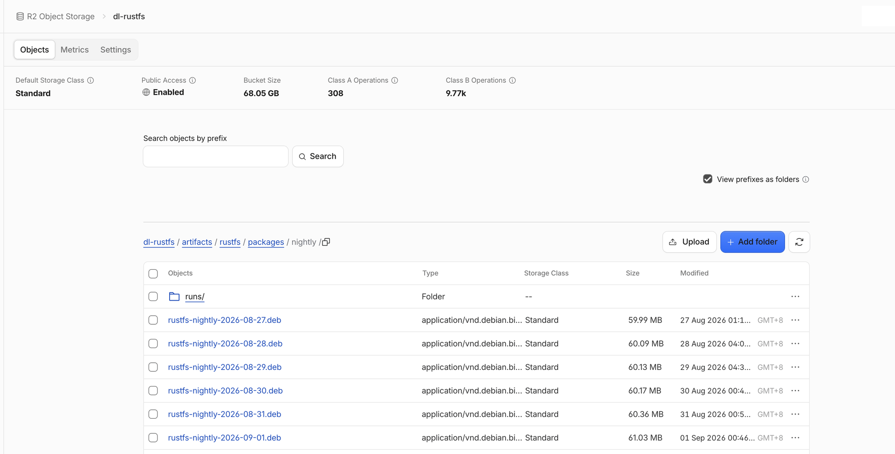

そのダッシュボードのバケットサイズは、Cloudflare が示すバケット全体の合計です。このページ後半の RustFS カウンタは、移行ジョブが報告した値です。

単一オブジェクトの取り込み後、Console の **Browser** にローカルバケットのそのオブジェクトが表示されます。

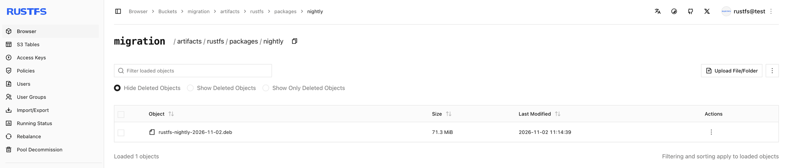

### 6. プレフィックスをバックフィルする

**Start backfill** はソースを走査し、まだローカルにないキーを取り込みます。この手順のダイアログでは次の設定を使いました。

| オプション | 意味 | この手順での値 |
| --- | --- | --- |
| Source listing prefix | このプレフィックスだけを一覧する | `artifacts/rustfs/packages/nightly/` |
| Existing local objects | キーがすでにローカルにあるときの扱い | **Always skip** |
| Dry run | 一致を一覧し、キューにも書き込みにもしない | 事前確認ではオン、取り込みではオフ |

**Dry run** は一致するオブジェクトを一覧するだけで、キューに入れず、オブジェクトも書きません。プレフィックスを確認してから **Dry run** をオフにして取り込みます。

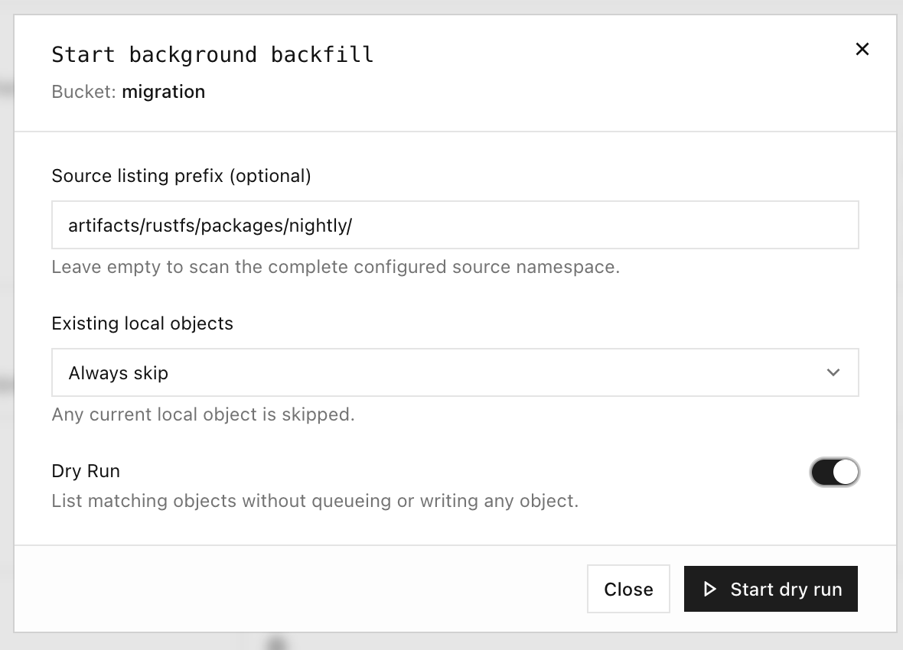

手順中に記録したプレフィックス一覧の抜粋です。ラボの記録では先頭のキーが切れています。完全なキーは `artifacts/rustfs/packages/nightly/rustfs-nightly-2026-10-29.deb` の形です。タイムスタンプは当時の記録で、おおよそ UTC です。完全な一覧はこの抜粋より長くなります。

```text
…ghtly-2026-10-29.deb
[2026-11-02 03:25:08]  70.36 MiB artifacts/rustfs/packages/nightly/rustfs-nightly-2026-10-30.deb
[2026-11-02 03:25:08]  70.65 MiB artifacts/rustfs/packages/nightly/rustfs-nightly-2026-10-31.deb
[2026-11-02 03:25:08]  71.15 MiB artifacts/rustfs/packages/nightly/rustfs-nightly-2026-11-01.deb
[2026-11-02 03:14:39]  71.34 MiB artifacts/rustfs/packages/nightly/rustfs-nightly-2026-11-02.deb
[2026-11-02 03:25:08]  71.34 MiB artifacts/rustfs/packages/nightly/rustfs-nightly-latest.deb
```

バックフィルがオブジェクトを書き込んでいる間、Console は一覧済み件数と取り込み済み件数を表示します。ソースの走査が続いている間は、完了割合を表示しません。

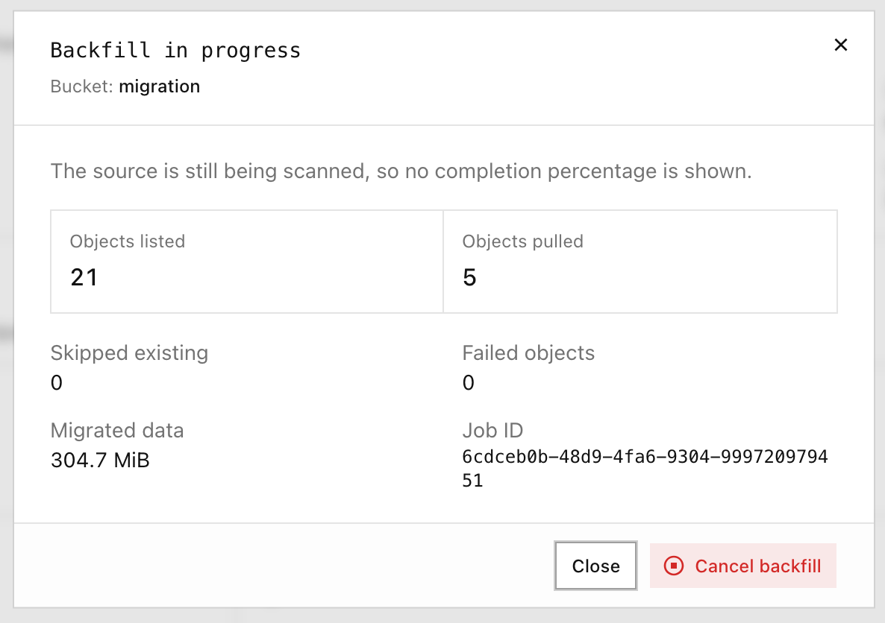

### 7. ドライランのあと、ソース名前空間をバックフィルする

設定済みのソース名前空間を走査するには、**Source listing prefix** を空にします。先に **Dry run** を実行して一覧を確認します。その後 **Dry run** をオフにしてバックフィルを開始します。

この手順のドライランは、オブジェクトを一覧しただけで取り込みはありませんでした。

| Listed | Pulled | Skipped | Failed objects | Data |
| --- | --- | --- | --- | --- |
| 128 | 0 | 0 | 0 | 0 B |

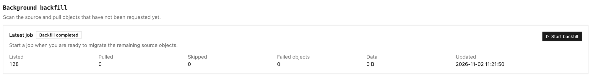

その後、プレフィックスを空にして実行した全体のバックフィルは次の結果でした。

| Listed | Pulled | Skipped | Failed objects | Data |
| --- | --- | --- | --- | --- |
| 128 | 127 | 1 | 0 | 8.0 GiB |

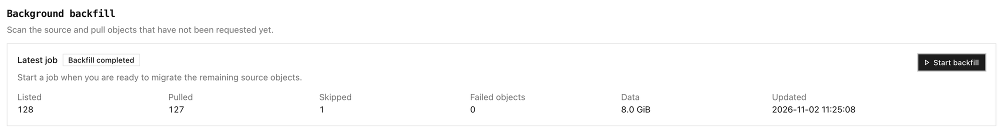

### 8. バケットを確認する

オンデマンド移行のページで確認します。

1. **Runtime status** — 移行済みオブジェクトと移行済みデータが 0 ではなく、取り込み失敗が記録されていない。
2. **Background backfill** — 最新ジョブに、一覧、取り込み、スキップ、失敗の件数が表示されている。
3. **Browser** と `rc` — 上の端末セッションのように `rc ls` でプレフィックスを一覧し、ローカルにあるキーを `rc cp` で再度読む。

この手順のランタイムパネルは **Migrated data** が 8.1 GiB、**Migrated objects** が 128 でした。最新のバックフィルは Listed 128、Pulled 127、Skipped 1、Failed objects 0、Data 8.0 GiB でした。

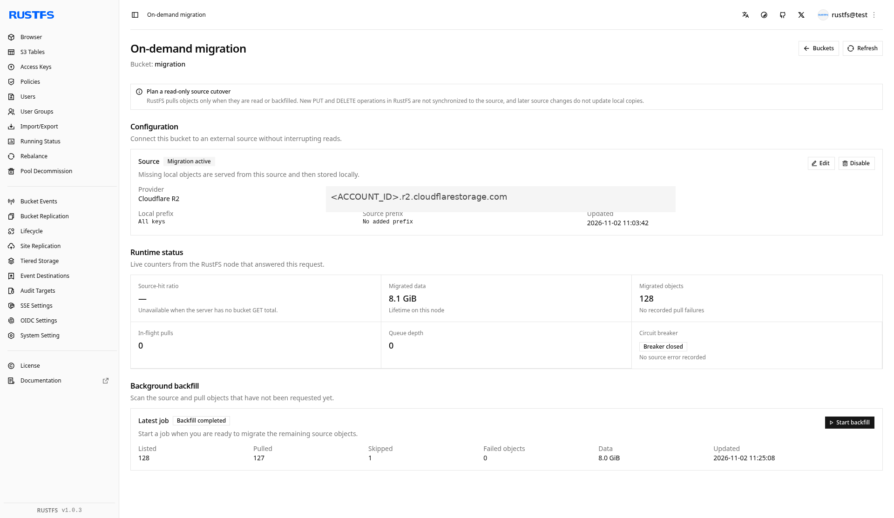

手順後のバケット一覧では、`migration` が 128 オブジェクト、8.1 GiB になっています。

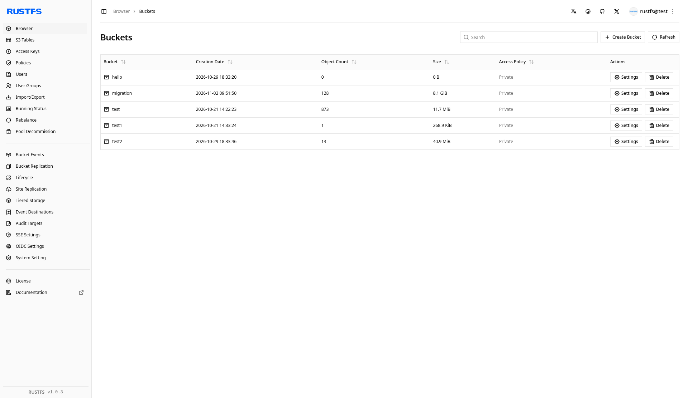

:::warning[ローカルコピーはソースを追従しない]

R2 上の同じキーを後から変更しても、ローカルオブジェクトの上には取り込まれません。そのキーへのローカル `PUT` はソースへ書き戻されず、ソースキーより前に残ります。オンデマンド移行は、ソースからの継続的なレプリケーションではありません。

:::

### 次のステップ

- 送信方向のコピーが必要なときは、[バケットレプリケーションを設定する](./replication.md)
- [rc をインストールして使う](/ja/operations/rc)
- サイト設定と ID データには、[サイトレプリケーションを設定する](/ja/operations/high-availability/site-replication)
