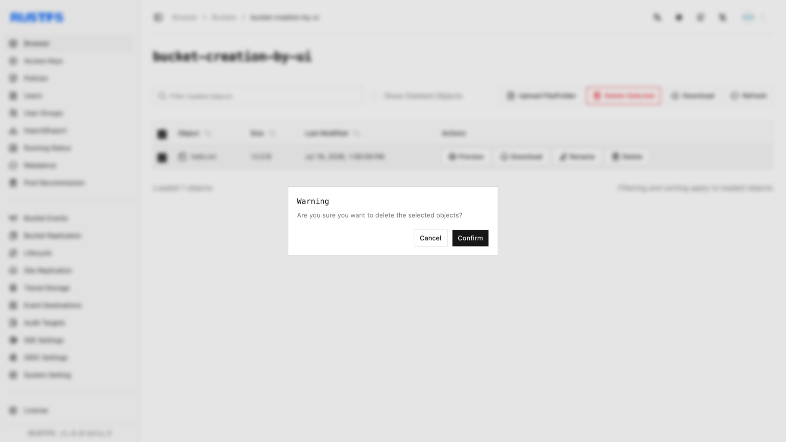

このガイドでは、オブジェクトの削除を扱います。

## 要件

- コマンドラインの手順を使う前に、[`rc`](/ja/operations/rc) をインストールして設定します。
- オブジェクトを削除する前に、エイリアス、バケット、オブジェクトキーを確認します。

## RustFS UI を使う

1. RustFS Console にログインします。
2. 削除するオブジェクトが含まれるバケットを選択します。
3. バケットページで、削除するオブジェクトを選択します。
4. 右上の **Delete Selected Items**（選択項目の削除）を選び、続けて **Confirm**（確認）を選択します。



## `rc` を使う

オブジェクトを削除します。

```bash
rc object remove rustfs/my-bucket/hello.txt
rc object list rustfs/my-bucket
```

```text
Removed: rustfs/my-bucket/hello.txt
✓ Removed 1 object(s).
```

RustFS Console で削除を確認します。

## API を使う

API でオブジェクトを削除します。

```http
DELETE /{bucketName}/{objectName} HTTP/1.1
```

S3 リクエストは AWS Signature V4 で署名する必要があります。ヘッダーを手作業で組み立てず、S3 クライアントを使います。アクセスキーを設定した [AWS CLI](https://docs.aws.amazon.com/cli/latest/userguide/getting-started-install.html) では、次のように実行します。

```bash
aws s3api delete-object \
  --bucket bucket-creation-by-api \
  --key hello.txt \
  --endpoint-url http://localhost:9000
```

RustFS Console で削除を確認します。
