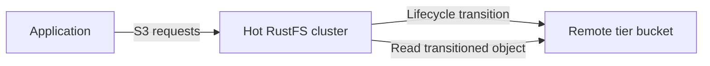

RustFS の階層化ストレージは、ローカルストレージ上のオブジェクトを、設定したリモートバックエンドへ移します。このページでは、対応しているターゲットを説明し、Console で RustFS の階層を追加して維持する方法を示します。

階層化は非同期です。RustFS はオブジェクトのメタデータをローカルに保持し、オブジェクトデータをリモート階層へ転送し、元のバケットとオブジェクトキーを通じた S3 の読み取りを継続して提供します。



:::note[階層名は AWS のストレージクラスではない]

ライフサイクルルールは、`COLDTIER` のような大文字の名前で、登録済みの階層を参照します。その文字列と完全に一致する有効な名前で RustFS の階層を登録し、ターゲットの動作を確認していない限り、`INTELLIGENT_TIERING`、`GLACIER`、`DEEP_ARCHIVE` のような AWS のクラスラベルで代用してはなりません。

:::

## 対応しているバックエンド

RustFS のソースは、次のターゲット種別について、ウォームバックエンドの実装を定義しています。

| 種別 | 設定キー | 典型的なターゲット |
| --- | --- | --- |
| RustFS | `rustfs` | 別の RustFS デプロイ |
| S3 | `s3` | Amazon S3、またはこのバックエンドが対応する S3 エンドポイント |
| Wasabi | `wasabi` | Wasabi のオブジェクトストレージ |
| MinIO | `minio` | MinIO デプロイ |
| Aliyun | `aliyun` | Alibaba Cloud Object Storage Service（OSS） |
| Tencent | `tencent` | Tencent Cloud Object Storage（COS） |
| Huaweicloud | `huaweicloud` | Huawei Cloud Object Storage Service（OBS） |
| Azure | `azure` | Azure Blob Storage |
| GCS | `gcs` | Google Cloud Storage |
| R2 | `r2` | Cloudflare R2 |

プロバイダーごとのペイロードと、認証情報の要件は異なります。以下の一連の手順では RustFS バックエンドを使います。RustFS のソースに、この経路のホットクラスターからコールドクラスターまでのエンドツーエンドテストが含まれているためです。

## 始める前に

次を準備します。

- ホットデータを格納する、ソースの RustFS デプロイ。
- ソースとは別のターゲット RustFS デプロイと、既存のターゲットバケット。この例では、ターゲット上の `my-bucket` を使います。
- そのバケットでオブジェクトの書き込み、取得、一覧表示、削除ができる、ターゲットの認証情報。
- ソースデプロイの RustFS Console へのアクセス。

本番では、両方のデプロイに TLS を使います。ターゲットの認証情報は、階層専用のバケットとプレフィックスに制限します。

## 1. 階層化ストレージを開く

ソースデプロイの RustFS Console にサインインします。左のナビゲーションで **Tiered Storage**（階層化ストレージ）を選び、右上の **Add Tier**（階層を追加）を選びます。

## 2. ターゲットを選択する

ターゲットのプロバイダーを選びます。この例では **RustFS** を選び、ソースデプロイを別の RustFS デプロイへ接続します。

## 3. ターゲットの詳細を入力する

フォームに入力します。

| フィールド | 値 |
| --- | --- |
| **Name (A-Z,0-9,_)**（名前。A-Z、0-9、_） | `COLDTIER` のような、一意で大文字の階層名を入力します。 |
| **Endpoint**（エンドポイント） | ターゲットとなる RustFS の S3 エンドポイントを入力します。 |
| **Access Key**（アクセスキー） | ターゲットデプロイのアクセスキーを入力します。 |
| **Secret Key**（シークレットキー） | ターゲットデプロイのシークレットキーを入力します。 |
| **Bucket**（バケット） | `my-bucket` のような、既存のターゲットバケット名を入力します。 |
| **Prefix (Optional)**（プレフィックス。任意） | 階層へ移すオブジェクト専用のプレフィックスを、必要に応じて入力します。 |
| **Region**（リージョン） | `us-east-1` のようなターゲットのリージョンを、必要に応じて入力します。 |

ターゲットバックエンドが、別の対応ストレージクラスを要求する場合を除き、**Storage Class**（ストレージクラス）は既定のままにします。

:::warning[階層の認証情報を保護する]

フォームにはシークレットキーが含まれます。ターゲットのバケットとプレフィックスに制限した認証情報を使います。スクリーンショット、チケット、ログにキーを出してはなりません。

:::

## 4. 階層を保存する

**Save**（保存）を選びます。RustFS はバックエンドを検証し、小さなオブジェクトの書き込み、読み取り、削除によって疎通を確認します。エンドポイント、認証情報、バケットの権限、またはバックエンド設定がその確認を完了できない場合、保存は失敗します。

**Tiers**（階層）の一覧に階層が表示されたあと、[ライフサイクル管理](/ja/administration/data/lifecycle-management) で移行ルールを設定します。登録しただけではオブジェクトは移動しません。ライフサイクルルールがその階層名を参照して初めて移動します。

## `rc` で階層を管理する

[`rc`](/ja/operations/rc) をインストールして設定し、ソースデプロイに登録された階層を一覧します。

```bash
rc bucket lifecycle tier list local
```

Console の手順で説明したのと同じ設定で、RustFS の階層を追加します。

```bash
rc bucket lifecycle tier add rustfs COLDTIER local \
  --endpoint <target-rustfs-endpoint> \
  --access-key <your-access-key> \
  --secret-key <your-secret-key> \
  --bucket my-bucket \
  --region us-east-1
```

階層の設定と、取得できる統計を確認します。

```bash
rc bucket lifecycle tier info COLDTIER local
```

残りの階層コマンドは、認証情報の更新と、階層の削除です。

```bash
rc bucket lifecycle tier edit COLDTIER local \
  --access-key <your-access-key> \
  --secret-key <your-secret-key>
rc bucket lifecycle tier remove COLDTIER local
```

移行ルールの作成、移行の確認、ローカルコピーの復元は、[ライフサイクル管理](/ja/administration/data/lifecycle-management) を参照します。階層を変更する前に `rc bucket lifecycle tier <command> --help` を実行し、プロバイダー固有のオプションを確認します。

## 階層の稼働状況を監視する

SigV4 で署名したリクエストと、`admin:ListTier` 権限を使い、階層の統計エンドポイントを呼び出します。

```http
GET /rustfs/admin/v3/tier-stats?tier=COLDTIER HTTP/1.1
Host: <hot-rustfs-endpoint>
```

移行の失敗は、ソースクラスターの容量と、ターゲット側の可用性とともに監視します。階層を設定すると、復元済みのローカルコピーがないオブジェクトの読み取り経路に、ターゲットのサービスとネットワーク経路が加わります。

## 階層を変更または削除する

Admin API は、次の変更用ルートを公開しています。いずれも `admin:SetTier` が必要です。

| 操作 | ルート |
| --- | --- |
| 階層を編集する | `POST /rustfs/admin/v3/tier/{tiername}` |
| 階層を削除する | `DELETE /rustfs/admin/v3/tier/{tiername}` |
| すべての階層を消去する | `POST /rustfs/admin/v3/tier/clear` |

階層を編集または削除する前に、次を行います。

1. その階層を参照するライフサイクルルールを無効にします。
2. 移行ジョブが、その階層をまだ使っていないことを確認します。
3. ソースのオブジェクトが、そのターゲットバケットまたはプレフィックスに保存されたデータに依存していないことを確認します。
4. 階層の設定をバックアップし、ターゲットの場所を記録します。

通常の階層の変更では、バックエンドの使用状況を確認し、空でないターゲットを保護します。移行済みオブジェクトがすべて回復できることを独自に証明していない限り、それらの確認を迂回する `force` オプションを使ってはなりません。使用中の階層の設定を削除すると、ソースクラスターから移行済みオブジェクトを読み取れなくなることがあります。

:::warning[階層上のオブジェクトを直接変更しない]

ターゲットバケット内で生成されたオブジェクトの名前変更、上書き、削除をしてはなりません。ローカルの移行メタデータとリモートデータの整合を RustFS が保てるよう、ソースオブジェクトはホット側の RustFS クラスターを通して管理します。

:::

## Admin API リファレンス

現在の RustFS ソースは、次の階層用ルートを登録しています。

| メソッド | ルート | 権限 |
| --- | --- | --- |
| `PUT` | `/rustfs/admin/v3/tier` | `admin:SetTier` |
| `POST` | `/rustfs/admin/v3/tier/{tiername}` | `admin:SetTier` |
| `DELETE` | `/rustfs/admin/v3/tier/{tiername}` | `admin:SetTier` |
| `POST` | `/rustfs/admin/v3/tier/clear` | `admin:SetTier` |
| `GET` | `/rustfs/admin/v3/tier`（設定の一覧） | `admin:ListTier` |
| `GET` | `/rustfs/admin/v3/tier/{tier}`（接続の確認） | `admin:ListTier` |
| `GET` | `/rustfs/admin/v3/tier-stats`（統計の読み取り） | `admin:ListTier` |

Admin API のリクエストには、すべて SigV4 認証が必要です。これらのルートは管理用インターフェースであり、通常の S3 バケット操作ではありません。

## 次のステップ

[ライフサイクル管理](/ja/administration/data/lifecycle-management) を確認し、階層化ストレージで使う管理者とサービス認証情報に [アクセスポリシー](/ja/security-compliance/iam/policies) を設定します。
