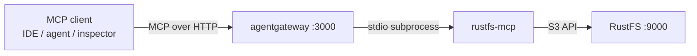
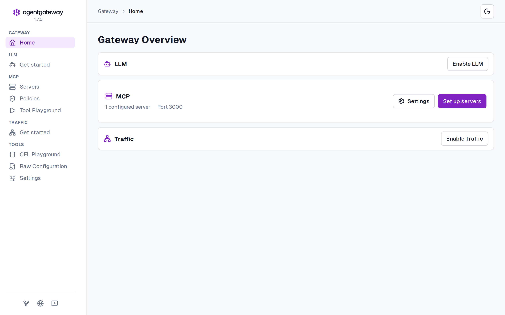
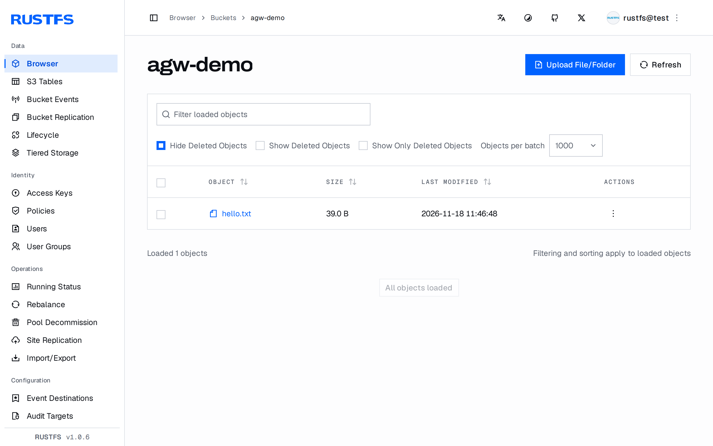

[agentgateway](https://github.com/agentgateway/agentgateway) は MCP・A2A・LLM トラフィック向けの AI ネイティブ プロキシです。その MCP ゲートウェイは MCP サーバーをフェデレーションし、認証・ポリシー・OpenTelemetry オブザーバビリティ付きでネットワーク経由で公開します。[RustFS は独自の MCP サーバー](https://github.com/rustfs/mcp)を同梱しており、ストレージ操作をツールとして公開していますが、トランスポートは stdio のみです。ローカルのサブプロセスとしてなら使えますが、リモートからはアクセスできません。このガイドは両者を接続します。agentgateway が RustFS MCP サーバーを stdio ターゲットとして起動し、リモート MCP エンドポイントとして提供することで、どんな MCP クライアントからもゲートウェイ経由で RustFS ストレージを操作できるようになります。このワークフローは agentgateway `1.7.0`、`rustfs/mcp` サーバー、RustFS `1.0.6` で検証しました。

ゲートウェイホストの Docker と、到達可能な RustFS サーバーが必要です。

## アーキテクチャ



ゲートウェイは `rustfs-mcp` を子プロセスとして起動し、その stdio トランスポートとポート 3000 の MCP Streamable HTTP リスナーの間を変換します。ストレージ操作はゲートウェイを経由するため、ゲートウェイのポリシー・レート制限・テレメトリーがオブジェクトストレージのツール呼び出しにも適用されます。

:::note[stdio サーバーにゲートウェイが必要な理由]

stdio の MCP サーバーは、それを起動したマシンからしかアクセスできません。agentgateway が欠けているトランスポートを補います。リモートクライアントは HTTP で接続し、S3 の認証情報はゲートウェイホスト上にとどまります。

:::

## 1. RustFS MCP サーバーイメージをビルドする

MCP サーバーは独立リポジトリにあります。ソースからイメージをビルドします：

```bash
git clone https://github.com/rustfs/mcp.git rustfs-mcp
docker build -t rustfs/rustfs-mcp:latest rustfs-mcp
```

ビルドで得られるイメージは stdio で MCP サーバーを実行し、標準の `AWS_*` 環境変数で設定された任意の S3 互換エンドポイントと通信します。

## 2. agentgateway を設定する

ゲートウェイの設定を作成します。ターゲットは MCP イメージをサブプロセスとして起動し、ボリュームマウントがアップロードツール用のホストディレクトリを公開し、エンドポイントは Docker ブリッジゲートウェイアドレス経由で RustFS を指します：

```yaml title="config.yaml"
mcp:
  port: 3000
  targets:
  - name: rustfs
    stdio:
      cmd: docker
      args:
      - run
      - --rm
      - -i
      - -v
      - /data/agentgateway/demo:/demo
      - -e
      - AWS_ACCESS_KEY_ID=<your-access-key>
      - -e
      - AWS_SECRET_ACCESS_KEY=<your-secret-key>
      - -e
      - AWS_REGION=us-east-1
      - -e
      - AWS_ENDPOINT_URL=http://172.17.0.1:9000
      - rustfs/rustfs-mcp:latest
```

:::note[MCP コンテナからのエンドポイントアドレス指定]

MCP サーバーはコンテナ内で動くため、RustFS ホストの `127.0.0.1:9000` には到達できません。Docker ブリッジゲートウェイアドレス `172.17.0.1:9000`（または共有ネットワークエイリアス）を使ってください。RustFS 自身もカスタムブリッジネットワークの Docker で動いている場合、Docker はブリッジ同士を分離します。両コンテナを同じネットワークに接続し、コンテナ名を使ってください。

:::

設定内容を渡してゲートウェイを起動します：

```bash
agentgateway -c "$(cat config.yaml)"
```

ログに各リスナーが確認できます。ポート 3000 の MCP バインド、`http://localhost:15000/ui` の管理 UI、15020 の stats エンドポイントです。



## 3. ゲートウェイ経由で RustFS ツールを呼び出す

MCP インスペクターを使うと手動検証のためにゲートウェイを操作できます：

```bash
npx @modelcontextprotocol/inspector --cli http://localhost:3000/mcp --method tools/list
```

```json
"tools": ["create_bucket", "delete_bucket", "get_object", "list_buckets", "list_objects", "upload_file"]
```

ゲートウェイ経由でバケットを作成し、ファイルをアップロードします：

```bash
npx @modelcontextprotocol/inspector --cli http://localhost:3000/mcp \
  --method tools/call --tool-name create_bucket \
  --tool-arg bucket_name=agw-demo

npx @modelcontextprotocol/inspector --cli http://localhost:3000/mcp \
  --method tools/call --tool-name upload_file \
  --tool-arg local_file_path=/demo/hello.txt \
  --tool-arg bucket_name=agw-demo --tool-arg object_key=hello.txt
```

```text
✅ **File uploaded successfully!**
```

:::note[アップロードパスは MCP サーバー側]

`upload_file` は MCP サーバーを実行しているプロセスのファイルシステムから `local_file_path` を読みます。つまりコンテナ内です。手順 2 のボリュームマウント `-v /data/agentgateway/demo:/demo` がホストディレクトリをコンテナ内の `/demo` として公開するため、ツールはファイルを読めます。

:::

## 4. RustFS 内のオブジェクトを確認する

ゲートウェイ経由で書き込まれたオブジェクトは、通常の S3 書き込みと同様にバケットに着地します。S3 API で確認し、接続プレースホルダーをすべて置き換えてください：

```bash
aws s3api list-objects --bucket agw-demo \
  --endpoint-url http://localhost:9000
```

```json
{
    "Contents": [
        {
            "Key": "hello.txt",
            "Size": 39,
            "StorageClass": "STANDARD"
        }
    ]
}
```

ゲートウェイ経由で読み戻してループを閉じます：

```bash
npx @modelcontextprotocol/inspector --cli http://localhost:3000/mcp \
  --method tools/call --tool-name get_object \
  --tool-arg bucket_name=agw-demo --tool-arg object_key=hello.txt --tool-arg mode=read
```

    Content: hello from rustfs-mcp via agentgateway



## 検証結果

| 検査 | 期待される結果 |
| --- | --- |
| ゲートウェイ経由の MCP ハンドシェイク | `serverInfo.name` が `rustfs-mcp-server`、プロトコル `2025-03-26` を報告 |
| `tools/list` | 6 つのストレージツールすべてがフェデレーション：`create_bucket`、`delete_bucket`、`get_object`、`list_buckets`、`list_objects`、`upload_file` |
| ゲートウェイ経由の `create_bucket` | バケットが RustFS に現れる |
| ゲートウェイ経由の `upload_file` | オブジェクトがバケットに着地。コンソールと S3 API の両方で見える |
| ゲートウェイ経由の `get_object` | 内容がアップロードしたファイルとバイト単位で一致 |
| ゲートウェイ管理 UI | 構成済みの MCP サーバーとポートを表示 |

## トラブルシューティング

### `Error: invalid config: invalid type: string "config.yaml"`

config パラメータが受け取るのは設定の中身であり、パスではありません。ファイルの内容を渡してください：`agentgateway -c "$(cat config.yaml)"`。

### MCP ツールがタイムアウトしたり接続エラーを報告したりする

MCP コンテナから RustFS のアドレスに到達できていません。コンテナ内の `127.0.0.1:9000` はコンテナ自身を指します。`172.17.0.1:9000`（Docker ブリッジゲートウェイ）か共有ネットワークエイリアスを使ってください。手順 2 を参照。

### `upload_file` がローカルファイル未存在で失敗する

パスは MCP サーバーコンテナ内で解決されます。`-v` でホストディレクトリをコンテナにマウントし、マウント後のパスを参照してください。手順 2 を参照。

### `GET /mcp` が `406 Not Acceptable` を返す

想定された動作です。Streamable HTTP エンドポイントは `Accept: application/json, text/event-stream` ヘッダー付きの `POST` のみを受け付けます。ブラウザではなくインスペクターなどの MCP クライアントを使ってください。

## 次のステップ

- ツール一式の全体像は [RustFS MCP サーバー](/developer/mcp)のリファレンスを参照してください。
- ゲートウェイのアイデンティティ用に [アクセスキー管理](/security-compliance/iam/access-token) で専用の認証情報を作成してください。
- [agentgateway ドキュメント](https://agentgateway.dev/docs/) に従い、同じゲートウェイで認証ポリシー・レート制限・OpenTelemetry を活用してください。
