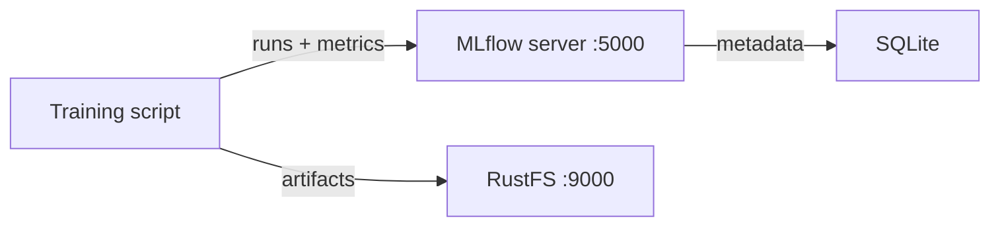
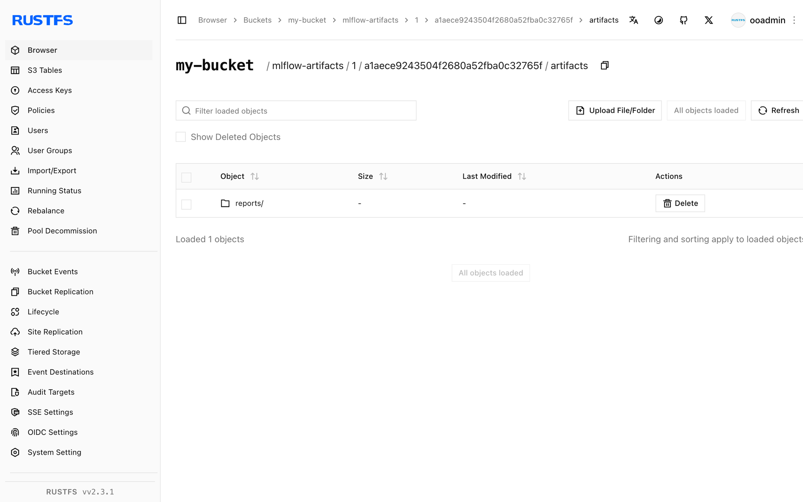

このガイドでは、実験追跡とモデルレジストリのプラットフォームである [MLflow](https://github.com/mlflow/mlflow) を、S3 アーティファクトストアとして **RustFS** に接続します。Docker Compose で MLflow のトラッキングサーバーを起動し、トレーニング実行からパラメーター、メトリクス、アーティファクトを記録し、アーティファクトが RustFS に保存されることを確認します。この流れは `ghcr.io/mlflow/mlflow:v2.22.1` と `rustfs/rustfs-x86-musl:v2.3.1` で検証済みです。

Docker と Compose プラグインが必要です。このデプロイはローカルでの統合テストを目的としており、本番向けではありません。

## アーキテクチャ



トラッキングサーバーは、実験とランのメタデータを SQLite に保持し、モデルファイル、プロット、レポートなどのアーティファクトを `s3://` のアーティファクトルート経由で RustFS に直接保存します。クライアント自身が boto3 と `MLFLOW_S3_ENDPOINT_URL` の設定でアーティファクトをアップロードするため、同じ RustFS 認証情報がクライアントにも必要です。

## 1. プロジェクトファイルを作成する

作業ディレクトリを作成します。

```bash
mkdir rustfs-mlflow
cd rustfs-mlflow
```

環境変数ファイルを作成し、両方の認証情報プレースホルダーを置き換えます。

```ini title=".env"
RUSTFS_ACCESS_KEY=<your-access-key>
RUSTFS_SECRET_KEY=<your-secret-key>
MLFLOW_BUCKET=my-bucket
```

アーティファクトバケットには専用の認証情報を使います。`.env` をバージョン管理にコミットしないでください。

Compose ファイルを作成します。

```yaml title="compose.yaml"
services:
  rustfs:
    image: rustfs/rustfs-x86-musl:v2.3.1
    environment:
      RUSTFS_ACCESS_KEY: ${RUSTFS_ACCESS_KEY}
      RUSTFS_SECRET_KEY: ${RUSTFS_SECRET_KEY}
      RUSTFS_VOLUMES: /data
      RUSTFS_ADDRESS: ":9000"
      RUSTFS_CONSOLE_ADDRESS: ":9001"
      RUSTFS_CONSOLE_ENABLE: "true"
    volumes:
      - rustfs-data:/data
    ports:
      - "9000:9000"
      - "9001:9001"
    healthcheck:
      test: ["CMD", "curl", "-sf", "http://127.0.0.1:9000/health"]
      interval: 10s
      timeout: 5s
      retries: 6
      start_period: 10s
    networks:
      - mlflow

  create-bucket:
    image: rustfs/rc:latest
    depends_on:
      rustfs:
        condition: service_healthy
    environment:
      RUSTFS_ACCESS_KEY: ${RUSTFS_ACCESS_KEY}
      RUSTFS_SECRET_KEY: ${RUSTFS_SECRET_KEY}
      MLFLOW_BUCKET: ${MLFLOW_BUCKET}
    entrypoint:
      - /bin/sh
      - -c
      - |
        /usr/bin/rc alias set rustfs http://rustfs:9000 "$${RUSTFS_ACCESS_KEY}" "$${RUSTFS_SECRET_KEY}"
        /usr/bin/rc mb --ignore-existing rustfs/$${MLFLOW_BUCKET}
    networks:
      - mlflow

  mlflow:
    image: ghcr.io/mlflow/mlflow:v2.22.1
    command:
      - server
      - --backend-store-uri
      - sqlite:////mlflow/mlflow.db
      - --default-artifact-root
      - s3://${MLFLOW_BUCKET}/mlflow-artifacts
      - --host
      - 0.0.0.0
      - --port
      - "5000"
    environment:
      AWS_ACCESS_KEY_ID: ${RUSTFS_ACCESS_KEY}
      AWS_SECRET_ACCESS_KEY: ${RUSTFS_SECRET_KEY}
      MLFLOW_S3_ENDPOINT_URL: http://rustfs:9000
      AWS_DEFAULT_REGION: us-east-1
    depends_on:
      create-bucket:
        condition: service_completed_successfully
    ports:
      - "5000:5000"
    volumes:
      - mlflow-db:/mlflow
    networks:
      - mlflow

networks:
  mlflow:

volumes:
  rustfs-data:
  mlflow-db:
```

MLflow はバケットを作成しないため、`create-bucket` サービスはサーバー起動前に実行する必要があります。`MLFLOW_S3_ENDPOINT_URL` は、パススタイルアクセスでサーバーの boto3 クライアントを RustFS に向けます。SQLite データベースはボリューム上にあるため、再起動後も実験メタデータが残ります。本番デプロイでは、マネージドなデータベースのバックエンドを使うことを推奨します。

## 2. デプロイを検証して起動する

コンテナを起動する前に、Compose ファイルを解決します。

```bash
docker compose config
```

サービスを起動し、トラッキングサーバーを待ちます。

```bash
docker compose up -d
docker compose ps
```

`create-bucket` サービスは終了コード `0` で終わり、MLflow UI は `http://localhost:5000` で応答します。

```bash
curl -sf http://localhost:5000/ >/dev/null && echo ready
```

このあとアーティファクトが `my-bucket` に届く様子を見るため、`http://localhost:9001` の RustFS Console を開きます。

## 3. トレーニング実行を記録する

クライアントスクリプトを作成します。依存関係がすべて同梱された MLflow イメージの中で実行します。

```bash title="train_demo.py" {12}
import mlflow

mlflow.set_tracking_uri("http://localhost:5000")
mlflow.set_experiment("rustfs-demo")

with mlflow.start_run(run_name="rustfs-verify") as run:
    mlflow.log_params({"model": "demo-regressor", "alpha": 0.5})
    for step in range(3):
        mlflow.log_metric("rmse", 0.9 - step * 0.2, step=step)
    with open("model-summary.txt", "w") as f:
        f.write("demo model trained against RustFS artifact store\n")
    mlflow.log_artifact("model-summary.txt", artifact_path="reports")
    print("run_id:", run.info.run_id)
    print("artifact_uri:", run.info.artifact_uri)
```

スクリプトを実行中のコンテナへコピーし、サービスの環境で実行します。

```bash
docker compose cp train_demo.py mlflow:/tmp/train_demo.py
docker compose exec -w /tmp mlflow python train_demo.py
```

`artifact_uri` は `s3://my-bucket/mlflow-artifacts/<experiment-id>/<run-id>/artifacts` と表示されます。アーティファクトはクライアントから RustFS へ直接アップロードされます。

## 4. RustFS でアーティファクトを確認する

トラッキングサーバー経由でアーティファクトを読み戻し、同じオブジェクトを RustFS で一覧表示します。次の内容を `verify.py` として保存し、`<your-run-id>` を手順 3 で表示された識別子に置き換え、同じ方法で実行します。

```bash title="verify.py" {5}
import mlflow

mlflow.set_tracking_uri("http://localhost:5000")
client = mlflow.MlflowClient()
print([a.path for a in client.list_artifacts("<your-run-id>", "reports")])
path = client.download_artifacts("<your-run-id>", "reports/model-summary.txt")
print(open(path).read())
```

ダウンロードはトラッキングサーバー経由で RustFS からオブジェクトを読み取ります。続いてバケット内のオブジェクトを確認します。

```bash
docker compose exec rustfs /usr/bin/rc ls local/my-bucket/mlflow-artifacts/ -r
```

出力にはアーティファクトのオブジェクトが含まれます。

```text
mlflow-artifacts/1/a1aece9243504f2680a52fba0c32765f/artifacts/reports/model-summary.txt
```



ラン、パラメーター、メトリクスは SQLite に保存されるためサーバーを再起動しても残り、アーティファクトは RustFS に残ります。

```bash
docker compose restart mlflow
docker compose exec -w /tmp mlflow python verify.py
```

再起動したサーバーに対して `list_artifacts` が再び成功し、RustFS 内の同じオブジェクトを読み取ります。

## 5. デプロイを停止またはリセットする

すべてのデータを残したままコンテナを停止します。

```bash
docker compose down
```

RustFS のボリュームがアーティファクトオブジェクトを、MLflow のボリュームがメタデータデータベースを保持します。RustFS 内のアーティファクトを含むすべてを削除するには、`--volumes` を付けます。

## トラブルシューティング

### アーティファクト記録時の `ModuleNotFoundError: No module named 'boto3'`

`log_artifact` を実行するクライアントは S3 へ直接アップロードするため、boto3 が必要です。トレーニングスクリプトを実行する環境へインストールするか、手順 3 のとおり MLflow イメージ内でスクリプトを実行します。

### アーティファクトのアップロード時の `AccessDenied` または接続エラー

クライアント環境に `MLFLOW_S3_ENDPOINT_URL` が設定されていることを確認します。未設定の場合、boto3 は実際の AWS S3 へリクエストを送ります。エンドポイントは、トレーニングスクリプトを実行するマシンから到達できる必要があります。Compose ネットワークの外では `http://localhost:9000` 、中では `http://rustfs:9000` を使います。

### バケットエラーでサーバーが起動しない

アーティファクトバケットは、サーバー起動前に存在する必要があります。`create-bucket` サービスのログを確認します。

```bash
docker compose logs create-bucket
```

## 次のステップ

- 追加の MLflow 操作を採用する前に、[S3 互換性に関する注意](/ja/administration/protocols/s3)を確認します。
- [アクセスキー管理](/ja/security-compliance/iam/access-token)で、本番用の専用認証情報を作成します。
- [MLflow ドキュメント](https://mlflow.org/docs/latest/)に従い、モデルレジストリを追加するか、メタデータストアをマネージドデータベースへ移します。
