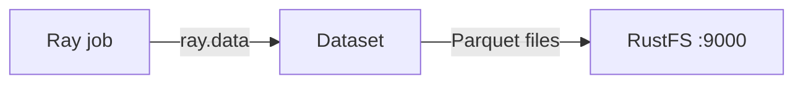
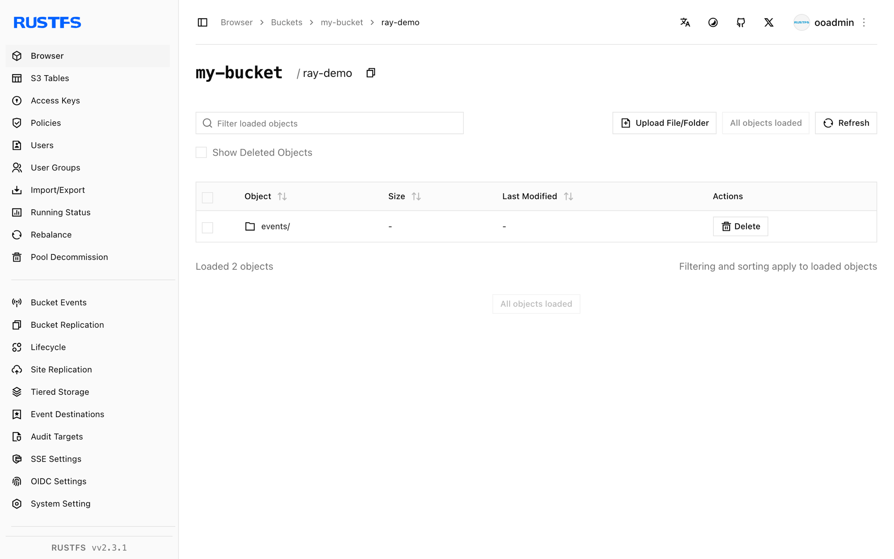

このガイドでは、分散 AI および Python コンピュートのフレームワークである [Ray](https://github.com/ray-project/ray) を、Ray Data の S3 ファイルシステムサポートを通じて **RustFS** に接続します。公式イメージ内で Ray ジョブを実行し、データセットを Parquet として RustFS のバケットへ書き込み、読み戻してオブジェクトを確認します。この流れは `rayproject/ray:2.44.0-py311`（Ray 2.44、pyarrow のファイルシステム）と `rustfs/rustfs-x86-musl:v2.3.1` で検証済みです。

Docker が必要です。このデプロイはローカルでの統合テストを目的としており、本番向けではありません。

## アーキテクチャ



Ray Data は pyarrow の `S3FileSystem` を通じてデータセットを読み書きします。RustFS 向けに構成した `S3FileSystem` を渡すと、Parquet、CSV、JSON を含むすべてのデータセット操作がバケットへ向きます。

## 1. ジョブファイルを作成する

接続用のプレースホルダーをすべて置き換えて、スクリプトを作成します。

```python title="ray_s3.py"
import ray
ray.init(ignore_reinit_error=True)

import pandas as pd
from pyarrow.fs import S3FileSystem

fs = S3FileSystem(
    endpoint_override="http://<your-rustfs-endpoint>:9000",
    access_key="<your-access-key>",
    secret_key="<your-secret-key>",
    region="us-east-1",
)

df = pd.DataFrame({"id": range(5), "value": [x * 1.5 for x in range(5)]})
ds = ray.data.from_pandas(df)
ds.write_parquet("my-bucket/ray-demo/events/", filesystem=fs)

back = ray.data.read_parquet("my-bucket/ray-demo/events/", filesystem=fs).take_all()
print("rows:", len(back))
print("sample:", back[0])
ray.shutdown()
```

`endpoint_override` には、スキームを含む完全なエンドポイント URL を指定します。pyarrow の `S3FileSystem` はカスタムエンドポイントに対してパススタイルアクセスのリクエストを使うため、追加のフラグは不要です。同じファイルシステムオブジェクトは、`write_csv`、`read_json`、その他の Ray Data メソッドでも使えます。

## 2. ジョブを実行する

RustFS と同じ Docker ネットワーク上の Ray イメージで、スクリプトを実行します。

```bash
docker run --rm --network oo-rustfs_default \
  -v "$PWD/ray_s3.py":/tmp/ray_s3.py \
  rayproject/ray:2.44.0-py311 python /tmp/ray_s3.py
```

```text
rows: 5
sample: {'id': 0, 'value': 0.0}
```

## 3. RustFS でオブジェクトを確認する

データセットのプレフィックスを一覧表示します。

```bash
rc ls rustfs/my-bucket/ray-demo/ -r
```

Ray Data はデータセットを Parquet ブロックとして書き込みます。

```text
ray-demo/events/0_000000_000000.parquet
```



## 4. 停止またはリセット

Ray Data 自身は状態を持ちません。デモ用データセットを削除するには、次を実行します。

```bash
rc rm rustfs/my-bucket/ray-demo/ --recursive --force
```

## トラブルシューティング

### `Unable to connect to endpoint` またはタイムアウト

`endpoint_override` にスキームが含まれ、Ray コンテナから到達できることを確認します。Compose ネットワーク内のホスト名は `rustfs` です。ホストからは `http://localhost:9000` を使います。

### 書き込み時の `Access Denied`

アクセスキーとシークレットキーが `S3FileSystem` 自体に渡されていることを確認します。このコードパスでは、Ray はコンテナの AWS 環境変数を読み取りません。

## 次のステップ

- 追加の Ray 操作を採用する前に、[S3 互換性に関する注意](/ja/administration/protocols/s3)を確認します。
- [アクセスキー管理](/ja/security-compliance/iam/access-token)で、本番用の専用認証情報を作成します。
- [Ray Data ドキュメント](https://docs.ray.io/en/latest/data/data.html)に従い、同じバケット上で変換の連鎖、トレーニングへの取り込み、チェックポイントを構成します。
