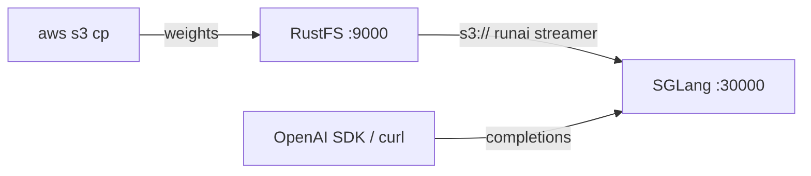

このガイドは、大規模言語モデルやマルチモーダルモデル向けのサービングフレームワーク [SGLang](https://github.com/sgl-project/sglang) を、モデルの重みの保存先として **RustFS** に接続します。モデルを RustFS バケットにアップロードし、SGLang に `s3://` URI を指定すると、重みをバケットから直接ストリーミングしながら OpenAI 互換リクエストに応答します。このワークフローは `lmsysorg/sglang:v0.5.22-xeon`（SGLang 0.5.22、CPU エンジン）で `Qwen/Qwen2.5-0.5B-Instruct` を CPU 専用ホスト上の RustFS バケットから提供して検証しました。

Docker と小さな Hugging Face モデルが必要です。このデプロイはローカルでの結合テスト用であり、本番環境向けではありません。

## アーキテクチャ



`--model-path` がオブジェクトストレージ URI のとき、SGLang は自動的にロード形式を `runai_streamer` に切り替えます。メタデータファイル（`config.json`、トークナイザ）はローカルキャッシュに一度だけダウンロードされ、その後、重みテンソルはエンジンのロード中に遅延ストリーミングされます。バケットがモデルの唯一のコピーであり続けるため、サービングホストにローカルのモデルストアは不要です。

:::note[CPU イメージには S3 ストリーマーが含まれない]

`xeon` CPU イメージには `runai-model-streamer-s3` が含まれず、`s3://` のモデルパスでのサーバー起動は `ImportError: S3 files module not found` で失敗します。サーバー起動前にコンテナ内へパッケージをインストールしてください。イメージの仮想環境は `uv` で管理されており、`pip` モジュールはありません。

:::

## 1. モデルを RustFS へアップロードする

Hugging Face からモデルファイルを取得してバケットへコピーし、接続プレースホルダーをすべて置き換えます：

```bash
docker run --rm -v "$PWD/models:/models" --entrypoint python3 \
  lmsysorg/sglang:v0.5.22-xeon -c \
  'from huggingface_hub import snapshot_download; snapshot_download("Qwen/Qwen2.5-0.5B-Instruct", local_dir="/models/qwen2.5-0.5b-instruct")'

aws s3 cp models/qwen2.5-0.5b-instruct \
  s3://my-bucket/sglang-models/qwen2.5-0.5b-instruct --recursive \
  --endpoint-url http://<your-rustfs-endpoint>:9000 \
  --acl private
```

以降のコマンドのために認証情報をエクスポートします：

```bash
export AWS_ACCESS_KEY_ID=<your-access-key>
export AWS_SECRET_ACCESS_KEY=<your-secret-key>
export AWS_DEFAULT_REGION=us-east-1
```

モデルごとに独立したプレフィックスを使えば、複数のモデルで同じバケットを共有できます。ストリーマーが読み取る重みファイルは `.safetensors` 形式のみです。

## 2. バケットを指して SGLang を起動する

CPU イメージを起動し、S3 ストリーマーパッケージをインストールしてから、バケット URI でサーバーを起動します：

```bash
docker run -d --name sglang -p 30000:30000 \
  -e AWS_ACCESS_KEY_ID \
  -e AWS_SECRET_ACCESS_KEY \
  -e AWS_DEFAULT_REGION \
  -e AWS_ENDPOINT_URL=http://<your-rustfs-endpoint>:9000 \
  --entrypoint bash lmsysorg/sglang:v0.5.22-xeon -c \
  'uv pip install -q runai-model-streamer-s3 && \
   python3 -m sglang.launch_server \
     --model-path s3://my-bucket/sglang-models/qwen2.5-0.5b-instruct \
     --served-model-name qwen2.5-0.5b-instruct \
     --host 0.0.0.0 --port 30000 \
     --device cpu --trust-remote-code \
     --disable-overlap-schedule \
     --mem-fraction-static 0.45'
```

`AWS_ENDPOINT_URL` はストリーマーを RustFS に向けるもので、カスタムエンドポイントへのリクエストはパススタイル addressing を使います。`--mem-fraction-static` は CPU バックエンドで KV キャッシュに割り当てるホストメモリの割合です。空きメモリが多いホストでは値を上げてください。起動完了の行を待ちます：

```bash
docker logs -f sglang
```

```text
The server is fired up and ready to roll!
```

## 3. 推論を実行する

モデルが提供されていることを確認し、OpenAI 互換の補完リクエストを送ります：

```bash
curl -s http://localhost:30000/v1/models
```

```json
{"object":"list","data":[{"id":"qwen2.5-0.5b-instruct","object":"model","owned_by":"sglang","root":"qwen2.5-0.5b-instruct","max_model_len":32768}]}
```

```bash
curl -s http://localhost:30000/v1/completions \
  -H "Content-Type: application/json" \
  -d '{"model":"qwen2.5-0.5b-instruct","prompt":"RustFS is","max_tokens":16,"temperature":0}'
```

```json
{"object":"text_completion","model":"qwen2.5-0.5b-instruct","choices":[{"index":0,"text":" a file system for the Linux kernel that is designed to be used in embedded systems","finish_reason":"length"}],"usage":{"prompt_tokens":4,"total_tokens":20,"completion_tokens":16}}
```


## 4. 停止またはリセット

バケットのオブジェクトを残したままデモを解体するには：

```bash
docker rm -f sglang
```

保存したモデルを削除するには：

```bash
aws s3 rm s3://my-bucket/sglang-models --recursive \
  --endpoint-url http://<your-rustfs-endpoint>:9000
```

## トラブルシューティング

### `ImportError: S3 files module not found`

RunAI ストリーマーの S3 バックエンドがありません。手順 2 のように、サーバー起動前にコンテナ内で `uv pip install runai-model-streamer-s3` を実行してください。

### `pip: command not found` または `No module named pip`

イメージの `/opt/.venv` は `uv` によって `pip` なしで作成されています。`pip install` ではなく `uv pip install` を使ってください。

### `Loaded weights leave no GPU memory for the KV cache`

このホストでは `--mem-fraction-static` が読み込み済みの重みに対して小さすぎます。エラーメッセージに最小値が表示されるので、より大きい割合（16 GB ホストの 0.5 B モデルなら `0.45` など）で再起動してください。

### リクエストが署名エラーやアクセスエラーで失敗する

サーバーコンテナで 4 つの変数すべてが設定されているか確認してください：`AWS_ACCESS_KEY_ID`、`AWS_SECRET_ACCESS_KEY`、`AWS_DEFAULT_REGION`、そしてスキーム付きの `AWS_ENDPOINT_URL` です。

## 次のステップ

- 追加のサービング操作を採用する前に [S3 互換性についての注意](/administration/protocols/s3) を確認してください。
- [アクセスキー管理](/security-compliance/iam/access-token) で本番用の専用認証情報を作成してください。
- [SGLang ドキュメント](https://docs.sglang.io/) に従い、同じバケットベースのモデルストアの上でテンソル並列化・量子化・より大きなモデルを利用してください。
